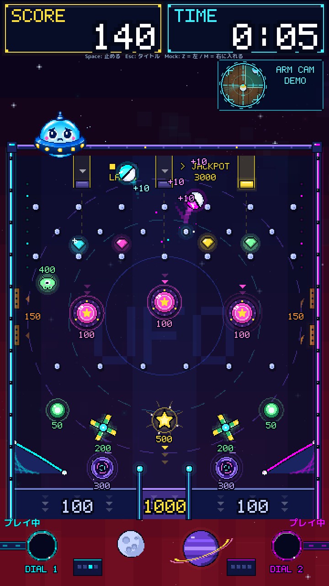
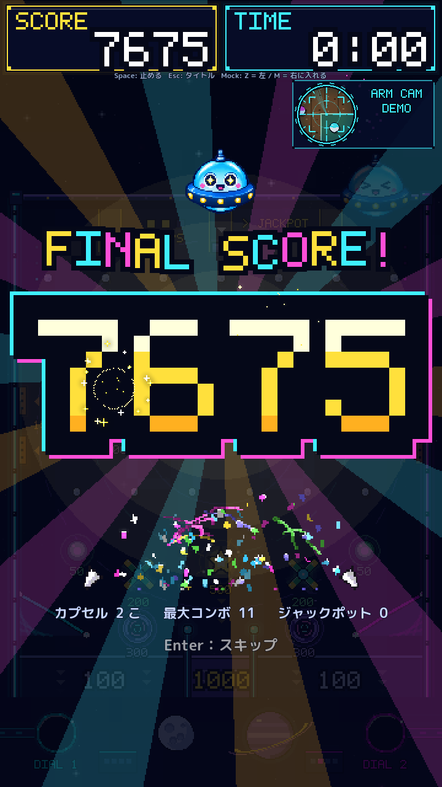
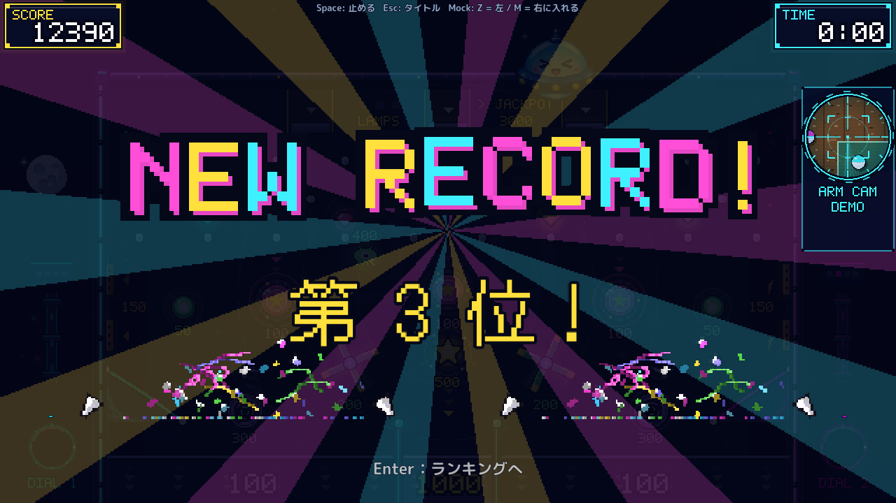

# SUMMON THE UFO ゲームモード仕様（v0.3）

150 秒のスコアゲームの**ゲーム仕様の正本**（Issue #138）。ルール、画面の配置、時間の流れ、得点、状態遷移、例外、機器とのやり取りをここで決める。

- 機器（M5Dial ×2・イルミ・ハブ）との**通信と LED の契約の正本**は UFO-DeviceHub の [`docs/game-mode-interface.md`](https://github.com/fooping-tech/UFO-DeviceHub/blob/main/docs/game-mode-interface.md)（[UFO-DeviceHub #8](https://github.com/fooping-tech/UFO-DeviceHub/issues/8)。プロトコル版 1、ファームウェア 0.3）。この文書はそれに合わせてある（§7・§8・§13）。
- 仕様を変える PR は、この文書を直し、Issue #138 と DeviceHub #8 の両方にコメントする。
- ここに書いた数値は**すべて調整値**（未確定）。プレイテストと実機の計測で決める。値は `config/game_config.json` の `game_mode` 節にある。

実装の状況は §11、未検証の項目は §12。

## 1. 体験

プレイヤーは実物のクレーンでカプセルを掴み、画面の**左外側**にある 1 号機（Dial 1）か**右外側**にある 2 号機（Dial 2）に入れる。入れたカプセルは画面の中に転送されたように見え、画面上を左右に往復する UFOくんから落とされ、ピンボールの盤面を転がって得点になる。盤面の下まで落ちると、入れたのと同じ側の Dial に戻る演出とともに、実物のカプセルが Dial から排出される。これを 150 秒くり返して得点を競う。

- クレーンの操作（キー・ジェスチャー・自動キャッチ）は「ゲームモード」と同じで、スコアゲームの間もそのまま使える。
- スコアゲームの画面は、クレーンの画面（ロープと UFO）の上に重ねる別の画面。**画面上の UFOくんはスコアゲームの絵で、実機の位置とは関係ない**（`RobotState` を読まない・書かない）。
- スコアゲームはクレーンにコマンドを送らない。機器へは周辺機器のハブ（UFO-DeviceHub）経由だけ。

## 2. 機器の配置

| 画面の側 | 機器 | デバイス ID | 画面のポート | 画面の色（初期提案） |
|---|---|---|---|---|
| 左 | 1 号機 = Dial 1 | `0x20` | 左下 | シアン `0,255,255` |
| 右 | 2 号機 = Dial 2 | `0x21` | 右下 | マゼンタ `255,0,255` |

色は Dial の**号機色**と同じにする（初期値は UFO-DeviceHub の既定色）。`game_mode.dials.<side>.color`（RGB）で変えると、ゲームがセッションごとに `SET_DIAL_COLOR` で Dial にも同じ色を送るので、画面のポートと Dial の LED がそろう（§8）。

## 3. 時間の流れ

| 段階（phase） | 内容 |
|---|---|
| `IDLE` | タイトルで「3 スコアゲーム」を選んだ直後。Enter で開始（最初の 1 回は練習へ。下の「開始前の練習」） |
| `TUTORIAL` | 開始前の練習（#149）。**150 秒の時計は止まったまま、得点・カプセルは本番に残らない**。終わると `COUNTDOWN` |
| `COUNTDOWN` | 3 秒（`countdown_s`）。両 Dial を `SET_MODE GAME` にする。**まだ受け取らない** |
| `PLAYING` | 150 秒（`duration_s`）。開始と同時に両 Dial へ `ARM_RECEIVER`。右上に残り時間、左上に得点 |
| `SETTLING` | 0 秒になった。**新しいカプセルは受け付けない**。プレイ中のカプセルは最後まで得点し、排出する。最大 30 秒（`settle_max_s`） |
| `RESULT` | リザルト演出（§3.2）: 中央の巨大なスコア → ボーナス加算 → FINAL SCORE。カプセル数、最大コンボ、ジャックポット数、異常のあった Dial。そのあとハイスコアランキング（§3.3）。Enter は演出中なら最後まで飛ばし、ランキングの画面ではもう一回。T で練習から、Esc でタイトル |
| `STOPPED` | Space（停止）で止めた。Enter でやり直し、T で練習から |

- 残り 30 秒（`hurry_s`）: 音楽を速いテイクへ切り替え（クロスフェード）、イルミを速くする。残り 10 秒（`warning_s`）: 毎秒の警告音、時計が赤く点滅。
- 0 秒の境界: 0 秒より前に `BALL_RECEIVED` が届いたカプセルはプレイする。0 秒の時点で空いている Dial には `DISARM_RECEIVER` を送る（受取待ちにする途中・応答待ちの Dial にも送る）。それでも 0 秒の直前に入って後から届いたカプセル（遅れカプセル）は、**盤面に出さず・得点せず**、そのまま排出する。
- `SETTLING` が 30 秒で終わらないとき: まだ終わっていない側を `FAULT` にして `RESULT` に進む（その Dial は係の人が確かめる）。

## 4. 画面の配置（縦画面 720 × 1280 の固定座標、#157）

画面は **9:16 の縦型**。設計解像度は 720 × 1280 で、32 インチの縦置きモニタ（1080 × 1920、または 2160 × 3840）いっぱいに映す。モニタの回転は OS の設定で行い、ゲームの中では画面を回さない。比率の違うモニタでは 9:16 のまま左右に帯が付き、切れたり伸びたりしない。設定の手順は `docs/display_setup.md`。

座標はすべて `game/scripts/game_mode/game_mode_layout.gd`（`GameModeLayout`）にまとめてある。HUD・盤面・演出・リザルト・ランキングはここから位置を取る。




上から順に:

| 帯 | y | 置くもの |
|---|---|---|
| HUD | 0〜114 | 左に SCORE、右に TIME（それぞれ画面の半分の幅。数字は 1 ドット 8 px = 縦 56 px）。その下に係の人向けのキーの案内（小さい字） |
| 状態 | 130〜242 | 左にハンド操作（カメラ映像・スティック・手の状態）、中央にコンボ（連鎖数・倍率・残り時間の棒）と「JACKPOT チャンス！」、右にアームカメラのスコープ |
| レール | 250〜352 | UFOくんが左右に往復（y = 298、盤面の幅の 10 %〜90 % = x 96〜624、片道 6 秒） |
| 盤面 | 352〜1100 | 縦長のピンボール盤面（幅 660 × 高さ 714）。下端の 1066〜1134 がゴールの帯 |
| Dial | 1100〜1280 | 左下に Dial 1 のポート (92, 1192)、右下に Dial 2 のポート (628, 1192)。それぞれの上にその Dial の状態の 1 行。ポートから画面の外（実機の Dial の側）へ導管と光が伸びる |

**左が Dial 1、右が Dial 2**（実機の置き方と同じ）。この対応は変えていない。

盤面の中（上から下へ。`PinballField` の定数）:

| もの | 位置 |
|---|---|
| 壁 | x = 30 と 690 |
| カプセルの出現 | y = 366。x は UFOくんがいた位置 |
| スイッチ ×3 | y = 404、x = 180 / 360 / 540。板の幅は 28 px |
| ピン（上の 3 段） | y = 452 / 506 / 560、94 px 間隔の千鳥（7・6・7 本） |
| 宝石 ×4 | y = 533、x = 172 / 266 / 454 / 548。当たり判定だけで、カプセルを止めない。取ると 10 秒消える |
| 宇宙人 | y = 614 付近を x = 96〜624 で 9 秒かけて往復。当たり判定だけ。つかまえると 5 秒消える |
| バンパー ×3 | (190, 684) (360, 660) (530, 684) |
| 壁のターゲット ×4 | 左右の壁の y = 652 / 732。当たると 6 秒点灯（表示だけ） |
| ピン（下の 1 段） | y = 800、6 本 |
| 小バンパー ×2 | (126, 896) (594, 896) |
| スター | (360, 916)。取ると 8 秒消える |
| 回転ギミック ×2 | (226, 934) (494, 934)。十字（腕 30 px）が互いに逆向きに回る |
| スリングショット ×2 | 下の左右の斜面（壁の y = 968 から内側 110 px、y = 1034 まで）。当たると斜め上・内向きにはじく |
| ワープホール ×2 | (224, 1022) (496, 1022)。左右のゴールの上。落ちたカプセルを 0.7 秒とどめて、上・内向きに打ち上げる。**1 個のカプセルにつき 1 回だけ** |
| ゴール | 下端 y = 1066。左（x < 306）・中央（306〜414）・右（> 414） |
| カプセル | 半径 18 px（横画面のときと同じ） |

### 横画面の盤面からの置き直し（#157）

横長の盤面（幅 980 × 高さ 502）を伸び縮みさせたものではない。カプセル・ピン・バンパーの大きさと、カプセルが通れるすき間はそのままにして、幅 660 × 高さ 714 の中に置き直した。得点表とルール（コンボ、3 連スイッチ、ジャックポット、ワープは 1 回、15 秒の上限）は変えていない。

盤面が狭く・長くなった分、同じ部品でも当たる回数が増えるので、横画面のときの当たり方に近づくよう次を調整した（どれも調整値）:

- ピンは 3 段 + 1 段（計 26 本。横画面は 3 段 29 本）。
- スイッチの板の幅 56 → 28 px、回転ギミックの腕 44 → 30 px、中央ゴールの幅 140 → 108 px。
- 重力 `game_mode.field.gravity_scale` 0.7 → 0.85。

カプセル 60 個を盤面の幅いっぱい（10 %〜90 %）に落として測った結果（`ScoreManager` で採点。1 個ずつ、コンボは 1 個の中だけ）:

| | 横画面（#156 まで） | 縦画面 |
|---|---|---|
| 盤面にいる時間 | 平均 4.9 秒、最大 9.9 秒 | 平均 6.2 秒、最大 11.9 秒 |
| 1 個あたりの得点 | 平均 2340、中央値 1690 | 平均 3223、中央値 2810 |
| ゴール | 左 24 / 中央 19 / 右 17 | 左 22 / 中央 16 / 右 22 |
| ゴールに届かなかった数 | 0 | 0 |

盤面が長いので滞在時間は約 1.3 倍、得点は平均で約 1.4 倍になっている（ばらつきの大きい測定で、60 個では ± 1 割ほど動く）。得点表は調整値なので、展示の前のプレイテストで合わせる。

### 見た目（#140 / #141）

ネオンレトロ × ピクセルアート。濃紺を地に、シアン・マゼンタ・黄・紫をアクセントにする。

**ドットの大きさ**: UFOくんのスプライトは 64×64 ドットで、2 倍で表示する（1 ドット = 画面の 2 px）。背景・盤面の絵・エフェクトは、これと同じ大きさのドットになるよう、**360×640 のキャンバス**（`GameModeController.pixel_view`）に描いて 2 倍で映す（#157 で縦に。1080 × 1920 のモニタでは 1 ドットが 3 px、2160 × 3840 では 6 px）。丸・斜めの線・回るものも同じドットになる。座標は 720×1280 のまま（太さ 2 = 1 ドット）。物理（`PinballField`）はキャンバスの外で、絵（`PinballFieldArt`）は物理の状態を読むだけ。得点・時計のパネルと日本語の文字はキャンバスの上に重ねる（ドット文字は 2 px の倍数の大きさ）。

絵はコードで描く（素材ファイルなし）: 暗い 1 ドットの輪郭、ハイライトと影、少ない色数。数字と英字は 5×7 のドット文字 `PixelText`、日本語は #134 のフォント（大きい字は DotGothic16、本文は M PLUS Rounded 1c）。

| もの | 見た目 |
|---|---|
| 背景（`GameModeBackdrop`） | 濃紺の帯、斜めに横切る遠い星の帯、淡い星雲、3 層の星、光の粒、流れ星、下から立ちのぼる光の柱。盤面の下、2 つのポートの間に月と輪のある惑星。各 Dial のポートから画面の端（実機の Dial の側）へ伸びる導管と、その上を外へ流れる光、ランプ |
| 盤面の床 | 星が少し透ける暗いパネル。軌道の輪、スイッチから下へのレーン線、バンパーと中央ゴールを指す矢印ランプ、スターの後ろの放射、両脇を流れるランプ、うっすら `UFO` の文字 |
| 盤面の枠 | 左の壁は Dial 1 の色、右の壁は Dial 2 の色のネオン管（暗い輪郭、ボルト、上の角の金具）。上に UFO が動くレールと流れるランプ |
| ねらう場所 | 得点するものは**呼吸するように光る**（バンパー・小バンパー・スター・ターゲットの輪、消えているスイッチの矢印、中央ゴール）。それぞれの**得点を横に書く**。スイッチの間に「LAMPS（点いた数）→ JACKPOT 3000」 |
| 宝石・宇宙人・ワープホール | 宝石は色違いのカット石（上下に揺れ、きらめく。取ると輪郭だけ残る）。宇宙人は一つ目の小さなドット絵で、足を動かし、進む方を見る。ワープホールは光の腕が回り込む黒い穴で、カプセルを吸うと速く回り、打ち上げるとき白く光る。絵は文字の並びで定義したドット絵（`PinballFieldArt.GEM` / `ALIEN`）で、1 文字 = 1 ドット |
| 当たった瞬間 | ピンは輪、バンパーは膨らんで白く、回転ギミックは残像、スリングショットはゴムが飛び出す、ターゲットは点灯 |
| ゴール | 下へ流れる矢印。中央はジャックポットのとき黄色く点滅 |
| カプセル | 暗い縁、上半分がその Dial の色、下半分は白。通った跡に**光の軌跡**（直前の 12 点。コンボで太くなる） |
| 得点の一時表示 | 得点した場所にドット文字で `+100 x1.5`。跳ねて出て、上がって、点滅して消える（約 1.1 秒）。大きい得点とコンボ 2 段目以上は大きい字 |
| スコア・時計 | 左上と右上のパネル。得点が増えている間は数字が黄色く弾む。時計は残り 30 秒で黄、10 秒で赤の点滅 |
| スコアゲームのタイトル画面（開始待ち） | 大きな `SUMMON THE UFO` のロゴ、大きな UFOくん、点滅する START、遊び方の 3 枚のカード。**プレイ中は出さない** |

### アームカメラのスコープ（`ArmScope`、#141）

ねらいを定める照準の見た目で、右の柱にアーム先端のカメラを丸く出す（左の柱のハンド操作の表示と対）。

- 円の上に、十字線、30 度ごとの目盛り、回る破線の輪、掃引線、四隅のブラケット。
- 映すのはカメラの窓口（`CameraHub`）の focus の映像。バックエンドが揺れ補正の映像（#118: オプティカルフローで揺れを打ち消したもの。`camera.focus.stabilize`）を送っている間は、**その補正済みの映像**になる。スコープ自身は何も測らない。
- 円の下に `ARM CAM` と状態: `STAB ON`（補正済みの映像。ブラケットが閉じて黄色。打ち消している揺れの大きさを `SHAKE` の棒で出す）、`STAB WAIT`（補正中だが、いま映像に追える特徴がない）、`STAB OFF`（カメラそのまま。バックエンドなし（`--game-only`）、補正オフ、俯瞰カメラで代用しているとき）。
- **表示だけ**。映像は保存せず、ロボットの動きや得点の判定に使わない。
- `--game-mode-demo` では、動いて止まる机の絵がカメラの代わりになる（カメラなしで見た目を確認できる。状態は `DEMO`）。
- 設定は `game_mode.scope`（`enabled`、`zoom` 1〜4）。

### 共通の演出と UFOくんのリアクション（#144）

当たった・入ったことに画面が反応する部品。どれも 360×640 のキャンバスの中（UFOくんと同じドット）で、表示だけ。

| 部品 | 内容 |
|---|---|
| 粒子（`GameModeParticles`） | 当たった場所から飛び散る 1〜2 ドットの火花。**192 個の固定のプール**で、空きがなければ古いものを使い回す（ノードを作らない・捨てない）。数は対象ごと（ピン 3、バンパー 10、スター 18、ジャックポット 48 など。`GameModeController.HIT_FX`）で、コンボで増える。ゴールからは上へ噴き上がる |
| 衝撃の輪 | 当たった場所から広がる輪。16 個の固定のプール |
| ヒットフラッシュ | 得点したカプセルが 0.09 秒白く光る |
| ヒットストップ | 大きな得点で 0.05 秒、ボーナスとジャックポットで 0.08 秒（上限 0.1 秒）、**絵だけ**が止まる（キャンバスを描き直さない）。物理・時計・通信・機器の処理は止まらない |

UFOくんは表情のシート（`assets/ufo/ufo_expressions.png`）で反応する（`GameModeVFX.REACTIONS` / `MOODS`）:

| きっかけ | 表情と動き |
|---|---|
| 待機 | いつものアニメ。ときどきまばたき |
| GO! | 目を輝かせて 2 回跳ねる。まわりに火花と輪 |
| カプセルが上がってくる | 驚いて小さく跳ねる |
| カプセルを落とす | ウインクして少し沈む。落とす場所に火花 |
| 得点（ピン以外） | 笑って小さく跳ねる |
| 大きな得点（スター・宇宙人・中央ゴール・ボーナス・ジャックポット） | 目を輝かせて 2 回跳ねる |
| ミス（15 秒の時間切れ、Dial の異常） | 悲しい顔で左右に揺れる |
| 残り 30 秒 | 驚いて揺れ、そのあとは心配顔のまま上下が速くなり、汗が飛ぶ |
| TIME UP（清算中） | 眠い顔 |
| 結果 | 得点があれば笑顔と紙吹雪、0 点なら悲しい顔 |
| 停止（Space） | 驚いた顔 |

強い反応の途中に弱い反応が来ても、強いほうを最後まで見せる（得点の笑顔が、開始やミスの反応を上書きしない）。`visual_quality: low` で火花は半分になりヒットストップはなし、`effects: false` で火花・輪・ヒットフラッシュ・ヒットストップ・UFOくんの動きを止める（表情は変わる）。

プレイの状況で変わるもの（どれも表示だけ）:

| 状況 | 変化 |
|---|---|
| 残り時間 | 空の色が濃紺から少しずつ紫へ。残り 30 秒で紫と桃色の光、残り 10 秒で赤く脈打つ（`backdrop.urgency` / `time_k`） |
| 得点 | 画面全体が数ドット沈んで戻る（ピンは弾まない。バンパーなど小、ゴール中、スターと中央ゴール大、ボーナスとジャックポット最大。コンボで強くなる。上限 16 px）|
| コンボ | 段が上がると中央に `COMBO x1.5` と背景の光。段が高いほど星が流れ、光の柱が強く、盤面のランプが速く、得点の字と軌跡が大きい。連鎖が切れると元に戻る |

見た目は状態を映すだけで、得点・物理・判定・機器とのやり取りは変えない（画面の弾みや演出の終わりを、物理・時計・通信は待たない）。`game_mode.visual_quality` を `low` にすると、背景が動かない簡素なものになる。`game_mode.effects` を `false` にすると、弾み・軌跡・呼吸する光を止める（確認用。ゲームは同じ）。

盤面は Godot の 2D 物理（カプセルは `RigidBody2D`）。**ロープの物理（自前の Verlet）とは別物で、ロープには使わない**。カプセル同士は衝突しない（初期版）。

- **停滞対策**: 速さ 14 px/s 未満が 1.2 秒続いたカプセルは小さく突く。
- **最大滞在**: 盤面に 15 秒（`field.max_stay_s`）いたカプセルは取り出して排出に進む。このときゴールの得点はない（それまでの得点は残る）。
- **長く残ったカプセルは落ち着く**（#147）: 盤面に 5 秒（`field.settle_after_s`）いたカプセルは、そこから 3 秒（`settle_over_s`）かけてバンパー・小バンパー・スリングのはじく力が 1 割（`settle_kick`）まで弱まり、重力が 2.5 倍（`settle_gravity`）まで強まる。ワープホールも素通りする。落ちてすぐの跳ね方と、当たったときの得点は変わらない。最大滞在は、それでも残ったときの最後の手段。

## 5. カプセルと Dial ごとの状態

カプセル 1 個 = 実物 1 個。Dial 1 台につき 1 個、**同時に最大 2 個**。各カプセルは次を持ち、**入れた Dial からだけ排出する**。

| 項目 | 内容 |
|---|---|
| `capsule_id` | `c<session>-<dial 16進>-<cycle>-<通し番号>` |
| `source_dial` | `0x20` / `0x21` |
| `session` | ハブのセッション ID（`BALL_RECEIVED` を受けたときのもの） |
| `cycle` | Dial の受取サイクル番号（`ARM_RECEIVER` のたびに増える） |
| `drop_x` | 投下する X。**`BALL_RECEIVED` を受けた瞬間の UFO の X で固定**し、その後のアニメーション中に変えない |

Dial ごと（左右独立）の状態:

```
OFFLINE → ARMING → READY → ABSORBING → DROPPING → SIMULATING → RETURNING → RELEASING → VERIFYING → READY
                     └（0 秒）→ CLOSING → CLOSED            どこからでも異常 → FAULT
```

| 状態 | 画面 | 機器 | 次へ |
|---|---|---|---|
| `OFFLINE` | じゅんび中 | Dial が応えない。3 秒ごとに `SET_MODE GAME` からやり直す | 応答 → `ARMING` |
| `ARMING` | じゅんび中 | `SET_MODE GAME` → （`PLAYING` になってから）`ARM_RECEIVER` | ACK → `READY` |
| `READY` | ここに入れてね | 受取待ち | `BALL_RECEIVED` → `ABSORBING`（`ARM_RECEIVER` の ACK より先に届いた・ACK が失われた場合も、新しい cycle の `BALL_RECEIVED` なら `ARMING` / `OFFLINE` から受け取る） |
| `ABSORBING` | ポートが開き、カプセルがポートから投下点へ飛ぶ（0.85 秒） | — | 時間 → `DROPPING` |
| `DROPPING` | 投下点に現れる（0.25 秒） | — | 時間 → `SIMULATING` |
| `SIMULATING` | 盤面を転がって得点 | — | ゴール / 15 秒 → `RETURNING` |
| `RETURNING` | 出口から自分の側のポートへ吸い込まれ、光が Dial の方向へ流れる | 0.6 秒後（同期点、`release_sync_s`）に `RELEASE_BALL` | 送信 → `RELEASING` |
| `RELEASING` | `RELEASE_STARTED` で排出の演出 | `RELEASE_DONE` を待つ（8 秒まで） | `RELEASE_DONE` → `VERIFYING`。8 秒来なければ、送り直さずに `VERIFYING` で Dial の状態を確かめる |
| `VERIFYING` | — | `GET_STATUS`。`dial_state` が `COMPLETE` / `READY` で、スイッチが OFF であること（0.5 秒おきに 4 回まで） | 確認 → `ARM_RECEIVER` → `READY`（0 秒後なら `CLOSED`） |
| `CLOSING` / `CLOSED` | — | 0 秒: `DISARM_RECEIVER`。`RESULT` で `SET_MODE STANDBY` | — |
| `FAULT` | 係の人を呼んでね＋理由 | **何も送らない** | 次のラウンドまでそのまま |

取り込み（スイッチ → 投下）は合計 1.1 秒が初期目標（`absorb_s` + `drop_s`）。実機で計測して調整する。

## 6. 得点（調整値）

| 対象 | 得点 | 補足 |
|---|---|---|
| ピン | 10 | コンボの倍率はかかるが、コンボは増やさない |
| バンパー | 100 | はじき返す |
| 回転ギミック | 200 | |
| スター | 500 | 取ると 8 秒消える |
| 小バンパー | 50 | はじき返す（#141 で追加） |
| 壁のターゲット | 150 | #141 で追加 |
| スリングショット | 30 | コンボは増やさない（#141 で追加） |
| 宝石 | 100 | 取ると 10 秒消える（#141 で追加） |
| 宇宙人 | 400 | つかまえると 5 秒消える（#141 で追加） |
| ワープホール | 300 | 入ったときに得点。カプセル 1 個につき 1 回（#141 で追加） |
| スイッチ | 50 | 3 つ全部点くと **+1500**（3 連スイッチ）。点灯は全カプセルで共有し、そろうと消える |
| 左 / 右ゴール | 100 | |
| 中央ゴール | 1000 | |
| ジャックポット | 3000 | 3 連スイッチ完成から 20 秒以内の中央ゴール（中央ゴールの 1000 の代わり。1 回で消える） |

- **コンボ**: バンパー・回転・スター・スイッチ・小バンパー・壁のターゲット・宝石・宇宙人・ワープホールに 2.5 秒以内に続けて当てると連鎖が増える。連鎖 2 以上で ×1.5、4 以上で ×2、6 以上で ×3。ゴールとピンにも倍率がかかる。
- **連打の抑制**: 同じカプセルが同じ対象で得点するのは 0.4 秒に 1 回。
- **重複の抑制**: カプセルのゴール得点は 1 回だけ。出口の通知が重なっても、後から古いイベントが来ても二重に得点しない。
- UFO の位置で落とす場所が変わるので、どのタイミングで Dial に入れるかがねらいどころ（スイッチの真上、中央ゴールの真上）。

## 7. 機器とのやり取り（プロトコル版 1）

| 場面 | 送る | 待つ |
|---|---|---|
| 開始 | 両 Dial に `SET_MODE {mode: GAME}`、`PLAYING` で `ARM_RECEIVER` | ACK |
| 受取 | — | イベント `BALL_RECEIVED {cycle}` |
| 排出 | `RELEASE_BALL`（カプセル 1 個につき 1 回だけ） | ACK、イベント `RELEASE_STARTED` → `RELEASE_DONE` / `RELEASE_FAILED` |
| 確認 | `GET_STATUS` | STATUS（`dial_state`、`switch_on`） |
| 0 秒 | 空いている Dial に `DISARM_RECEIVER` | ACK |
| 終了 | `SET_MODE {mode: STANDBY}`（`FAULT` の Dial には送らない） | — |
| 停止（Space、Esc） | 全機器に `STOP_ALL` | — |
| Dial の LED（§8） | `SET_DIAL_COLOR`、`SET_DIAL_EFFECT`（ファームウェア 0.3 から） | 待たない |

言葉の意味（混同しない）:

- **ACK** = 機器が命令を**受け取った**。動作が終わったことではない。
- **`RELEASE_DONE`** = サーボの動作シーケンスが**終わった**。**カプセルが実際に出たことの証明ではない**（排出を確かめるセンサーは今はない）。そのため `VERIFYING` でスイッチが OFF に戻ったかを確かめ、戻らなければ次の受け取りを始めない。

重複と古いイベント:

- イベントはセッション ID・送信元・イベント ID で重複を捨てる（ハブのゲートウェイも捨てているが、ゲームでも捨てる）。
- `BALL_RECEIVED` は、同じセッションで `cycle` が前回以下なら捨てる（スイッチのチャタリング、再送）。
- 今のセッションと違うセッション ID のイベントは捨てる（古いセッションのイベントが遅れて届いても、投下・得点・排出をしない）。
- `RELEASE_STARTED` / `RELEASE_DONE` / `RELEASE_FAILED` は、その Dial が `RELEASING` のときだけ使う（`command_id` が分かっていれば照合する）。

ゲームから機器への経路: Godot `GameModeController` → `GameModeDevices` → （バックエンド）WebSocket の `devicehub_command` / `devicehub_status` / `devicehub_stop_all` → `DeviceHubService` → UFO-DeviceHub の `DeviceGateway`（セッション・ACK・再送）。イベントは `devicehub_event` で届く。体験と得点は Godot、命令・セッション・ACK は Python。

## 8. 光（イルミと LED）

**光は飾り。送って忘れる**: 送信に失敗しても、応答がなくても、ゲームと排出は止めない。

| 場面 | イルミ（`0x10`、今ある命令） |
|---|---|
| カウントダウン | `SET_LIGHT_MODE GAME_READY` |
| 開始 | `SET_LIGHT_MODE GAME_PLAY`、`TRIGGER_EFFECT GAME_START` |
| 受取 | `TRIGGER_EFFECT BALL_RECEIVED` |
| 排出開始 | `TRIGGER_EFFECT BALL_RELEASED` |
| 3 連スイッチ・ジャックポット | `TRIGGER_EFFECT SCORE` |
| 残り 30 秒 | `SET_LIGHT_MODE GAME_PLAY`（明るく・速く） |
| 結果 | `SET_LIGHT_MODE RESULT`、`TRIGGER_EFFECT GAME_CLEAR` |

### Dial の LED（転送の光）

Dial 1 台に LED が 2 系統ある（前面 G1 と、G15。どちらもその Dial が駆動し、命令の `target: BOTH` で両方に出す）。ゲームは UFO-DeviceHub の契約（`docs/game-mode-interface.md` §5）の名前付きアニメーションを、その Dial の号機色で送る（`game_mode.dial_leds`）。

| いつ（ゲーム） | アニメーション | `SET_DIAL_EFFECT` |
|---|---|---|
| `SET_MODE GAME` が通ったとき（セッションごと） | — | `SET_DIAL_COLOR`（その側の色） |
| `BALL_RECEIVED` を受けて取り込みを始めるとき | `INTAKE` | CHASE / `TO_SCREEN` / 1500 ms / NORMAL |
| `RETURNING` を始めるとき（`RELEASE_BALL` の 0.6 秒前） | `RETURN_FLOW` | COMET / `TO_DIAL` / 0（続く）/ NORMAL |
| `RELEASE_STARTED` を受けたとき | `RELEASING` | CHASE / `TO_DIAL` / 0 / NORMAL |
| `FAULT` になったとき | `FAULT` | FLASH 赤 / 1500 ms / HIGH |
| `RESULT`（正常に閉じた Dial） | — | NONE / HIGH（Dial 自身の表示に戻す） |

- 画面側は同じ色・同じ向きで、ポートと画面の端（Dial の方向）の間を光が流れる（取り込みは Dial → 画面、排出は画面 → Dial）。左右は独立で、同時・逆方向も出る。
- Dial は検出した瞬間に自分で「白 → 号機色で画面方向」を光らせる。ゲームの `INTAKE` は同じ色・同じ向きなので、後から届いても見た目がつながる。
- 演出の終わりは Dial が自分で決める（カプセルの検出、排出シーケンスの終了、`STOP_ALL`、セッションの変更、通信断）。ゲームは後始末の命令に頼らない。
- **結果を待たない**: `IGNORED_PRIORITY`・`NOT_CONFIGURED`（G15 の LED がない機体）・タイムアウトは無視する。`RELEASE_BALL` を LED の応答で遅らせない。
- **古いファームウェア**（Dial 0.2 は `UNSUPPORTED`、Hub 0.2 は `BAD_REQUEST`）: その Dial にはそのラウンドの間 LED 命令を送らない。Dial は自分の状態の LED を出し、ゲームは同じに進む。
- `ATTRACT`（受取待ちの呼び込み）は送っていない（Dial 自身の受取待ち表示が出る）。
- 画面と Dial の間にさらに別の LED テープを足す場合の配線・制御は未定（DeviceHub 側の文書 §3）。

## 9. 例外

| 起きたこと | ゲームの動き |
|---|---|
| `RELEASE_BALL` が拒否された・応答がない | その側を `FAULT`。**送り直さない** |
| `RELEASE_FAILED` | `FAULT` |
| `RELEASE_DONE` が 8 秒来ない | 送り直さず、`GET_STATUS` で確かめる。Dial が `COMPLETE` でスイッチが OFF なら（通知だけが失われた）次へ進む。そうでなければ `FAULT`（排出できたか分からない） |
| 排出後も Dial がカプセルありのまま | `FAULT`（次の受け取りを始めない） |
| ハブとの通信が切れて、つながり直した（新しいセッション） | プレイ中のカプセルは得点を続けるが、**自動では排出しない**（Dial はもうそのカプセルを覚えていない）→ `FAULT`。排出の途中だった側も `FAULT`。空いていた側は受け取りをやり直す |
| ハブにつながらない | 両側とも「じゅんび中」で待ち、盤面の上に理由を出す（バックエンドが返す: 別のシステムのハブ（システム番号の違い）／ポートが見つからない／開けない／ハブとして応答しない／バックエンドがない・ハブを使っていない）。つながれば受け取りを始める |
| Dial が一時的にオフライン | 空いていた側は `OFFLINE` で待ち、戻ったら受け取りをやり直す |
| Dial にカプセルが残ったまま開始（か、Dial が本体の設定モード） | `ARM_RECEIVER` が拒否され、その側は「じゅんび中」のまま理由を出す。係の人が取り出すと進む |
| 0 秒 | §3 |
| 15 秒たっても盤面にいる | §4 |
| Space（停止） | クレーンを止め（これまでどおり）、スコアゲームを止め、全機器に `STOP_ALL`。**その後は得点も排出も受け取りもしない**。カプセルが Dial に残っていたら係の人が取り出す |
| Esc（タイトルへ） | プレイ中なら Space と同じように止めてから戻る |
| イルミ・LED の失敗 | 無視して進む |

**安全は演出より優先**。復帰のあとの自動再排出はしない。`STOP_ALL` はソフトウェアの停止で、電源を切るのとは違う。通信が切れたことが分かっても、機器が止まったことは保証されない。

`FAULT` になった Dial を元に戻すのは人の作業: カプセルを取り出し、必要なら設定画面の「テスト」タブ（#108）で Dial を確かめる。

## 10. トレース

1 行 1 イベントの JSON Lines。`game_mode.trace` がオンのとき、ラウンドごとに `user://game_mode/trace_<日時>.jsonl`（mac では `~/Library/Application Support/Godot/app_userdata/CoreXY UFO/game_mode/`）。個人情報・鍵は入らない（ID・状態・数値だけ）。

項目: `t_ms`（単調時計）、`game_t`（開始からの秒）、`session_id`、`source_dial`、`cycle`、`capsule_id`、`event`、`command_id`、`result`（ACK の結果・無視した理由）、`game_state`（phase）、`lane_state`、`physics_position`、`score_delta`、`effect_id`（命令名・イベント名・得点の対象）、`led_command`、`release_status`、`breakdown`（`result` の行だけ: リザルトの内訳。§3.2）。

`event` の種類: `game_start` `hurry` `time_up` `result` `ranking`（ランキングへの登録の結果。`result` に `rank 3` か登録しなかった理由、`score_delta` に最終スコア） `stopped` `session` `lane_state` `command` `ack` `event` `event_ignored` `ball_ignored` `capsule_created` `score` `stay_timeout` `release` `led` `fault`。

DeviceHub 側のトレース（`pc/trace.py`。バックエンドの `--devicehub-trace <file>` か config の `devicehub.trace` で、ハブに送った命令・ACK・イベントを 1 行ずつ書く）とは `session_id`・`source_dial`・`cycle`・`command_id` で突き合わせる。受取は `(session_id, source_dial, cycle)`、排出は `RELEASE_BALL` の `command_id`。スイッチが入った時刻と受信時刻の差は、バックエンドがイベントに付ける `received_at`（単調時計）とこの `t_ms` から測る（機器側の時刻との対応付けは未実装）。

## 3.1 開始前の練習（#149）

スコアゲームのタイトルで Enter を押すと、すぐカウントダウンに入らず、**UFO の召喚 → 手の練習 → 実物のカプセルを 1 個入れる実践 → 本番**の順に進む。テーマは「昭和のオカルトを令和の技術で完全再現！」。1 画面に 1 つのことだけを、大きな絵と大きな 1 行で見せる。アプリ起動時のモード選択のタイトル画面は変えていない。

| # | 画面の 1 行 | 絵 | 次へ進む条件 |
|---|---|---|---|
| 0 召喚 | ベントラベントラスペースピープル！（続けて「さあ、ぼくと ゲームを はじめよう！」） | 魔法陣に UFOくんが降りてくる | UFOくんが言い終わったら自動で進む。**OK は出さない**（何もしていないので） |
| 1 パー | てを ひらいて パー！ | 開いた手 | 手の形 `open` を **3 秒**保つ（ゲージが溜まる。#171） |
| 2 ピンチ | おやゆびと ひとさしゆびを くっつけよう！ | つまんだ手から UFOくんへ光が流れる | **人差し指**のピンチ（`pinch` かつ `pinch_finger = index`）を **3 秒**保つ。中指のピンチは数えない |
| 3 移動 | そのまま てを うごかそう！ | 手と一緒に動く UFOくん、上下左右の矢印 | 下の「ロボットを動かせるとき・動かせないとき」。できたら「きみと こころが つながったよ！ ベントラベントラスペースピープル！ これで ハンドパワーで うごかせるよ！」と言い、言い終わるまで次のステップを待つ（#179。ステップの `done_say`。声が終わらなくても `tell_max_s` で進む） |
| 4 つかむ | グーで キャッチ！ | 手の形、閉じる爪 | 下の同じ表 |
| 5 はなす（#171） | チョキで はなす！ | 手の形、開く爪 | つかむと同じ（爪を**開く**依頼。動かせないときは開く形を保つ） |
| 6 上下のつまみ（#171、つまむ方式だけ） | てのこうを むけて ゆびを くっつけよう！ | つまんだ手と「てのこうを カメラに むける」 | **手の甲をカメラに向けた**（`palm = down`）人差し指のピンチを 3 秒保つ。手のひら側のピンチは数えず、案内を出す |
| 7 上下に動かす（#171、つまむ方式だけ） | そのまま うえ・したに うごかそう！ | 上下に動く手と UFOくん、上 = あがる / 下 = さがる | 移動と同じだが、手のスティックが**上下モード**（`mode = z`）で 3 秒。動かせないときは、手の甲を向けたつまみを上か下へ運んで 3 秒（横は数えない） |
| 8 ルール | カプセルを ポータルに いれると とくてん！ | つかむ → ポータル → 画面でピンボール → 得点 → 同じポータルから返る、の 5 コマ | 説明だけ（画面に「せつめい」と出す）。言い終わったら自動で進む |
| 9 実践 | カプセルを ひとつ いれてみよう！ | 盤面が見える。左右のポート（DIAL 1 / DIAL 2）に矢印。説明は画面の上の帯と、2 つのポートの間 | 練習カプセルが 1 個、受信 → 落下・得点 → 返却 → 排出 → 状態確認まで終わる |

- **成功の演出は 1 ステップに 1 回だけ**: 大きな赤い丸と「OK!」、ピンポーンの音（`tutorial_ok`、合成音）、UFOくんのウインク、星。1.4 秒（`ok_s`）見せて次へ。
- **責めない案内**: 手が見えない → 「てを カメラに みせてね」。カメラ・通信が途切れた → 「てのカメラが みつからないよ。かかりの ひとを よんでね」。8 秒できない → 「もういちど やってみよう」。
- **判定の安定化**: 形は続けて保った時間で数える（0.2 秒より短い途切れは許す。それより長いと数え直し）。古いイベント・順序の入れ替わりは `GestureControl` が捨て、鮮度（`stale_ms`）が切れている間は何も数えない。
- **声のキャッシュ（#171）**: 一度作ったせりふの音声はファイルに残し（`cache/speech/`、Git に入れない。`homework.speech.cache`）、同じせりふはそこから再生する（VOICEVOX に毎回頼まない）。バックエンドを止めても残る。VOICEVOX が作ったせりふは、VOICEVOX が止まっていてもその声で出る。話者・サンプリング周波数を変えると別のファイル。
- **最初の呪文の声（#171）**: 声は補助の通信路で頼むので、練習を始めた瞬間はまだつながっていないことがある。最初のせりふはつながるのを最長 2.5 秒（`game_mode.tutorial.voice_link_wait_s`）待ってから出す（待たずに文字だけで流れてしまうのを防ぐ）。初めて作るせりふは VOICEVOX の返事を 6 秒まで待つ。
- **声**: UFOくんのせりふはバックエンドの音声（VOICEVOX、なければ say）に頼む。使えないとき・間に合わないときは文字だけで進む（画面にせりふを出す）。**声が終わるのを待つのは最長 12 秒**で、声の完了は進行の条件にしない。音声認識は使わない（呪文を言うのは UFOくん）。
- **手のカメラがないとき**（ジェスチャーがオフ）: 手のステップは絵と文字で説明するだけで、OK を出さずに進む。
- **縦画面（#157）**: 練習のパネルは状態の帯の下から盤面の下端まで（720 × 1280 のうち x 20〜700、y 250〜1080）。1 画面の中は上から、手の絵 → その結果（UFOくん・爪・図解）→ 大きな 1 行 → 補足 → 案内、の順に縦に並ぶ。ルールの 5 コマは 3 コマ + 2 コマの 2 段。
- **ゲージの音（#179）**: 手のステップでゲージが溜まっている間、短い音が 0.14 秒ごとに鳴り、溜まるほど高くなる。止まっている間・説明だけのステップ・OK の後は鳴らない。
- **進み方**: 画面左上に「れんしゅう 2 / 9」（手の形で方向を決める方式は 7 ステップ: 上下の 2 つがない）。動かす系のステップ（3・7）と形を保つステップ（1・2・6）は約 3 秒（`steps` の `hold_s` / `move_s` で変えられる）。
- **デバッグパネル（#171）**: スコアゲームを開くと右のデバッグパネルは閉じる（F1 / Tab で開ける。ほかのモードに戻ると元どおり）。開いたままにするなら `game_mode.debug_panel: true`。練習中の Enter は何もしない（間違って飛ばさないため）。

画面（作った手の動きと模擬の Dial で撮ったもの）: [召喚](images/game_mode/tutorial_0_summon.png)、[ピンチ](images/game_mode/tutorial_2_pinch.png)、[移動の OK](images/game_mode/tutorial_3_move_ok.png)、[ルール](images/game_mode/tutorial_5_rules.png)、[実践](images/game_mode/tutorial_6_practice.png)。

### ロボットを動かせるとき・動かせないとき

練習は**ロボットにも Dial にも自分では何も送らない**。手の操作は今までどおり `GestureControl` → 調停 → `_send_jog` の経路だけで、練習はその結果を見ているだけ。ジェスチャーの安全の条件（`gesture.allow_real_robot`、モーター有効、原点復帰、校正の `confirmed` など）は何も変えていない。

| ステップ | ロボットを動かせるとき（`gesture_gate()` が空） | 動かせないとき（実機が未許可・未準備など） |
|---|---|---|
| 3 移動 | 手のスティックが実際に操縦中（`ACTIVE`）で、最高速の 25 % 以上を 0.5 秒 | 手だけで判定: このステップで始めたピンチを画面の 12 % ぶん運ぶ。画面に「ての れんしゅうだけ するよ（いま ロボットは うごかない）」と出す |
| 4 つかむ | 手の操作が実際に出した「爪を閉じる」要求（`claw_requested("closed")`）。形を保っただけでは成功にしない | 手だけで判定: 閉じる形を 0.5 秒保つ。同じ表示を出す |

「つかむ」で求める形は、使っている手の読み方（`gesture.scheme`）が爪を閉じる形として持っているもの（`claw_poses()`）から決める。ピンチ・ジョイスティックはグー、手の形で方向を決める方式はチョキ。後者では 2・3 が「ゆびさし」「ゆびを さした ほうへ うごかそう」になる。

### かんたんモードの練習（#169）

難易度が かんたん（§3.4）のとき、4 が「グーで キャッチ！（下降 → つかむ → 上昇）」「ゆび 1ぽんで ひだりの 1ごうきへ！」「ゆび 2ほんで みぎの 2ごうきへ！」の 3 ステップになる。形と保つ時間（0.6 秒）は本番と同じ。この 3 ステップは**手の形だけを判定し、何も動かさない**（画面にもそう書く）。続く練習カプセルは本番と同じ かんたんモードの操作で入れる。指 1 本 / 2 本（`pose = point` / `peace`）の認識の確かさは実機のカメラで未検証。

### 練習カプセル（6 実践）

- 本番と同じ左右の状態機械を、**時計なしで**動かす（`GameModeController.practice`: `open` → `closing` → `done` / `fault`）。両 Dial を `SET_MODE GAME`・`ARM_RECEIVER` にし、`BALL_RECEIVED` → 取り込み → 落下・得点 → 返却 → `RELEASE_BALL` → `RELEASE_DONE` → `GET_STATUS`（スイッチ OFF）まで、セッション・Dial・cycle の重複排除、LED・演出も本番と同じ。左に入れたものは左、右に入れたものは右から返す。
- 1 個が返ったら、もう片方の Dial は `DISARM_RECEIVER` で閉じる。その間に入ってしまったカプセルは、盤面に出さずにそのまま返す（0 秒の境界と同じ扱い）。
- **`RELEASE_DONE` と状態確認は「サーボが動き終わり、スイッチが OFF になった」ことしか言わない**。画面は「かえしたよ。でてこなかったら かかりの ひとに いってね」と出し、物理的に出てきたとは言わない。
- 排出の失敗・状態確認の失敗・通信断は `fault`: OK を出さず、「かかりの ひとを よんでね」と出して**本番へ進まない**。`RELEASE_BALL` を自動で送り直さない。
- 練習の得点は左上に `PRACTICE` と表示する。練習が終わると本番は**全部を初期化してから**始まる（得点 0、カプセル 0、残り 150 秒）。Dial が練習で報告した cycle だけは覚えておき、練習カプセルの遅れた報告を本番で新しいカプセルと数えない。トレースは別のファイル（`practice_*.jsonl`）。

### 停止とスタッフの操作

- **Space**: 練習中も常に効く。`STOP_ALL` を送り、練習を終えて `STOPPED` にする。そのあと何も排出しない（カプセルが Dial にあれば係の人が取り出す）。
- **Esc**: タイトルへ戻る。練習カプセルが動いていれば `STOP_ALL` を送る。
- **スタッフ用**（ファンクションキー。間違って押しにくい）: `F6` = このステップをやり直す、`F7` = 次のステップへ（OK は出ない）、`F8` = 練習を飛ばして本番へ。**カプセルが練習の途中にある間は F7 / F8 を受け付けない**（「カプセルが もどるまで まってね」）。実践で Dial が受取待ちのときに飛ばすと、先に両 Dial を `DISARM_RECEIVER` で閉じてから本番へ進む（カウントダウン中は受け取らないため。閉じる間に入ったカプセルはそのまま返す）。
- 設定（設定画面「ハンドジェスチャー」）: `game_mode.tutorial.enabled`（オフなら Enter ですぐ本番。T で練習）、`game_mode.tutorial.mode`。ステップの文言・保持時間・順番は `game_mode.tutorial.steps` / `modes` で上書きできる（定義は `gesture_tutorial_steps.gd`）。

## 3.2 終了のリザルト演出（#153）

150 秒が終わってから、得点が増えていく過程を見せる。**画面と音だけ**で、クレーンにも Dial にもイルミにも新しい命令は送らない。`SETTLING`（清算・排出・異常の判定）、`STOP_ALL`、`STANDBY`、`FAULT` の処理は変えていない。




### 流れ

| 段 | 画面 | 同じ瞬間に出るもの |
|---|---|---|
| TIME UP!（`SETTLING` の間） | 盤面を暗くして巨大な「TIME UP!」、下に「スコア集計中…」 | 白フラッシュ、低い衝撃音（`timeup_hit`）と既存のジングル、シェイク、ヒットストップ |
| YOUR SCORE（`RESULT` に入った直後） | 中央に巨大な数字が 0 から走る。後ろで光の放射線が回る | 数えるたびにブリップ音（`result_count`。進むほど高くなる）と光の粒。止まった瞬間に `score_lock`、シェイク、バウンド、衝撃波 |
| BONUS!（ボーナス 1 つごと） | 「BONUS!」が飛び出し、ボーナス名と「+点」が出る → 点が数字に吸い込まれる → 数字が走る | 発表: `bonus_show`、シェイク、火花。着弾: `bonus_hit`、フラッシュ、シェイク、バウンド、ヒットストップ、衝撃波、火花、紙吹雪。確定: `score_lock`（高め） |
| FINAL SCORE! | 数字が一度縮み、大きく跳ねて止まる。3 色の文字が波打つ | `final_hit` とファンファーレ（`result`）、最大のシェイク・バウンド・ヒットストップ、衝撃波 3 重、火花、紙吹雪（pixelfx `success_confetti` `success_sparkle`）、UFOくんが喜ぶ |
| 落ち着いたあと | 最終スコアは中央に大きく残る。下にカプセル数・最大コンボ・ジャックポット数、「Enter：もう一回　T：練習から　Esc：タイトル」 | — |

- 0 点のボーナスは発表しない。得点 0・カプセル 0 個でも FINAL SCORE（0）まで進む（そのときは静かに出し、UFOくんはしょんぼりする）。
- 高額のボーナスほど強い: 強さ = ボーナスの点 ÷ `strong_at`（0.3〜1.0）。シェイク・火花の数・紙吹雪・ヒットストップに掛かる。
- 数字は桁数に合わせて大きさを決める（縦画面: 4 桁で 1 ドット 22 px、5 桁で 18 px、FINAL でその 1.15 倍。14 桁でも画面の幅に収まる）。ドットは必ず偶数 px（盤面のドットと同じ大きさ）。
- 縦画面（#157）では上から、UFOくん → 見出し（YOUR SCORE / BONUS! / FINAL SCORE!）→ 巨大な数字 → ボーナスの行と「+点」→ カプセル数など → 操作、の順に縦に並ぶ。「TIME UP!」は 2 行（TIME / UP!）で画面の幅いっぱいに出す。SCORE・TIME と状態の帯はその間も見えている。
- 異常のあった Dial は、演出の間も画面の下に赤字で出したままにする。

### ボーナスの計算（調整値: `game_mode.result_bonus`）

| ボーナス | 計算 | 初期値 |
|---|---|---|
| カプセルボーナス | 時間内に Dial が受け取ったカプセルの数 × `capsule_each` | 100 |
| コンボボーナス | 最大コンボ（連鎖の最長）× `combo_each` | 50 |
| ジャックポットボーナス | ジャックポットの回数 × `jackpot_each` | 500 |

`final_score = base_score + total_bonus`、`total_bonus = capsule_bonus + combo_bonus + jackpot_bonus`。

- `base_score` はプレイ中の得点（`ScoreManager.score`。意味は変えていない）。**3 連スイッチの +1500 とジャックポットの 3000 はプレイ中に入っていて、ここでは足さない**（ここで足すのは終了ボーナスだけ）。
- カプセルに数えるのは、0 秒より前に `BALL_RECEIVED` が届いたもの。0 秒の後に届いてそのまま排出した「遅れカプセル」と、練習カプセルは数えない。プレイしたカプセルは、排出に失敗したものも数える（投入は有効だったため）。
- 内訳は `RESULT` に入るとき **一度だけ** 確定する（`ResultBonus.of_round`）。`SETTLING` の間の得点も含む。確定した内訳はトレースの `result` の行の `breakdown` にそのまま書く。

### 真の値と表示の値

- 真の値: `GameModeController.result`（内訳）。確定後は誰も書き換えない。
- 表示の値: `ResultShow.shown`（いま画面に出ている数字）。真の値に向かって増えるだけで、真の値を越えない。各段の終わりで真の値に一致する。
- 左上の SCORE のパネルも、リザルトの間は同じ表示の値を出す（大きな数字と食い違わない）。

### 同期の仕組み

演出は Tween やタイマーを個別に持たず、**1 本の時刻表**（`ResultShow`、進めるのは `GameModeController.tick`）で動く。ある瞬間に出るもの（音・シェイク・フラッシュ・火花・シート）は 1 つの合図（cue）にまとめ、同じ tick の中で全部を始める。音が鳴り終わるのを待つ段はない。`reset()` で全部が消えるので、次のラウンドに何も持ち越さない。

時間（秒、`game_mode.result_show`）: `intro_s` 0.5 → `count_s` 1.6 → `hold_s` 0.8 →（ボーナスごとに `announce_s` 0.9 → `absorb_s` 0.45 → `bonus_count_s` 0.7 → `bonus_hold_s` 0.5）→ `wind_up_s` 0.35 → `final_s` 3.2。ボーナス 3 つで約 14 秒。

### 操作と設定

- **Enter**: 演出の途中なら最後の絵まで飛ばす（もう 1 回押すと次のラウンド）。終わっていればすぐ次のラウンド。
- **T**: 練習から。**Esc**: タイトル。どちらも演出の途中で押せ、演出は残らない。
- **Space**: 演出に関係なく `STOP_ALL` を送る。演出はその場で終わり、最終スコアは残る。
- `game_mode.effects: false`: 演出なしで最終スコアをすぐ出す（シェイク・火花・シートなし、ジングルだけ）。得点と操作は同じ。
- 画面シェイクは既存の `render.screen_shake` で切れる。
- 音は `GameModeSounds` の優先度と同時発音数（8）の中で鳴らす。数えるブリップ音は優先度 0・40 ms に 1 回までで、ほかの音を押し出さない。新しい 6 音は合成音（音源ファイルは足していない）。

### 未検証

- 音は聴いて確かめていない（合成音の音色・音量、ブリップ音の高さの上がり方、ファンファーレとの重なり）。
- 子どもが見てどう感じるか、演出の長さが合っているかは見てもらっていない。
- 展示の PC での処理の重さ（開発機では約 68 FPS）。

## 3.3 ハイスコアランキング（#155）

リザルト演出が終わると、最終スコアを自動でランキングに登録し、TOP10 を出す。**名前・ニックネームの入力はなく、保存も表示もしない**。見せるのは順位とスコアだけ。画面とファイルだけの機能で、機器への命令は送らない。`ScoreManager` の得点計算は変えていない。




### 順位の決め方

- 上位 10 件。スコアの高い順。**同点は先に登録した記録が上**。
- 使うスコアはボーナス込みの最終スコア（§3.2 の `final_score`）。
- 0 点は登録しない。11 位以下になるスコアは保存しない（10 位と同点のスコアも入らない）。
- 1 ラウンドは 1 回だけ登録する。ラウンドごとの ID（開始時に作る）を覚えていて、同じ ID をもう一度渡しても何も変わらない。

### 登録するラウンド・しないラウンド

| ラウンド | 登録 |
|---|---|
| 150 秒を遊んで `RESULT` まで進んだ（`SETTLING` が上限で終わり Dial が `FAULT` のときも含む） | する |
| リザルト演出の途中で T や Esc を押した（ラウンドは最後まで遊んだ） | する（画面を離れるときに、演出なしで登録する） |
| プレイの途中で Space で止めた（`STOPPED`）、Esc でタイトルへ戻った | しない（`RESULT` に進まない） |
| 開始前の練習（`TUTORIAL`） | しない（結果がない） |
| 自動デモ（`--game-mode-demo`） | しない |
| 短くしたラウンド（`--game-mode-seconds`） | しない |
| 0 点 | しない |

登録しなかったときも、ランキングの画面は出す（下に今回のスコアと理由を出す）。

### 流れ

`PLAYING` → `SETTLING` → `RESULT`（リザルト演出）→ 登録 → ランキング表示。phase は `RESULT` のままで、ランキングの画面は `GameModeController.ranking_view`（`""` / `record` / `board`）で表す。

1. リザルト演出が終わった tick で登録する（`_register_score`）。ファイルもこのとき書く。
2. 最終スコアをそのまま `hold_s`（1.2 秒）見せる。
3. TOP10 に入ったとき: 「NEW RECORD!」と「第 ○ 位！」を `record_s`（3.2 秒）。同じ tick で、合成音 `new_record` とファンファーレ（`jackpot`）、シェイク、バウンド、ヒットストップ、衝撃波 3 重、火花、紙吹雪（pixelfx `success_confetti` `success_sparkle`）。順位が高いほど強い。
4. ランキングの画面（HIGH SCORES）。今回の順位はネオンの枠で光り、点滅し、`NEW` の印が付く。圏外・登録なしのときは 3 を飛ばしてここに来る。

### 画面

- 上に `HIGH SCORES`、その下に 1〜10 位。1 位はゴールド、2 位はシルバー、3 位はブロンズ、4〜10 位は薄いシアン。1〜3 位は大きい。記録のない順位は `---`。
- 縦画面（#157）では、画面の中央に縦長の板（幅 640 × 高さ 752）を置き、1〜3 位は 1 ドット 10 px（縦 70 px）、4〜10 位は 6 px（縦 42 px）で出す。「NEW RECORD!」は 2 行（NEW / RECORD!）。
- **Enter** = もう一回、**T** = 練習から、**Esc** = タイトル。演出の途中の Enter は順に「リザルト演出を飛ばす → ランキングの画面へ → もう一回」。
- スコアゲームのタイトルで **R** を押すとランキングを見られる（もう一度 R で戻る。Enter でそのまま開始）。
- `game_mode.effects: false`: 「NEW RECORD!」の演出は出さず、今回の順位に印を付けたランキングをすぐ出す。
- `game_mode.ranking.enabled: false`: 登録もランキングの表示もしない（リザルトは #153 のとおりに終わる）。

### ファイル

`user://game_mode/rankings.tsv`（mac では `~/Library/Application Support/Godot/app_userdata/CoreXY UFO/game_mode/`）。UTF-8、タブ区切り、1 行目は見出し。

```
rank	score	timestamp	id
1	18250	2026-11-17T10:21:05	1794844062-896669-28221875
```

- `rank` は人が読むための列で、読み込むときは信じずに `score` から並べ直す。`timestamp` は記録した日時、`id` は二重登録を防ぐための ID。個人情報は入らない。
- ファイルがなければ空のランキングで始まる。記録が 1 件できるまでファイルは作らない。
- 読めない行は飛ばし、読める行だけを使う（得点が数字でない、0 以下、列の数が違う、ID が重複）。飛ばした行があったときは、元のファイルを `rankings.tsv.bad` に残す。
- 書き込みは一時ファイルに書き、読み返して内容が合っていることを確かめてから置き換える（書き込みが途中で切れたときは、前のファイルをそのまま残す）。書けなかったときはゲームを止めず、その起動の間だけメモリに持ち、ランキングの画面に「保存できなかった」と出す。メモリにだけある記録は読み直し（タイトルへ戻る、R）で消さず、次の読み直しのときにもう一度保存を試す。
- ランキングを消すには、ゲームを閉じてこのファイルを消す。
- 確認用: `--game-mode-ranking-file <path>` で別のファイルを使う（このときはデモ・短いラウンドも登録する）。

### 未検証

- 音（`new_record` の音色・音量、ファンファーレとの重なり）は聴いて確かめていない。
- 子どもが「第 ○ 位！」を読めるか、演出の長さが合っているかは見てもらっていない。
- Windows での一時ファイルからの置き換え（開発機は macOS）。

## 3.4 かんたんモード（Easy、#169）

初めての子どもが、Z（上下）や爪の細かい操作なしでカプセルを入れられる遊び方。**XY だけ手で動かし、つかむ・上げる・左右の Dial へ運ぶ・落とすは自動**。むずかしいモード（Hard）は今までどおりで、何も変わらない。

| 手の形 | かんたん（Easy） | むずかしい（Hard） |
|---|---|---|
| つまんで動かす | UFO の XY 移動（離すと止まる）。手のひらの向きに関係なく XY だけ（Z は動かない） | 今までどおり（手のひら下 = Z） |
| グーを 0.6 秒 | その場で自動キャッチ（爪を開く → 下降 → 爪を閉じる → 安全高さへ上昇） | 爪を閉じる |
| 指 1 本を 0.6 秒 | **つかんだ後だけ**: 左の Dial 1 へ運んで落とす | 何もしない |
| 指 2 本（チョキ）を 0.6 秒 | **つかんだ後だけ**: 右の Dial 2 へ運んで落とす | 爪を開く |
| Space / E-STOP | いつでも止まる | いつでも止まる |

- **切り替え**: 難易度はラウンドの設定（`game_mode.difficulty`。**既定は `easy`**（#179）。使えない環境では下のとおり、むずかしいモードの操作になる）。スコアゲームのタイトルで **D**、または設定画面の「スコアゲームの操作（難易度）」。ラウンド中は切り替わらない。練習（§3.1）は選んだ難易度の操作を見せる（`game_mode.tutorial.mode` は古い設定の読み替えだけに残る）。
- **使える条件**: バックエンド接続（自動の動きはバックエンドのシーケンス）と、手の読み方が「つまんで動かす」（`pinch_joystick`）。満たさないときは Easy を**有効にしない**: タイトルに理由を出し、むずかしいモードの操作で遊ぶ（手の形で方向を決める方式は Easy 未対応）。
- キーボード（矢印・W / S・Q / A）は係の人のために Easy でもそのまま使える（自動の動きの間は使えない）。

### 状態（ゲーム側 `EasyModeControl` とバックエンド `EasySequencer`）

```text
MANUAL_XY ─グー→ AUTO_GRAB: OPEN_CLAW → LOWER_TO_CATCH → CLOSE_CLAW → RAISE_WITH_ITEM
          → WAIT_DESTINATION ─指 1 本 / 2 本→ DELIVER_DIAL_1 / 2:
            安全高さの確認 → MOVE_TO_DIAL → LOWER_TO_RELEASE → RELEASE → RAISE_EMPTY → MANUAL_XY
WAIT_DESTINATION ─15 秒だれも選ばない→ EXPIRED（バックエンド）= FAULT（ゲーム）
どの状態でも: stop / soft_stop / モーター OFF / 通信断 / アラーム / 原点喪失 / タイムアウト → FAULT
```

- **だれが何をするか**: 手の形の意味はゲームの `EasyModeControl`（`game/scripts/game_mode/easy_mode_control.gd`、main シーンが持つ）が決め、バックエンドへ `easy_grab` / `easy_deliver {destination, grab_id}` を**1 つの合図につき 1 回だけ**送る。動かすのはバックエンドの `EasySequencer`（`backend/.../sequence/easy.py`）で、キャッチから投入の終わりまで（行き先待ちの間も）**モーションロックを持ち続ける**。手動の JOG・移動・ほかのシーケンス・2 回目のキャッチは busy で断られる。`GameModeController` は今までどおりクレーンに何も送らない。
- **合図の数え方**: 手の形は 0.6 秒（`game_mode.easy.hold_s`）途切れずに保つ。別の形・手が見えない・2 本の手・古いイベント・カメラ切れが 1 tick でも入ればやり直し（順序の入れ替わったイベントは `GestureControl` が落とす）。合図を 1 回使ったら、**パー（か、つまむ）を一度見るまで次の合図は数えない**（グーのまま・指のままでは繰り返さない。グーから指へ直接変えても数えない）。キャッチは、つまみを離して JOG が止まってからだけ始まる。手がロボットを動かしてよいかの関門（`gesture_gate`: ウィンドウのフォーカス、モーター・原点復帰、実機の許可）と、ハンドジェスチャーのスイッチ（H / `--no-gesture`）は、キャッチの合図にも行き先の合図にもかかる（閉じている間は合図を数えない）。
- **指は行き先待ちの間だけ**: `easy_deliver` は、そのキャッチの `grab_id` が一致し、バックエンドが `WAIT_DESTINATION` のときに 1 回だけ通る。古い合図・二重の合図・ほかのキャッチの合図は断られる（`request_id` の重複はサーバーが再実行しない）。Hard の「チョキ = 爪を開く」は Easy では出ない（`GestureControl.claw_enabled = false`。`claw_requested` をそのまま流さない）。
- **時間切れ（EXPIRED）**: 15 秒（`game_mode.easy.wait_destination_s`）だれも選ばなければ、**動かさず・爪を開かず・落とさず**に終わる。ABORT も送らない（何も動いていないので。爪は閉じたまま安全高さにある）。ロックは返すので、係の人がキーで戻せる（Q で爪を開く、など）。ゲーム側は FAULT になり、自分では再開しない。
- **ゲームの開始時に初期位置へ（#177）**: かんたんモードはアームを手で上げられないので、練習が始まるとき・ラウンドのカウントダウンが始まるときに、バックエンドへ `easy_reset` を 1 回頼む: **爪を開く → 一番上まで巻き上げる**（XY は動かさない。爪はその場で開くので、持っていた物は高い所から落とさない）。どの高さからでも動き、終わるまで手の操作は待つ（画面に「じゅんびちゅう…」）。断られたとき（未校正、アラーム、原点未復帰など）は理由を出すだけで、止まらない。むずかしいモードでは何もしない。
- **アームが下がっているときのグー（#177）**: 安全高さより低い所でグーが出たら、下降も爪を開くこともせず、**その場で爪を閉じて上げ**、あとは通常どおり行き先待ちになる。アームが記録したキャッチの高さより低くても上げられるように、この「上がるだけ」の動きの間は Z の下限と 1 回の移動量の上限を可動範囲いっぱいに広げる（終わったら元に戻す）。
- **つかめなかったときのやり直し（#179）**: 行き先待ちの間に**パーを 1.5 秒続ける**（`game_mode.easy.cancel_hold_s`）と、バックエンドへ `easy_cancel` を 1 回送り、その場（安全高さ）で爪を開いて手の操作に戻る。運ばない。グーと指の間に見せる短いパー（0.2 秒）とは長さで区別し、画面に溜まり具合を出す。つまみ（ピンチ）は数えない。TIME UP の後でも使える（係の人を呼ばずに済む）。カプセルを持っていた場合は、安全高さからその場に落ちる。
- **Space で止めたとき（#179）**: 行き先待ちの間（何も動いていない）は、ABORT を送らずにその場で終わる（`STOPPED`: アラームにならず、原点も保つ。爪は閉じたまま。次のゲームの開始時に初期位置へ戻るとき爪が開く）。**動いている間（キャッチ中・運搬中・初期位置へ戻る途中）の Space は今までどおり ABORT** で、アラームになり原点復帰が要る。ファームウェアの STOP は巻き上げと爪のサーボを止めず、動いているサーボをすぐ止められるのは ABORT だけなので、ここは変えていない。
- **ゲームの画面からの復帰（#179）**: アームがアラーム中、または原点復帰が要る状態のとき、スコアゲームの画面に理由と「ふっきする」ボタンを出す（キーは **F10**）。押すと `clear_alarm` → 校正タブの「準備をまとめて実行」（#167）を順に送る（アームが動くので、係の人が周りを確かめてから）。進み具合と、止まったときの理由も同じ場所に出る。Space / Enter ではボタンは押されない。
- **FAULT からの復帰**: 自動では戻らない。係の人が原因を直してから **F9**、または次のラウンド・練習を始める（Enter / T）と `MANUAL_XY` に戻る。バックエンドは整っていないもの（アラーム、原点未復帰など）を断り続ける。
- **できたこと と つかめたこと は別**: キャッチの完了は「爪を閉じて上がった」、投入の完了は「Dial の上で爪を開いた」。カプセルを持っているか・Dial に入ったかはここでは分からない。得点が始まるのは今までどおり Dial の `BALL_RECEIVED` だけで、来なくても自動でやり直さない。クレーンも Dial も模擬のとき（`--mock` と模擬 Dial）だけ、実物が落ちないので、投入の完了で模擬 Dial にカプセルを入れる（実機のクレーンでは決して入れない）。
- **ラウンドの境界**: 新しいキャッチと新しい投入は、Dial がカプセルを受け取る間（`PLAYING`、練習カプセル）だけ。TIME UP のとき進行中のシーケンスはその区切りまで進む（キャッチ中なら行き先待ちまで、運搬中なら最後まで。遅れて入ったカプセルは §3 のとおり得点なしで返る）。TIME UP の後の行き先待ちでは指を受け付けず、時間切れ（EXPIRED）で止まる（受け取らない Dial へ運ばない）。Space はゲームと自動の動きを同時に止める（`soft_stop` → シーケンスは ABORT）。Esc でタイトルへ戻るときも、進行中の自動の動きを止める。返事の前に Space が先に届いて、止めた後でキャッチが始まってしまった場合は、返事を見てもう一度止める。
- **画面**（`easy_mode_hud.gd`）: 手で動かす間は盤面の上に細い帯（つまむ / グー / 指 1 本 / 指 2 本の手の絵、グーの溜まり具合、合図を受け付けなかった理由）。自動の動きの間は大きなパネル（「じどうで キャッチちゅう…」「どっちに いれる？」と左右の手の絵・残り時間、「ひだり / みぎ へ はこぶよ」、「いまは そうさ できないよ」「Space で とまる」）。FAULT は理由と係の人の操作。状態の移り変わりはトレース（`easy_state` / `easy_delivered`）とバックエンドのログにも残る。

### 投入位置の校正（実機）

- 左右の Dial の真上の XY、カプセルをつかむ高さ、Dial の上で爪を開く高さ（Z）は**機体ごとの値**で、`config/calibration.json` の `easy_dials`（Git に入れない）に保存する。設定画面の 校正 タブ「8. かんたんモードの投入位置」で、アームを手で動かして「Dial 1 / 2 に記録」「キャッチの高さに記録」「投入の高さに記録」（`easy_dial_set`）、試してから「確かめた」（`easy_dial_confirm`）。値を変えると確認は取り消される。Dial 1 と Dial 2 を同じ場所（20 mm 以内）に記録したものは使えない。
- **前回の値を使う**: 記録して確かめた値は次の起動でもそのまま使う（記録し直さない）。「準備をまとめて実行」（#167）の最後のステップ「かんたんモードの投入位置（前回の値）」が、使っている値か、使えない理由を表示する（何も動かさない。使えなくても準備は失敗にしない）。高さは記録したときの Z の目盛り（`z_counts_per_unit`）と一緒に保存し、Z を測り直して目盛りが変わったら古い高さは使わない（高さ 2 つを記録し直す）。
- 記録は「いまアームがいる場所」だけなので、**届かない場所は記録できない**。Dial が可動範囲の外にあるときは、見かけの座標を作らず、置き場所・機構を直す。それまで実機の Easy は使えない。
- 実機のキャッチの設定は、**校正タブで測った値だけ**から組み立てる（`sequence/easy.py::real_catch_params`）: 移動の高さ = Z の一番上の記録、つかむ・開く高さ = 上の記録、Z の向きと目盛り = Z の校正、爪 = 爪の開き・閉じの記録。下降量と巻取り量の上限は記録した下降ちょうど。機体の事実でないもの（各ステップのタイムアウト、許容差、爪の待ち時間、XY の速さ = `backend.xy_fast_feed_mm_min`（#179: Dial へ運ぶときは最速。ファームウェアの上限 15909.9 mm/min のすぐ下の 15900。実機ではこの速さで未検証）。`game_mode.easy.real.xy_feed_mm_min` を書けばそちら）は `game_mode.easy.real`。「確かめた」を押すまでは未確認の扱いで動かない。1 ボタンの自動キャッチの `auto_catch.real`（救出ボックスを含む。null のまま）は使わない。
- 自動の動きは、アームを一番上まで巻き上げてある状態からだけ始まる（低いと断る）。
- XY は安全高さ（`safe_z`）でだけ動く。運ぶ前に Z の読みを確かめ、下がっていたら FAULT。下降量・巻取り量・ソフトリミット・`z_floor` は自動キャッチと同じ検査。
- 仮想クレーン（`--mock`）は `game_mode.easy.dry_run` の作り物の値を使う（記録はできない）。

### 検証の状況（Easy）

| 項目 | Mock / ドライラン | 実機 |
|---|---|---|
| グー → キャッチ → 指 1 本 → 左、指 2 本 → 右、手動へ復帰 | 確認済み（pytest、Godot、バックエンドを `--mock` で起動した通し） | **未検証** |
| 1 合図 1 回（保持・形のゆらぎ・手の喪失・2 本の手・古いイベント・カメラ切れ） | 確認済み（Godot） | 未検証（実カメラでの指 1 本 / 2 本の認識の確かさを含む） |
| 未校正・未確認・原点未復帰・モーター OFF・JOG 中・ほかのシーケンス中の拒否 | 確認済み（pytest） | 未検証 |
| 校正タブの記録 → 確認 → 次の起動で前回の値を使う、Z を測り直したら古い高さを使わない、準備の最後のステップ | 確認済み（pytest: 実機の代わりに Mock を実機扱いにして） | **未検証**（タイムアウトの長さ・許容差は実機で見ていない初期値） |
| キャッチ中・行き先待ち・運搬中・下降中・開く直前の stop、切断、モーター OFF | 確認済み（pytest: 止めた後に何も送られない） | **未検証**（ABORT で実際に止まるか） |
| 時間切れで何も動かさない | 確認済み | 未検証 |
| パーを続けてやり直し（短いパー・ピンチ・ゲートが閉じている間は数えない）、行き先待ち中の Space でアラームにならない、画面からの復帰（F10・ボタン） | 確認済み（pytest、Godot） | **未検証** |
| 開始時の初期位置（どの高さからでも爪を開いて上げる）、下がった状態のグー（その場で閉じて上げる）、その途中の stop・切断 | 確認済み（pytest、Godot） | **未検証** |
| TIME UP・Space・Esc の境界、二重投入なし | 確認済み（Godot） | 未検証 |
| Hard の操作が変わらない | 確認済み（Godot） | 未検証 |
| Dial が可動範囲にあるか、投入の高さ、干渉 | — | **未確認**（配置を実機で見る） |

実機は段階を踏む: 校正（校正タブの 2・3・8）→ カプセルなしの低速試験 → 左右の投入位置の試験 → カプセルあり → 実機の Dial のイベントとの統合。自動テストの合格は実機の完了ではない。

## 11. 実装

| もの | 場所 |
|---|---|
| かんたんモード（#169、§3.4） | 手の形の意味 `easy_mode_control.gd`（`EasyModeControl`。画面なしでテストできる。main シーンが持ち、バックエンドへ頼むだけ）、画面 `easy_mode_hud.gd`、難易度 `GameModeController.difficulty`、バックエンドのシーケンス `sequence/easy.py`（`EasySequencer`）とコマンド `easy_grab` / `easy_deliver` / `easy_status` / `easy_dial_set` / `easy_dial_confirm`（`websocket/server.py`）、校正タブのカード `ui/calibration_panel.gd`。テスト `_test_easy_mode_*`、`backend/tests/test_easy_mode.py` |
| 進行（時計・左右の状態機械・例外） | `game/scripts/game_mode/game_mode_controller.gd`（`GameModeController`） |
| 得点・コンボ・ジャックポット | `score_manager.gd`（`ScoreManager`） |
| カプセルの記録 | `capsule_manager.gd`（`CapsuleManager`） |
| UFO の往復と投下点 | `ufo_drop_controller.gd`（`UfoDropController`） |
| 盤面（物理） | `pinball_field.gd`（`PinballField`） |
| 背景・ドット文字 | `game_mode_backdrop.gd`（`GameModeBackdrop`）、`pixel_text.gd`（`PixelText`） |
| 演出 | `game_mode_vfx.gd`（`GameModeVFX`）。シートは pixelfx（`VFXManager` 経由。下の表）。ポートの枠と光はコードで描く |
| 音 | `game_mode_sounds.gd`。効果音とジングルは Kenney の CC0 の音源ファイル（`game/assets/audio/sfx/`、対応は `manifest.json`）、ない・読めないときはゲーム内の合成音。音楽は `game/assets/audio/bgm/` に置いたファイル（#173、#181: トップメニュー `top.wav`、種類を選んだときのジングル `Intro Jingle.wav`（1 回）、練習 `tutorial.mp3`、校正タブは無音、フェードなし、音量は `gain_db` でそろえる。スコアゲームのタイトル `intro.mp3`、ゲーム中 `game.wav`、結果発表 `ending.mp3`。Git に入れない各 PC のファイル）、なければゲーム中だけ合成の曲。バス・左右のパン・優先度・連打の抑制・出典は `docs/audio_sources.md`（#143） |
| HUD | `game_mode_hud.gd` |
| 縦画面の配置（#157） | `game_mode_layout.gd`（`GameModeLayout`: 画面・各帯・ポート・中央の位置。数字はここだけに書く） |
| ハイスコアランキング（#155） | 順位・保存・読み込み・重複の防止 `ranking_manager.gd`（`RankingManager`。画面なしでテストできる）、画面 `game_mode_ranking_hud.gd`（`GameModeRankingHud`）、登録と画面の切り替え `GameModeController._tick_ranking` ほか |
| 終了のリザルト演出（#153） | 計算 `result_bonus.gd`（`ResultBonus`）、時刻表 `result_show.gd`（`ResultShow`。画面なしでテストできる）、画面 `game_mode_result_screen.gd`（`GameModeResultScreen`）。合図への応答は `GameModeController._on_result_cue` |
| 開始前の練習（#149） | `game/scripts/tutorial/`: ステップの定義 `gesture_tutorial_steps.gd`、判定 `gesture_tutorial_controller.gd`（画面なしでテストできる。何も送らない）、画面 `gesture_tutorial_hud.gd`（手の絵・図解はコードで描く）。練習カプセルは `GameModeController`（`practice_begin` ほか） |
| 機器の窓口 | `game_mode_devices.gd`、ゲーム内の模擬 `mock_dial_hub.gd`、バックエンド経由 `backend_dial_hub.gd` |
| トレース | `game_mode_trace.gd` |
| バックエンド | `devicehub/service.py::mock_ball`、`websocket/server.py` の `devicehub_mock_ball`（模擬ハブのときだけ）、UFO-DeviceHub の Python パッケージ `ufo-devicehub`（`external/UFO-DeviceHub/` の clone。コピーではない。`docs/devicehub_dependency.md`） |
| 設定 | `config/game_config.json` の `game_mode` |
| テスト | `game/tests/run_tests.gd` の `_test_game_mode_*`、`backend/tests/test_devicehub.py` |

演出のシート（pixelfx 0.3.0 で焼いたもの。`game/assets/vfx/catalog.json`、作り方は `pixelfx-vfx` スキル）:

| 場面 | シート id | pixelfx の元 | 使いどころ |
|---|---|---|---|
| ポートが開く | `capsule_portal_open` | `arcane/portal` | ポートが開いている間ループ（取り込み中・排出中） |
| 吸い込み | `capsule_absorb` | `shadow/black-hole` | カプセルがポートを通る間、ポートの後ろ |
| 軌跡 | `capsule_transfer_trail` | `pickups/xp-orb` | ポート ⇔ 投下点・出口を飛ぶカプセルに追従 |
| 出現 | `capsule_materialize` | `arcane/mana-burst` | 投下点 |
| 排出 | `capsule_release_burst` | `explosions/firework-burst` | `RELEASE_STARTED` で、Dial 側の画面の端 |
| ポートが閉じる | `capsule_portal_close` | `explosions/implosion` | 投下の瞬間・排出の完了 |

6 枚とも**灰色で焼いてあり、ゲームがその側の色を掛ける**（左右で同じシートを使う。色を変えても焼き直さない）。異常（`capsule_fault`）と得点（バンパー・スター・ボーナス）は既存のシート（`fail_poof` `grab_burst` `success_sparkle` `success_confetti`）。ポートの枠と Dial 方向への光はコードで描く。人の輪郭が残る `arcane/blink-in` / `blink-out`、`spawn/respawn-beam` は使わない。

### 動かし方（実機なし）

```bash
# ゲームだけ（Dial はゲーム内の模擬）。タイトルで 3、Enter で開始、Z = 左に入れる、M = 右に入れる
./start.sh --game-only
# すぐ始める。--game-mode-demo は模擬の Dial に自動でカプセルを入れる
./start.sh --game-only -- --game-mode --game-mode-devices mock --game-mode-demo
# バックエンドの模擬ハブ経由（WebSocket・DeviceGateway を通す）。-- の後ろはバックエンドの引数。
# ゲームではタイトルで 3、Enter、Z / M（模擬ハブのときだけ devicehub_mock_ball が効く）
./start.sh --mock --no-gesture -- --devicehub mock
```

| ゲームの引数 | 内容 |
|---|---|
| `--game-mode` | スコアゲームをすぐ始める |
| `--game-mode-devices mock\|backend\|auto` | Dial をゲーム内の模擬にするか、バックエンドのハブにするか（既定は `game_mode.devices`） |
| `--game-mode-seconds <秒>` | ラウンドの長さ（確認用） |
| `--game-mode-demo` | 模擬の Dial に自動でカプセルを入れる |
| `--game-mode-title` | スコアゲームのタイトル画面（開始待ち）で止める（画面の確認用） |
| `--game-mode-tutorial` | 練習から始める（#149）。`--game-mode-demo` を付けると、作った手の動きと模擬の Dial で最後まで自動で進む（この手は練習にだけ渡し、手の操作には流さないので何も動かさない） |

練習を手で試すとき（実機なし）: `./start.sh --game-only` でタイトルの 3 → Enter。デバッグパネルのマウスの手（左ボタン = つまむ、キー 1 = パー / 3 = グー）で 1〜4 を進め、6 は Z / M でカプセルを入れる。

## 12. 検証の状況

| 項目 | Mock | 実機 |
|---|---|---|
| 1 号機だけ / 2 号機だけ / 両側同時 / 逆方向同時 | 確認済み（自動テスト） | 未検証 |
| スイッチのチャタリング、イベントの再送、古いセッションのイベント | 確認済み | 未検証 |
| 通信断とつなぎ直し、Dial のオフライン | 確認済み | 未検証 |
| 排出の拒否・失敗・完了が来ない・カプセルが残る | 確認済み | 未検証 |
| 0 秒の境界、遅れカプセル、清算の上限 | 確認済み | 未検証 |
| 停止（Space / Esc）、15 秒の時間超過 | 確認済み | 未検証 |
| 盤面の物理（落下してゴールに届く） | 確認済み | — |
| バックエンドの模擬ハブでの受取 → 排出（左右） | 確認済み（pytest） | — |
| 150 秒を通したプレイ | ゲーム内の模擬で確認（`--game-mode-demo`） | 未検証 |
| 左右の配線、受取スイッチ、サーボ、Dial の LED | — | **未検証** |
| スイッチ → 画面の遅れ、`RELEASE_BALL` の同期点、演出の長さ | 初期値のまま | **未計測** |
| Dial の LED の色と方向の同期（`SET_DIAL_COLOR` / `SET_DIAL_EFFECT`）、優先度での拒否、古いファームウェア | 確認済み（ゲーム内の模擬と UFO-DeviceHub の模擬ハブ） | **未検証**（LED の上下の向き、G15 の LED の個数、2 系統同時点灯の電流は DeviceHub 側でも未確認） |
| `RELEASE_DONE` が来ないときの状態確認 | 確認済み | 未検証 |
| 得点表・難易度 | 初期値のまま | プレイテスト未実施 |
| 縦画面（#157）: タイトル、練習、プレイ、TIME UP、リザルト、ランキング、設定、デバッグパネル、勉強モード、通常ゲーム | 720 × 1280 の画面で撮って確認。150 秒の通しプレイ（模擬の Dial） | **未検証**（32 インチの実物のモニタ、1080 × 1920 / 2160 × 3840 での表示、離れた位置からの読みやすさ） |
| 開始前の練習（#149）: 各ステップの判定、見失い・途切れ・重複、練習カプセル、本番への混入なし、停止 | 確認済み（自動テスト、作った手と模擬の Dial） | **未検証**（実際のカメラと手、子どもが読めるか・できるか、声、実機の Dial、指 1 本の認識） |

ハイスコアランキング（#155）は自動テストと画面つきの確認済み（機器は関係しない。未検証は §3.3）。リザルト演出（#153）は Mock で確認済み（自動テストと、画面つきの `--game-mode-demo`）。音・子どもの反応・展示の PC での重さは未検証（§3.2）。Dial への命令は変えていないので、実機で新しく確かめる手順はない。

実機で最初に確かめる手順:

1. 設定画面の「テスト」タブで、両 Dial が一覧に出ること、GAME・受取待ち・排出が 1 台ずつ動くことを確かめる。
2. `--game-mode-seconds 30` でスコアゲームを始め、左にカプセルを入れる。左下のポートから取り込まれ、落ちたあと**左の Dial から**排出されることを見る。右も同じ。
3. 両方に続けて入れ、互いに邪魔しないことを見る。
4. プレイ中に Space を押し、Dial が止まり、そのあと何も動かないことを見る。
5. Dial の LED が画面のポートと同じ色で、取り込みは画面の方向へ、排出は Dial の方向へ流れることを見る（逆なら DeviceHub 側の `DIAL_LED_REVERSED`）。Hub と Dial はどちらもファームウェア 0.3 にする（片方だけ新しいと STATUS が読めない）。
6. トレースから、スイッチ → 取り込み開始、`RELEASE_BALL` → `RELEASE_STARTED` → `RELEASE_DONE` の時間を読み、`game_mode.timing` を合わせる。

## 13. 相手リポジトリとの記録

#149（開始前の練習）は既存のコマンド・イベントだけを使う。UFO-DeviceHub への依頼はない（プロトコルの変更なし）。練習カプセルは本番と同じ `SET_MODE GAME` → `ARM_RECEIVER` → `BALL_RECEIVED` → `RELEASE_BALL` → `RELEASE_DONE` → `GET_STATUS` で、練習の終わりに `DISARM_RECEIVER`、続けて本番の `SET_MODE GAME` を送る（`STANDBY` を挟まない）。実機の Dial がこの順を受け付けるかは未検証。

| 日付（JST） | この文書の版 | UFO-DeviceHub のコミット | プロトコル版 | 内容 |
|---|---|---|---|---|
| 2026-11-16 | v0.3（初版） | `f98999f`（`pc/` のコピー元。`__init__.py` に記録） | 1 | 既存のコマンド・イベントだけで実装。`pc/protocol.py` を `1302bac` → `f98999f` に更新（`DialState.SETTINGS` の追加だけ）。LED の契約（`docs/game-mode-interface.md`）は未作成 |
| 2026-11-16 | v0.3（LED 契約の取り込み） | `e965cdf`（UFO-DeviceHub PR #9。`pc/` 一式をコピーし直し: `protocol.py` `device_gateway.py` `mock_hub.py`、新規 `trace.py` `game_mode.py`） | 1（追加のみ。ファームウェア 0.3） | `SET_DIAL_COLOR` / `SET_DIAL_EFFECT` を §8 の表のとおり送る。号機色の初期値を DeviceHub の既定色に合わせた。`RELEASE_DONE` が来ないときは契約 §7 のとおり `GET_STATUS` で確かめる。既存コマンド・イベントの意味は変わっていない。Mock のみ・実機未検証 |
| 2026-11-17 | v0.3（変更なし） | `a402c37`（UFO-DeviceHub PR #10、main にマージ済み。`tools/devicehub.pin`） | 1（変更なし） | #159: `pc/` のコピーをやめ、UFO-DeviceHub の Python パッケージ `ufo-devicehub` を依存として使う。コマンド・イベント・LED の契約は同じ。UFO-DeviceHub 側の追加は PC 側だけ（開かないポートの指定、排他、つながらない理由の取得） |
