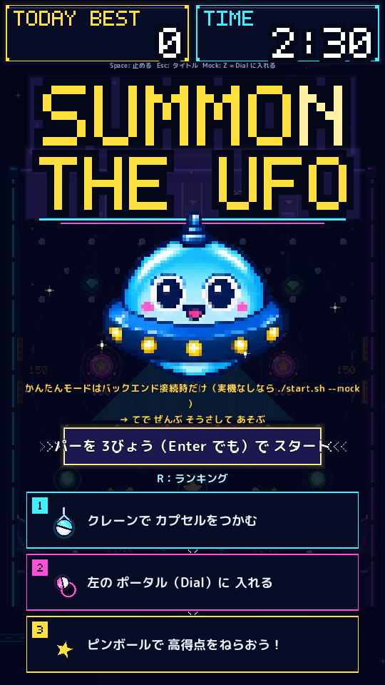
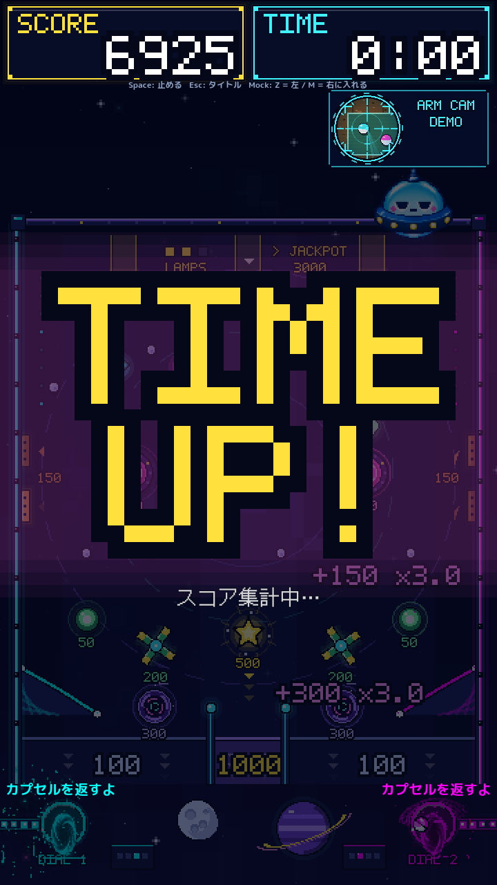
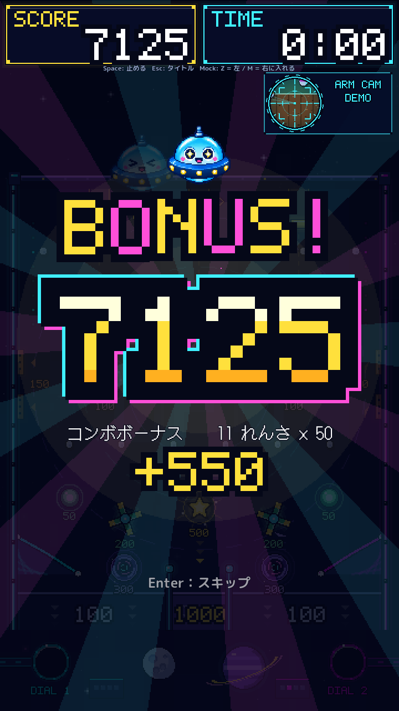
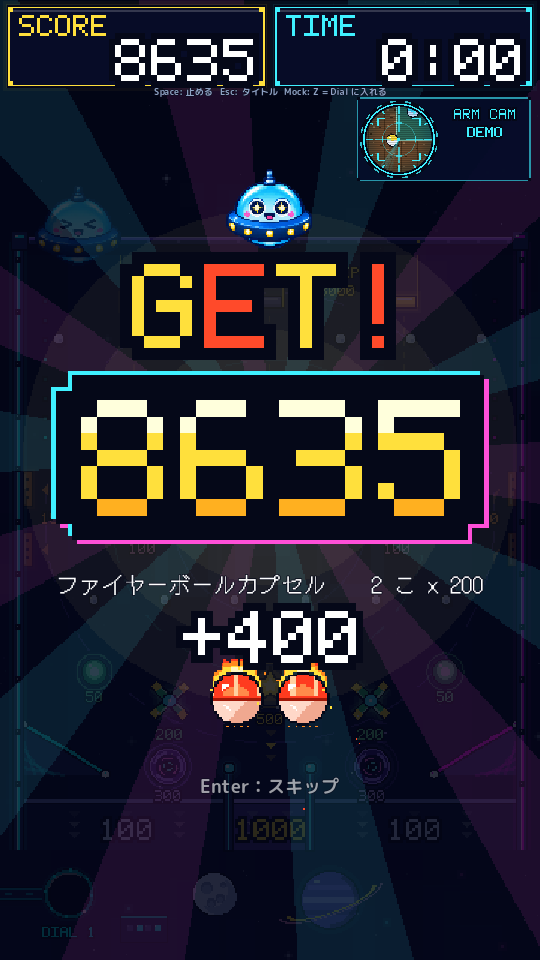
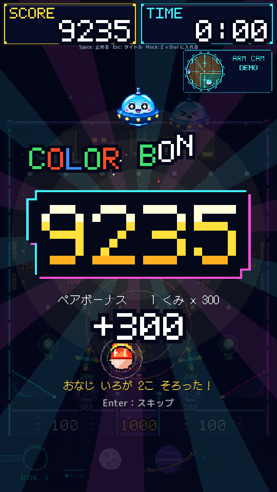
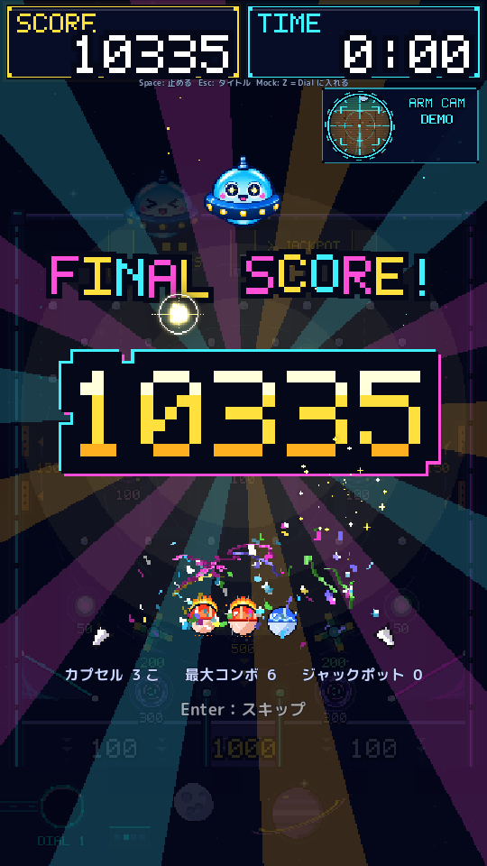
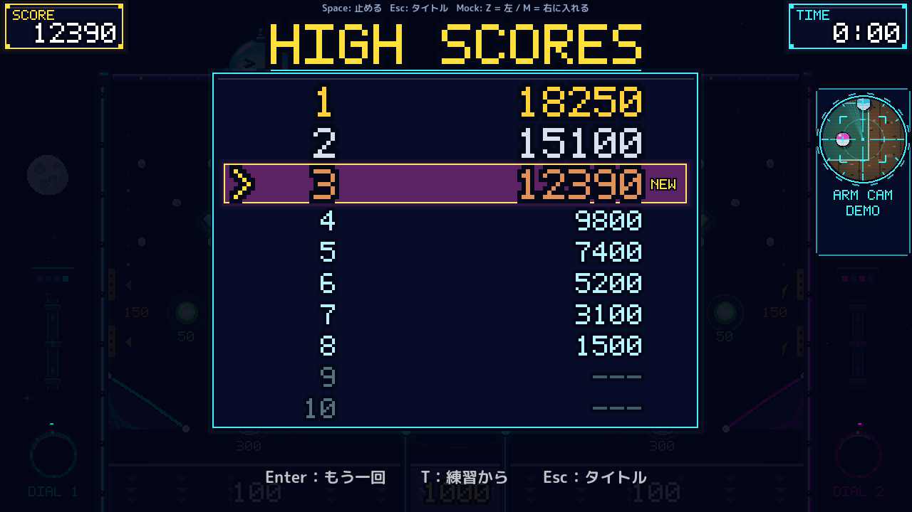

# SUMMON THE UFO ゲームモード仕様（v0.5）

150 秒のスコアゲームの**ゲーム仕様の正本**（Issue #138）。ルール、画面の配置、時間の流れ、得点、状態遷移、例外、機器とのやり取りをここで決める。

- 機器（M5Dial・イルミ・ハブ）との**通信と LED の契約の正本**は UFO-DeviceHub の [`docs/game-mode-interface.md`](https://github.com/fooping-tech/UFO-DeviceHub/blob/main/docs/game-mode-interface.md)（[UFO-DeviceHub #8](https://github.com/fooping-tech/UFO-DeviceHub/issues/8)。プロトコル版 1。LED演出にはファームウェア 0.3以上、#185の取り残し再排出には Dial 0.4以上が必要）。この文書はそれに合わせてある（§7・§8・§13）。
- 仕様を変える PR は、この文書を直し、Issue #138 と DeviceHub #8 の両方にコメントする。
- ここに書いた数値は**すべて調整値**（未確定）。プレイテストと実機の計測で決める。値は `config/game_config.json` の `game_mode` 節にある。

実装の状況は §11、未検証の項目は §12。

**v0.5（#200）: ポータルは左側だけ。** v0.4 までは左（1 号機 = Dial 1）と右（2 号機 = Dial 2）の 2 つのポータルがあったが、方針を変えて**左の Dial 1 だけ**にした。ゲームは Dial 2（`0x21`）に何も送らず、Dial 2 からのイベントも使わない。かんたんモードの指 2 本（右へ運ぶ）もなくした。

## 1. 体験

プレイヤーは実物のクレーンでカプセルを掴み、画面の**左外側**にあるポータル（1 号機 = Dial 1）に入れる。入れたカプセルは画面の中に転送されたように見え、画面上を左右に往復する UFOくんから落とされ、ピンボールの盤面を転がって得点になる。盤面の下まで落ちると、入れたポータルに戻る演出とともに、実物のカプセルが Dial から排出される。これを 150 秒くり返して得点を競う。

- クレーンの操作（キー・ジェスチャー・自動キャッチ）は「ゲームモード」と同じで、スコアゲームの間もそのまま使える。
- スコアゲームの画面は、クレーンの画面（ロープと UFO）の上に重ねる別の画面。**画面上の UFOくんはスコアゲームの絵で、実機の位置とは関係ない**（`RobotState` を読まない・書かない）。
- スコアゲームはクレーンにコマンドを送らない。機器へは周辺機器のハブ（UFO-DeviceHub）経由だけ。

## 2. 機器の配置

| 画面の側 | 機器 | デバイス ID | 画面のポート | 画面の色（初期提案） |
|---|---|---|---|---|
| 左 | 1 号機 = Dial 1 | `0x20` | 左下 | シアン `0,255,255` |

ポータルはこの 1 つだけ（#200）。画面の右下にポートはなく、ゲームは Dial 2（`0x21`）を使わない（Dial 2 がハブにつながっていても何も送らず、そのイベントは捨てて、トレースに `event_ignored` / `not_a_game_dial` を残す。`STOP_ALL` だけは全機器に届く）。Dial 2 を受取待ちにする命令も送らないので、Dial 2 に入れたカプセルは画面に出ず、返ってもこない（係の人が取り出す）。

色は Dial の**号機色**と同じにする（初期値は UFO-DeviceHub の既定色）。`game_mode.dials.left.color`（RGB）で変えると、ゲームがセッションごとに `SET_DIAL_COLOR` で Dial にも同じ色を送るので、画面のポートと Dial の LED がそろう（§8）。

## 3. 時間の流れ

| 段階（phase） | 内容 |
|---|---|
| `IDLE` | タイトルで「3 スコアゲーム」を選んだ直後。Enter で開始（最初の 1 回は練習へ。下の「開始前の練習」） |
| `TUTORIAL` | 開始前の練習（#149）。**150 秒の時計は止まったまま、得点・カプセルは本番に残らない**。終わると `COUNTDOWN` |
| `COUNTDOWN` | 3 秒（`countdown_s`）。Dial を `SET_MODE GAME` にする。**まだ受け取らない** |
| `PLAYING` | 150 秒（`duration_s`）。開始と同時に Dial へ `ARM_RECEIVER`。右上に残り時間、左上に得点 |
| `SETTLING` | 0 秒になった。**新しいカプセルは受け付けない**。プレイ中のカプセルは最後まで得点し、排出する。最大 30 秒（`settle_max_s`） |
| `RESULT` | リザルト演出（§3.2）: 中央の巨大なスコア → ボーナス加算 → FINAL SCORE。カプセル数、最大コンボ、ジャックポット数、異常のあった Dial。そのあとハイスコアランキング（§3.3）。Enter は演出中なら最後まで飛ばし、ランキングの画面ではもう一回。T で練習から、Esc でタイトル |
| `STOPPED` | Space（停止）で止めた。Enter でやり直し、T で練習から |

- 残り 30 秒（`hurry_s`）: 音楽を速いテイクへ切り替え（クロスフェード）、イルミを速くする。残り 10 秒（`warning_s`）: 毎秒の警告音、時計が赤く点滅。
- **カウントダウンの音（#325）**: 開始のカウントダウンは効果音ラボの「カウントダウン電子音」（プッ、プッ、プッ、ピー）、終わりの 10 秒は音声「10、9、8、7、6、5、4、3、2、1、0」（元気な女の子）。ファイルと出典は `game/assets/audio/se/README.md`。
  - **画面の数字と同期する**。ファイルの中で各数字が鳴り始める時刻を測り（ffmpeg でデコード、5 ms ごとの RMS が最大から -30 dB を超えた最初の時刻）、`GameModeSounds.CUE_ONSETS` に入れてある。
    - 電子音: 0.000（3）/ 1.003（2）/ 2.005（1）/ 2.993 s（ピー = GO!、4.63 s まで）
    - 音声: 0.005（10）/ 1.023（9）/ 2.015（8）/ 3.003（7）/ 4.006（6）/ 5.004（5）/ 6.016（4）/ 7.014（3）/ 8.002（2）/ 9.000（1）/ 10.007 s（0）
  - どちらも数字の間隔は 1 秒（ずれは最大 16 ms = 1 フレーム）なので、画面のほうは変えず、**音の再生位置を時計に合わせる**: 最後の数字（GO! / 0）の時刻を残り 0 秒に置き、毎 tick「いま聞こえているべき位置」= 最後の数字の時刻 − 残り秒（`countdown_left` / `time_left`）を計算する。その位置が 0 以上になった tick で、その位置から再生を始める（出力遅延 `AudioServer.get_output_latency()` の分だけ先から）。画面の数字は `ceil(残り秒)` で変わるので、数字 n が出る瞬間に、その数字の音の頭が聞こえる。
  - 再生中に 0.12 s 以上ずれたら（重いフレームなど）その位置へ戻す（0.5 s に 1 回まで）。
  - 電子音は `COUNTDOWN` の最初の tick から（`countdown_s` が 3 秒より短ければ途中から、長ければ 3 で始まる）。ピーが GO! なので、電子音があるときは `go` の音と 3・2・1 の `count` は鳴らさない（3 より大きい数字には `count`）。
  - 音声は残り 10.007 秒で始まり、0 が TIME UP（`SETTLING` に入る瞬間）に重なる。音声があるときは残り 10 秒以下の毎秒の `warning` は鳴らさない（`warning_s` が 10 より大きければ、その上の秒は `warning`）。ラウンドが 10 秒より短い・途中から残り時間が少ないときは、残り秒に当たる数字から始める。
  - 止める: Space（`STOPPED`）、Esc（タイトル）、練習、次のラウンドの開始では、その場で止める。TIME UP のあと（`SETTLING` / `RESULT`）は、0 を言い終わるまで（あと 0.55 s）だけ鳴らす。電子音が残っていれば止める。
  - ファイルがない・読めない・`game_mode.sounds.files` が false のときは、これまでどおり `count` / `go` / `warning`。
  - 音量（`CUE_GAIN_DB`）: `tools/audio_levels.py` で電子音 -10.3、音声 -18.7 LUFS（瞬間最大）。大きな効果音の -22 にそろえて、電子音 -4 dB、音声 +5 dB。
- 0 秒の境界: 0 秒より前に `BALL_RECEIVED` が届いたカプセルはプレイする。0 秒の時点で Dial が空いていれば `DISARM_RECEIVER` を送る（受取待ちにする途中・応答待ちのときも送る）。それでも 0 秒の直前に入って後から届いたカプセル（遅れカプセル）は、**盤面に出さず・得点せず**、そのまま排出する。
- `SETTLING` が 30 秒で終わらないとき: まだ終わっていなければ Dial を `FAULT` にして `RESULT` に進む（その Dial は係の人が確かめる）。

## 4. 画面の配置（縦画面 720 × 1280 の固定座標、#157）

画面は **9:16 の縦型**。設計解像度は 720 × 1280 で、32 インチの縦置きモニタ（1080 × 1920、または 2160 × 3840）いっぱいに映す。モニタの回転は OS の設定で行い、ゲームの中では画面を回さない。比率の違うモニタでは 9:16 のまま左右に帯が付き、切れたり伸びたりしない。設定の手順は `docs/display_setup.md`。

座標はすべて `game/scripts/game_mode/game_mode_layout.gd`（`GameModeLayout`）にまとめてある。HUD・盤面・演出・リザルト・ランキングはここから位置を取る。




上から順に:

| 帯 | y | 置くもの |
|---|---|---|
| HUD | 0〜114 | 左に SCORE、右に TIME（それぞれ画面の半分の幅。数字は 1 ドット 8 px = 縦 56 px）。その下に係の人向けのキーの案内（小さい字） |
| 状態 | 130〜242 | 左に短い知らせ（「COMBO xN」、パワーアップの残り時間。#258 で盤面の上から移した）、中央にコンボ（連鎖数・倍率・残り時間の棒）と「JACKPOT チャンス！」、右にアームカメラのスコープ |
| レール | 250〜352 | UFOくんが左右に往復（y = 298、盤面の幅の 10 %〜90 % = x 96〜624、片道 6 秒） |
| 盤面 | 352〜1100 | 縦長のピンボール盤面（幅 660 × 高さ 714）。下端の 1066〜1134 がゴールの帯 |
| Dial | 1100〜1280 | 左下に Dial 1 のポート (92, 1192)。その上に Dial の状態の 1 行。ポートから画面の左の外（実機の Dial の側）へ導管と光が伸びる。右下にポートはない（月と惑星の絵だけ） |

**手の窓（#258）**: 右下（x 400〜708、y 820〜1268、`GameModeLayout.GUIDE_RECT`）に角丸の窓を 1 つ出す。盤面の右下の隅に重なってよい。上に手のカメラの映像（292 × 219）、その下に手の状態の一言・速さの目盛り・スティックの輪。かんたんモードではさらにその下に、今の手でできること（つまんで いどう → グーで キャッチ → じどうで ポータルへ。#266: 指はいらない。グーの溜まり、受け付けなかった理由）、自動の動きの間はその案内（「ポータルへ はこぶよ！」など）を出す。今どの手をすればよいかを、この窓だけで分かるようにする。
- カプセルがポータルに入ってから盤面を出るまで（`ABSORBING` / `DROPPING` / `SIMULATING`）は、窓が右下の角へ小さく退避する（`GUIDE_SMALL` = 0.42 倍、`GUIDE_FAINT` = 不透明度 0.6）。終わると元の大きさに戻る。
- 練習のステップの間（全画面の練習パネル）は窓を出さない（練習が手の絵の横にカメラを出す）。練習カプセル（上の帯だけ）では出す。練習カプセルの説明は、ポートの右、窓の左に置く。

**ポータルは左の Dial 1 だけ**（実機の置き方と同じ。#200）。

盤面の中（上から下へ。`PinballField` の定数）:

| もの | 位置 |
|---|---|
| 壁 | x = 30 と 690 |
| カプセルの出現 | y = 366。x は UFOくんがいた位置 |
| スイッチ ×3 | y = 404、x = 180 / 360 / 540。板の幅は 28 px |
| ピン（上の 3 段） | y = 452 / 506 / 560、94 px 間隔の千鳥（7・6・7 本） |
| 宝石 ×4 | y = 533、x = 172 / 266 / 454 / 548。当たり判定だけで、カプセルを止めない。取ると 10 秒消える |
| 宇宙人 | y = 614 付近を x = 96〜624 で 9 秒かけて往復。当たり判定だけ。つかまえると 5 秒消える |
| バンパー ×3 | (190, 684) (360, 660) (530, 684) |
| 壁のターゲット ×4 | 左右の壁の y = 652 / 732。当たると 6 秒点灯（表示だけ） |
| ピン（下の 1 段） | y = 800、6 本 |
| 小バンパー ×2 | (126, 896) (594, 896) |
| スター | (360, 916)。取ると 8 秒消える |
| 回転ギミック ×2 | (226, 934) (494, 934)。十字（腕 30 px）が互いに逆向きに回る |
| スリングショット ×2 | 下の左右の斜面（壁の y = 968 から内側 110 px、y = 1034 まで）。当たると斜め上・内向きにはじく |
| ワープホール ×2 | (224, 1022) (496, 1022)。左右のゴールの上。落ちたカプセルを 0.7 秒とどめて、上・内向きに打ち上げる。**1 個のカプセルにつき 1 回だけ** |
| ゴール | 下端 y = 1066。左（x < 306）・中央（306〜414）・右（> 414） |
| カプセル | 半径 18 px（横画面のときと同じ） |

### 横画面の盤面からの置き直し（#157）

横長の盤面（幅 980 × 高さ 502）を伸び縮みさせたものではない。カプセル・ピン・バンパーの大きさと、カプセルが通れるすき間はそのままにして、幅 660 × 高さ 714 の中に置き直した。得点表とルール（コンボ、3 連スイッチ、ジャックポット、ワープは 1 回、15 秒の上限）は変えていない。

盤面が狭く・長くなった分、同じ部品でも当たる回数が増えるので、横画面のときの当たり方に近づくよう次を調整した（どれも調整値）:

- ピンは 3 段 + 1 段（計 26 本。横画面は 3 段 29 本）。
- スイッチの板の幅 56 → 28 px、回転ギミックの腕 44 → 30 px、中央ゴールの幅 140 → 108 px。
- 重力 `game_mode.field.gravity_scale` 0.7 → 0.85。

カプセル 60 個を盤面の幅いっぱい（10 %〜90 %）に落として測った結果（`ScoreManager` で採点。1 個ずつ、コンボは 1 個の中だけ）:

| | 横画面（#156 まで） | 縦画面 |
|---|---|---|
| 盤面にいる時間 | 平均 4.9 秒、最大 9.9 秒 | 平均 6.2 秒、最大 11.9 秒 |
| 1 個あたりの得点 | 平均 2340、中央値 1690 | 平均 3223、中央値 2810 |
| ゴール | 左 24 / 中央 19 / 右 17 | 左 22 / 中央 16 / 右 22 |
| ゴールに届かなかった数 | 0 | 0 |

盤面が長いので滞在時間は約 1.3 倍、得点は平均で約 1.4 倍になっている（ばらつきの大きい測定で、60 個では ± 1 割ほど動く）。得点表は調整値なので、展示の前のプレイテストで合わせる。

### 見た目（#140 / #141）

ネオンレトロ × ピクセルアート。濃紺を地に、シアン・マゼンタ・黄・紫をアクセントにする。

**ドットの大きさ**: UFOくんのスプライトは 64×64 ドットで、2 倍で表示する（1 ドット = 画面の 2 px）。背景・盤面の絵・エフェクトは、これと同じ大きさのドットになるよう、**360×640 のキャンバス**（`GameModeController.pixel_view`）に描いて 2 倍で映す（#157 で縦に。1080 × 1920 のモニタでは 1 ドットが 3 px、2160 × 3840 では 6 px）。丸・斜めの線・回るものも同じドットになる。座標は 720×1280 のまま（太さ 2 = 1 ドット）。物理（`PinballField`）はキャンバスの外で、絵（`PinballFieldArt`）は物理の状態を読むだけ。得点・時計のパネルと日本語の文字はキャンバスの上に重ねる（ドット文字は 2 px の倍数の大きさ）。

絵はコードで描く（素材ファイルなし）: 暗い 1 ドットの輪郭、ハイライトと影、少ない色数。数字と英字は 5×7 のドット文字 `PixelText`、日本語は #134 のフォント（大きい字は DotGothic16、本文は M PLUS Rounded 1c）。

| もの | 見た目 |
|---|---|
| 背景（`GameModeBackdrop`） | 濃紺の帯、斜めに横切る遠い星の帯、淡い星雲、3 層の星、光の粒、流れ星、下から立ちのぼる光の柱。盤面の下、ポートの右に月と輪のある惑星。Dial のポートから画面の左の端（実機の Dial の側）へ伸びる導管と、その上を外へ流れる光、ランプ |
| 盤面の床 | 星が少し透ける暗いパネル。軌道の輪、スイッチから下へのレーン線、バンパーと中央ゴールを指す矢印ランプ、スターの後ろの放射、両脇を流れるランプ、うっすら `UFO` の文字 |
| 盤面の枠 | 左の壁は Dial 1 の色、右の壁はマゼンタ（飾りの色。Dial とは関係ない）のネオン管（暗い輪郭、ボルト、上の角の金具）。上に UFO が動くレールと流れるランプ |
| ねらう場所 | 得点するものは**呼吸するように光る**（バンパー・小バンパー・スター・ターゲットの輪、消えているスイッチの矢印、中央ゴール）。それぞれの**得点を横に書く**。スイッチの間に「LAMPS（点いた数）→ JACKPOT 3000」 |
| 宝石・宇宙人・ワープホール | 宝石は色違いのカット石（上下に揺れ、きらめく。取ると輪郭だけ残る）。宇宙人は一つ目の小さなドット絵で、足を動かし、進む方を見る。ワープホールは光の腕が回り込む黒い穴で、カプセルを吸うと速く回り、打ち上げるとき白く光る。絵は文字の並びで定義したドット絵（`PinballFieldArt.GEM` / `ALIEN`）で、1 文字 = 1 ドット |
| 当たった瞬間 | ピンは輪、バンパーは膨らんで白く、回転ギミックは残像、スリングショットはゴムが飛び出す、ターゲットは点灯 |
| ゴール | 下へ流れる矢印。中央はジャックポットのとき黄色く点滅 |
| カプセル | 暗い縁、上半分がその Dial の色、下半分は白。通った跡に**光の軌跡**（直前の 12 点。コンボで太くなる） |
| 得点の一時表示 | 得点した場所にドット文字で `+100 x1.5`。跳ねて出て、上がって、点滅して消える（約 1.1 秒）。大きい得点とコンボ 2 段目以上は大きい字 |
| スコア・時計 | 左上と右上のパネル。得点が増えている間は数字が黄色く弾む。時計は残り 30 秒で黄、10 秒で赤の点滅 |
| スコアゲームのタイトル画面（開始待ち） | 大きな `SUMMON THE UFO` のロゴ、大きな UFOくん、点滅する START、遊び方の 3 枚のカード。**プレイ中は出さない** |

### アームカメラのスコープ（`ArmScope`、#141）

ねらいを定める照準の見た目で、右の柱にアーム先端のカメラを丸く出す（左の柱のハンド操作の表示と対）。

- 円の上に、十字線、30 度ごとの目盛り、回る破線の輪、掃引線、四隅のブラケット。
- 映すのはカメラの窓口（`CameraHub`）の focus の映像。バックエンドが揺れ補正の映像（#118: オプティカルフローで揺れを打ち消したもの。`camera.focus.stabilize`）を送っている間は、**その補正済みの映像**になる。スコープ自身は何も測らない。
- 円の下に `ARM CAM` と状態: `STAB ON`（補正済みの映像。ブラケットが閉じて黄色。打ち消している揺れの大きさを `SHAKE` の棒で出す）、`STAB WAIT`（補正中だが、いま映像に追える特徴がない）、`STAB OFF`（カメラそのまま。バックエンドなし（`--game-only`）、補正オフのとき）、`NO SIGNAL`（アームカメラが見つからない。#271: 俯瞰カメラを代わりに映すのはやめた。アームのカメラに見えて、外れたことに気づけなかったため。カメラの窓口がないとき（テストなど）は隠れる）。
- **表示だけ**。映像は保存せず、ロボットの動きや得点の判定に使わない。
- `--game-mode-demo` では、動いて止まる机の絵がカメラの代わりになる（カメラなしで見た目を確認できる。状態は `DEMO`）。
- 設定は `game_mode.scope`（`enabled`、`zoom` 1〜4）。

### 共通の演出と UFOくんのリアクション（#144）

当たった・入ったことに画面が反応する部品。どれも 360×640 のキャンバスの中（UFOくんと同じドット）で、表示だけ。

| 部品 | 内容 |
|---|---|
| 粒子（`GameModeParticles`） | 当たった場所から飛び散る 1〜2 ドットの火花。**192 個の固定のプール**で、空きがなければ古いものを使い回す（ノードを作らない・捨てない）。数は対象ごと（ピン 3、バンパー 10、スター 18、ジャックポット 48 など。`GameModeController.HIT_FX`）で、コンボで増える。ゴールからは上へ噴き上がる |
| 衝撃の輪 | 当たった場所から広がる輪。16 個の固定のプール |
| ヒットフラッシュ | 得点したカプセルが 0.09 秒白く光る |
| ヒットストップ | 大きな得点で 0.05 秒、ボーナスとジャックポットで 0.08 秒（上限 0.1 秒）、**絵だけ**が止まる（キャンバスを描き直さない）。物理・時計・通信・機器の処理は止まらない |

UFOくんは表情のシート（`assets/ufo/ufo_expressions.png`）で反応する（`GameModeVFX.REACTIONS` / `MOODS`）:

| きっかけ | 表情と動き |
|---|---|
| 待機 | いつものアニメ。ときどきまばたき |
| GO! | 目を輝かせて 2 回跳ねる。まわりに火花と輪 |
| カプセルが上がってくる | 驚いて小さく跳ねる |
| カプセルを落とす | ウインクして少し沈む。落とす場所に火花 |
| 得点（ピン以外） | 笑って小さく跳ねる |
| 大きな得点（スター・宇宙人・中央ゴール・ボーナス・ジャックポット） | 目を輝かせて 2 回跳ねる |
| ミス（15 秒の時間切れ、Dial の異常） | 悲しい顔で左右に揺れる |
| 残り 30 秒 | 驚いて揺れ、そのあとは心配顔のまま上下が速くなり、汗が飛ぶ |
| TIME UP（清算中） | 眠い顔 |
| 結果 | 得点があれば笑顔と紙吹雪、0 点なら悲しい顔 |
| 停止（Space） | 驚いた顔 |

強い反応の途中に弱い反応が来ても、強いほうを最後まで見せる（得点の笑顔が、開始やミスの反応を上書きしない）。`visual_quality: low` で火花は半分になりヒットストップはなし、`effects: false` で火花・輪・ヒットフラッシュ・ヒットストップ・UFOくんの動きを止める（表情は変わる）。

プレイの状況で変わるもの（どれも表示だけ）:

| 状況 | 変化 |
|---|---|
| 残り時間 | 空の色が濃紺から少しずつ紫へ。残り 30 秒で紫と桃色の光、残り 10 秒で赤く脈打つ（`backdrop.urgency` / `time_k`） |
| 得点 | 画面全体が数ドット沈んで戻る（ピンは弾まない。バンパーなど小、ゴール中、スターと中央ゴール大、ボーナスとジャックポット最大。コンボで強くなる。上限 16 px）|
| コンボ | 段が上がると中央に `COMBO x1.5` と背景の光。段が高いほど星が流れ、光の柱が強く、盤面のランプが速く、得点の字と軌跡が大きい。連鎖が切れると元に戻る |

見た目は状態を映すだけで、得点・物理・判定・機器とのやり取りは変えない（画面の弾みや演出の終わりを、物理・時計・通信は待たない）。`game_mode.visual_quality` を `low` にすると、背景が動かない簡素なものになる。`game_mode.effects` を `false` にすると、弾み・軌跡・呼吸する光を止める（確認用。ゲームは同じ）。

盤面は Godot の 2D 物理（カプセルは `RigidBody2D`）。**ロープの物理（自前の Verlet）とは別物で、ロープには使わない**。カプセル同士は衝突しない（初期版）。

- **停滞対策**: 速さ 14 px/s 未満が 1.2 秒続いたカプセルは小さく突く。
- **最大滞在**: 盤面に 15 秒（`field.max_stay_s`）いたカプセルは取り出して排出に進む。このときゴールの得点はない（それまでの得点は残る）。
- **長く残ったカプセルは落ち着く**（#147）: 盤面に 5 秒（`field.settle_after_s`）いたカプセルは、そこから 3 秒（`settle_over_s`）かけてバンパー・小バンパー・スリングのはじく力が 1 割（`settle_kick`）まで弱まり、重力が 2.5 倍（`settle_gravity`）まで強まる。ワープホールも素通りする。落ちてすぐの跳ね方と、当たったときの得点は変わらない。最大滞在は、それでも残ったときの最後の手段。

## 5. カプセルと Dial ごとの状態

カプセル 1 個 = 実物 1 個。Dial は 1 台で、1 台につき 1 個なので、**同時に 1 個**（MULTI BALL の画面上の分身を除く）。各カプセルは次を持ち、**入れた Dial から排出する**。

| 項目 | 内容 |
|---|---|
| `capsule_id` | `c<session>-<dial 16進>-<cycle>-<通し番号>` |
| `source_dial` | `0x20` |
| `session` | ハブのセッション ID（`BALL_RECEIVED` を受けたときのもの） |
| `cycle` | Dial の受取サイクル番号（`ARM_RECEIVER` のたびに増える） |
| `drop_x` | 投下する X。**`BALL_RECEIVED` を受けた瞬間の UFO の X で固定**し、その後のアニメーション中に変えない |

Dial の状態（コードでは側ごとのレーン `lanes["left"]`。今は左の 1 本だけ）:

```
OFFLINE → ARMING → READY → ABSORBING → DROPPING → SIMULATING → RETURNING → RELEASING → VERIFYING → READY
                     └（0 秒）→ CLOSING → CLOSED            どこからでも異常 → FAULT
```

| 状態 | 画面 | 機器 | 次へ |
|---|---|---|---|
| `OFFLINE` | じゅんび中 | Dial が応えない。3 秒ごとに `SET_MODE GAME` からやり直す | 応答 → `ARMING` |
| `ARMING` | じゅんび中 | `SET_MODE GAME` → （`PLAYING` になってから）`ARM_RECEIVER` | ACK → `READY` |
| `READY` | ここに入れてね | 受取待ち | `BALL_RECEIVED` → `ABSORBING`（`ARM_RECEIVER` の ACK より先に届いた・ACK が失われた場合も、新しい cycle の `BALL_RECEIVED` なら `ARMING` / `OFFLINE` から受け取る） |
| `ABSORBING` | ポートが開き、カプセル回収の演出（1.95 秒。下記） | — | 時間 → `DROPPING` |
| `DROPPING` | UFOくんの光の中を投下点へ落ちる（0.25 秒） | — | 時間 → `SIMULATING` |
| `SIMULATING` | 盤面を転がって得点 | — | ゴール / 15 秒 → `RETURNING` |
| `RETURNING` | 出口からポートへ吸い込まれ、光が Dial の方向へ流れる | 0.6 秒後（同期点、`release_sync_s`）に `RELEASE_BALL` | 送信 → `RELEASING` |
| `RELEASING` | `RELEASE_STARTED` で排出の演出 | `RELEASE_DONE` を待つ（8 秒まで） | `RELEASE_DONE` → `VERIFYING`。8 秒来なければ、送り直さずに `VERIFYING` で Dial の状態を確かめる |
| `VERIFYING` | — | `GET_STATUS`。`dial_state` が `COMPLETE` / `READY` で、スイッチが OFF であること（0.5 秒おきに 4 回まで） | 確認 → `ARM_RECEIVER` → `READY`（0 秒後なら `CLOSED`） |
| `CLOSING` / `CLOSED` | — | 0 秒: `DISARM_RECEIVER`。`RESULT` で `SET_MODE STANDBY` | — |
| `FAULT` | 係の人を呼んでね＋理由 | **何も送らない** | 次のラウンドまでそのまま |

取り込み（スイッチ → 投下）は合計 2.2 秒（`absorb_s` 1.95 + `drop_s` 0.25。#258 で演出のために 1.1 秒から延ばした）。実機で計測して調整する。

**カプセル回収の演出（#258、`capsule_collect`）**: `absorb_s` の時間を割って、①カプセルがポートからシュッと盤面の中ほどへ上がる（16 %）→ ②中ほどで大きくなって「カプセル回収！」（〜62 %）→ ③小さくなりながら UFOくんへ吸い込まれる（〜80 %）→ ④UFOくんが光る（輪と下向きの光）→ `DROPPING` で UFOくんの光の中を投下点へ落ちる。UFOくんは `ABSORBING` と `DROPPING` の間その場で待ち、投下点（取り込んだときの UFOくんの x）はその真下になる。演出は表示だけで、機器には何も送らない。

## 6. 得点（調整値）

| 対象 | 得点 | 補足 |
|---|---|---|
| ピン | 10 | コンボの倍率はかかるが、コンボは増やさない |
| バンパー | 100 | はじき返す |
| 回転ギミック | 200 | |
| スター | 500 | 取ると 8 秒消える |
| 小バンパー | 50 | はじき返す（#141 で追加） |
| 壁のターゲット | 150 | #141 で追加 |
| スリングショット | 30 | コンボは増やさない（#141 で追加） |
| 宝石 | 100 | 取ると 10 秒消える（#141 で追加） |
| 宇宙人 | 400 | つかまえると 5 秒消える（#141 で追加） |
| ワープホール | 300 | 入ったときに得点。カプセル 1 個につき 1 回（#141 で追加） |
| スイッチ | 50 | 3 つ全部点くと **+1500**（3 連スイッチ）。点灯は全カプセルで共有し、そろうと消える |
| 左 / 右ゴール | 100 | |
| 中央ゴール | 1000 | |
| ジャックポット | 3000 | 3 連スイッチ完成から 20 秒以内の中央ゴール（中央ゴールの 1000 の代わり。1 回で消える） |

- **コンボ**: バンパー・回転・スター・スイッチ・小バンパー・壁のターゲット・宝石・宇宙人・ワープホールに 2.5 秒以内に続けて当てると連鎖が増える。連鎖 2 以上で ×1.5、4 以上で ×2、6 以上で ×3。ゴールとピンにも倍率がかかる。
- **連打の抑制**: 同じカプセルが同じ対象で得点するのは 0.4 秒に 1 回。
- **重複の抑制**: カプセルのゴール得点は 1 回だけ。出口の通知が重なっても、後から古いイベントが来ても二重に得点しない。
- UFO の位置で落とす場所が変わるので、どのタイミングで Dial に入れるかがねらいどころ（スイッチの真上、中央ゴールの真上）。

## 7. 機器とのやり取り（プロトコル版 1）

| 場面 | 送る | 待つ |
|---|---|---|
| 開始 | Dial に `SET_MODE {mode: GAME}`、`PLAYING` で `ARM_RECEIVER` | ACK |
| 受取 | — | イベント `BALL_RECEIVED {cycle}` |
| 排出 | `RELEASE_BALL`（カプセル 1 個につき 1 回だけ） | ACK、イベント `RELEASE_STARTED` → `RELEASE_DONE` / `RELEASE_FAILED` |
| 確認 | `GET_STATUS` | STATUS（`dial_state`、`switch_on`） |
| 0 秒 | Dial が空いていれば `DISARM_RECEIVER` | ACK |
| 終了 | `SET_MODE {mode: STANDBY}`（`FAULT` の Dial には送らない） | — |
| 停止（Space、Esc） | 全機器に `STOP_ALL` | — |
| Dial の LED（§8） | `SET_DIAL_COLOR`、`SET_DIAL_EFFECT`（ファームウェア 0.3 から） | 待たない |

言葉の意味（混同しない）:

- **ACK** = 機器が命令を**受け取った**。動作が終わったことではない。
- **`RELEASE_DONE`** = サーボの動作シーケンスが**終わった**。**カプセルが実際に出たことの証明ではない**（排出を確かめるセンサーは今はない）。そのため `VERIFYING` でスイッチが OFF に戻ったかを確かめ、戻らなければ次の受け取りを始めない。

重複と古いイベント:

- イベントはセッション ID・送信元・イベント ID で重複を捨てる（ハブのゲートウェイも捨てているが、ゲームでも捨てる）。
- `BALL_RECEIVED` は、同じセッションで `cycle` が前回以下なら捨てる（スイッチのチャタリング、再送）。
- 今のセッションと違うセッション ID のイベントは捨てる（古いセッションのイベントが遅れて届いても、投下・得点・排出をしない）。
- `RELEASE_STARTED` / `RELEASE_DONE` / `RELEASE_FAILED` は、その Dial が `RELEASING` のときだけ使う（`command_id` が分かっていれば照合する）。

ゲームから機器への経路: Godot `GameModeController` → `GameModeDevices` → （バックエンド）WebSocket の `devicehub_command` / `devicehub_status` / `devicehub_stop_all` → `DeviceHubService` → UFO-DeviceHub の `DeviceGateway`（セッション・ACK・再送）。イベントは `devicehub_event` で届く。体験と得点は Godot、命令・セッション・ACK は Python。

## 8. 光（イルミと LED）

**光は飾り。送って忘れる**: 送信に失敗しても、応答がなくても、ゲームと排出は止めない。

| 場面 | イルミ（`0x10`、今ある命令） |
|---|---|
| カウントダウン | `SET_LIGHT_MODE GAME_READY` |
| 開始 | `SET_LIGHT_MODE GAME_PLAY`、`TRIGGER_EFFECT GAME_START` |
| 受取 | `TRIGGER_EFFECT BALL_RECEIVED` |
| 回収演出（#277） | アップで登場した瞬間に `SET_LIGHT_MODE CUSTOM`（カプセルの種類の色: ファイヤー赤・ウォーター青・グリーン緑、ふつうは Dial の色。明るさ 255、120 ms で切り替え）、UFOくんが光る瞬間に `TRIGGER_EFFECT SCORE`、カプセルが盤面に落ちたらラウンドの照明（`GAME_PLAY` など）に戻す。停止・新しいラウンドで打ち切り |
| 排出開始 | `TRIGGER_EFFECT BALL_RELEASED` |
| 3 連スイッチ・ジャックポット | `TRIGGER_EFFECT SCORE` |
| 残り 30 秒 | `SET_LIGHT_MODE GAME_PLAY`（明るく・速く） |
| 結果 | `SET_LIGHT_MODE RESULT`、`TRIGGER_EFFECT GAME_CLEAR` |

### ミスト（#316）

ミストは `SET_MIST CONTINUOUS`。カプセルの受取で `capsule_s`、結果の得点が決まったら `result_s`、学習モードのごほうびで `study_s` 出す（設定は `devicehub.mist`）。

**ミストは当面オフ（`game_mode.mist.enabled: false`、#318）**。設定の画面の「実機 → ミスト（イルミネーションの霧）」でオン・オフでき、保存したらすぐ反映される。オフにすると、サーボの停止を待っているミストも消す。1 回のミストで、サーボの返事が**約 16 秒**かき消される（2026-11-26 に実機で測定。イルミネーションは 3 秒・8 秒で OFF と報告するのに、サーボが答えるようになったのは約 12 秒後）。ファームウェアが待てるのは 5 秒なので、その間に爪や Z を動かすとゲームが止まる（カプセルのミストの後の次のつかみ、結果のミストの後の次のゲームの最初の「爪を開く」）。ミストの雑音をハードウェアで直したらオンに戻す。秒数（`capsule_s` 3・`result_s` 8・`study_s` 6）はオンのときに使う。

**サーボが動いている間は出さない**。ミストの駆動の雑音が、爪と Z のサーボ（同じ信号線）の返事を約 3〜4.5 秒かき消し、その間に動いたサーボはファームウェアが位置を見失う（`feedback_lost`、実機で確認。CoreXY_UFO #28 / #30）。カプセルが Dial に入るのは、ちょうど爪が開いている最中。
- 頼まれた時点でサーボが動いていれば、止まるまで待ってから送る。待っている間に重ねて頼まれたら、長いほうを 1 回だけ送る
  - 「動いている」= かんたんモードの手順が `OPEN_CLAW`・`LOWER_TO_CATCH`・`CLOSE_CLAW`・`RAISE_WITH_ITEM`・`LOWER_TO_RELEASE`・`RELEASE`・`RAISE_EMPTY`・`CLAW_STANDBY` のどれか、または手動の爪・Z の動き（`GRABBING`・`RELEASING`・`Z_LOWERING`・`Z_RAISING`）
  - Dial で離した後は、`RAISE_EMPTY` でアームが上がり終わってから出る（受取から約 2〜3 秒遅れる）
- `defer_max_s`（15 秒）より長く待ったら、そのミストは捨てる
- ミストが出ている間に次のサーボの動きが始まることはある。そのときはファームウェアが通信が戻るのを最大 5 秒待って位置を取り戻す（CoreXY_UFO #30）。かんたんモードの爪の手順の時間制限（`game_mode.easy.real.timeouts_s` の `open_claw`・`close_claw`・`release`・`claw_standby`）は、それを待てるように 10 秒

### Dial の LED（転送の光）

Dial 1 台に LED が 2 系統ある（前面 G1 と、G15。どちらもその Dial が駆動し、命令の `target: BOTH` で両方に出す）。ゲームは UFO-DeviceHub の契約（`docs/game-mode-interface.md` §5）の名前付きアニメーションを、その Dial の号機色で送る（`game_mode.dial_leds`）。

| いつ（ゲーム） | アニメーション | `SET_DIAL_EFFECT` |
|---|---|---|
| `SET_MODE GAME` が通ったとき（セッションごと） | — | `SET_DIAL_COLOR`（Dial の色） |
| `BALL_RECEIVED` を受けて取り込みを始めるとき | `INTAKE` | CHASE / `TO_SCREEN` / 1500 ms / NORMAL |
| `RETURNING` を始めるとき（`RELEASE_BALL` の 0.6 秒前） | `RETURN_FLOW` | COMET / `TO_DIAL` / 0（続く）/ NORMAL |
| `RELEASE_STARTED` を受けたとき | `RELEASING` | CHASE / `TO_DIAL` / 0 / NORMAL |
| `FAULT` になったとき | `FAULT` | FLASH 赤 / 1500 ms / HIGH |
| `RESULT`（正常に閉じた Dial） | — | NONE / HIGH（Dial 自身の表示に戻す） |

- 画面側は同じ色・同じ向きで、ポートと画面の端（Dial の方向）の間を光が流れる（取り込みは Dial → 画面、排出は画面 → Dial）。
- Dial は検出した瞬間に自分で「白 → 号機色で画面方向」を光らせる。ゲームの `INTAKE` は同じ色・同じ向きなので、後から届いても見た目がつながる。
- 演出の終わりは Dial が自分で決める（カプセルの検出、排出シーケンスの終了、`STOP_ALL`、セッションの変更、通信断）。ゲームは後始末の命令に頼らない。
- **結果を待たない**: `IGNORED_PRIORITY`・`NOT_CONFIGURED`（G15 の LED がない機体）・タイムアウトは無視する。`RELEASE_BALL` を LED の応答で遅らせない。
- **古いファームウェア**（Dial 0.2 は `UNSUPPORTED`、Hub 0.2 は `BAD_REQUEST`）: その Dial にはそのラウンドの間 LED 命令を送らない。Dial は自分の状態の LED を出し、ゲームは同じに進む。
- `ATTRACT`（受取待ちの呼び込み）は送っていない（Dial 自身の受取待ち表示が出る）。
- 画面と Dial の間にさらに別の LED テープを足す場合の配線・制御は未定（DeviceHub 側の文書 §3）。

## 9. 例外

| 起きたこと | ゲームの動き |
|---|---|
| `RELEASE_BALL` が拒否された・応答がない | Dial を `FAULT`。**送り直さない** |
| `RELEASE_FAILED` | `FAULT` |
| 排出完了（`RELEASE_DONE`）の後も、スイッチが ON のまま（カプセルが Dial から出ていない、#185） | 2 秒（`verify_retry_s` × `verify_tries`）確かめてから、**`RELEASE_BALL` をもう一度送る。2 回まで**（`game_mode.timeouts.release_retries`）。それでも出なければ `FAULT`（「カプセルが Dial から出ていない」）。Dial のファームウェア 0.4 以降が要る（UFO-DeviceHub: COMPLETE でスイッチが ON のときだけ 2 回目を受け付ける）。古い Dial は断るので、その場合は今までどおり `FAULT`（理由に「ファームウェアが古い」と出す）。`RELEASE_DONE` が来なかったとき・命令が拒否されたとき・通信がつながり直したときは、今までどおり送り直さない |
| `RELEASE_DONE` が 8 秒来ない | 送り直さず、`GET_STATUS` で確かめる。Dial が `COMPLETE` でスイッチが OFF なら（通知だけが失われた）次へ進む。そうでなければ `FAULT`（排出できたか分からない） |
| 排出後も Dial がカプセルありのまま | `FAULT`（次の受け取りを始めない） |
| ハブとの通信が切れて、つながり直した（新しいセッション） | プレイ中のカプセルは得点を続けるが、**自動では排出しない**（Dial はもうそのカプセルを覚えていない）→ `FAULT`。排出の途中だったときも `FAULT`。空いていたときは受け取りをやり直す |
| ハブにつながらない | 「じゅんび中」で待ち、盤面の上に理由を出す（バックエンドが返す: 別のシステムのハブ（システム番号の違い）／ポートが見つからない／開けない／ハブとして応答しない／バックエンドがない・ハブを使っていない）。つながれば受け取りを始める |
| Dial が一時的にオフライン | 空いていれば `OFFLINE` で待ち、戻ったら受け取りをやり直す |
| Dial にカプセルが残ったまま開始（か、Dial が本体の設定モード） | `ARM_RECEIVER` が拒否され、「じゅんび中」のまま理由を出す。係の人が取り出すと進む |
| 0 秒 | §3 |
| 15 秒たっても盤面にいる | §4 |
| クレーンの異常（#292。下の「クレーンの異常での自動停止」） | 一度だけ止める（Space と同じ: 全機器に `STOP_ALL`、得点・排出・受け取りなし）。**ラッチ**: スタッフが復旧を確かめるまで、Enter・T・手・F6 / F7 では始まらない |
| Space（停止） | クレーンを止め（これまでどおり）、スコアゲームを止め、全機器に `STOP_ALL`。**その後は得点も排出も受け取りもしない**。カプセルが Dial に残っていたら係の人が取り出す |
| Esc（タイトルへ） | プレイ中なら Space と同じように止めてから戻る |
| イルミ・LED の失敗 | 無視して進む |

**安全は演出より優先**。復帰のあとの自動再排出はしない。`STOP_ALL` はソフトウェアの停止で、電源を切るのとは違う。通信が切れたことが分かっても、機器が止まったことは保証されない。

`FAULT` になった Dial を元に戻すのは人の作業: カプセルを取り出し、必要なら設定画面の「テスト」タブ（#108）で Dial を確かめる。

### クレーンの異常での自動停止（#292）

実機（バックエンドのロボット）でスコアゲームの練習・カウントダウン・プレイ・清算をしている間、`RobotFaultGuard`（`game/scripts/game/robot_fault_guard.gd`）が物理 tick ごとにバックエンドの状態を見る。判定は `RobotFaultWatch`（`game_mode/robot_fault_watch.gd`、画面なしでテストできる）。模擬のクレーンとデモでは見ない。

- **異常とみなすもの**（見始めたときから**変わったもの**だけ）: ファームウェアの `ALARM` / `ESTOP`、原点を失った、モーターがオフになった、巻き上げ・爪サーボが電源の入れ直しを要する（`z_servo_power_cycle` / `arm_servo_power_cycle`）・巻き上げサーボが 1 回転モードに戻った（`z_servo_reset`）、かんたんモードのシーケンスが `FAULT`（ファームウェアのアラームなしも。Space による `stopped` は除く。**#302: サーボの命令が失敗しただけで STOP で止めたもの（`easy_mode.servo_fault`、#269: アラームなし・原点はそのまま・何も動いていない）も除く**。そのときかんたんモードは `servo_recovery_s` 後に `easy_reset`（爪を開いて一番上へ。ポータルの上ならカプセルはそこで落ちる）を自動で頼んで遊びを続ける。1 ラウンド `servo_recoveries` 回まで、超えたら今までどおりかんたんモードの FAULT のまま）、バックエンドとの通信が切れた、ロボット（Core2）との接続が切れた。見始める前からあったもの・同じ報告の繰り返し・一時的な `busy` や拒否（状態に出ない）では止めない（始める前の不具合は #275 が開始を止める）。通信が切れたら、ほかの値は古いので判定しない。原因の分類は CoreXY / Z / 爪 / シーケンス / 接続 / 不明（エラー文のサーボの id: 1 = 巻き上げ、2 = 爪）。
- **止め方**: ゲームは `GameModeController.robot_halt` で一度だけ `STOPPED`（`_halt`: `STOP_ALL`、得点・排出・受け取りなし）。ゲーム側からは新しい動作を頼まない（`main.halt_motion_requests`: かんたんモード・手・待機位置・練習の運搬）。クレーンには、通信が生きていてファームウェアがアラームでないときだけ `soft_stop` を 1 回。アラームならファームウェアが止めているので何も送らない。通信が切れていれば送れない。**停止の確認**は、`soft_stop` の後に届いた状態でアームが止まっていること（3 秒以内）。確かめられなければ「停止未確認」と出す（ソフトの停止は電源を切ることではない）。
- **ラッチ**: `robot_fault` が残っている間は `start_blocked()` が理由を返し、Enter・T・手・F6 / F7・起動オプションのどの開始も断る。キーと手ではアームを動かさない。ラッチ中の新しい異常は原因を更新するだけ（止め直さない）。中断したラウンドは再開しない。
- **スタッフの画面**（`ui/staff_recovery_panel.gd`）: ラッチ中は全画面の上に赤い帯（「ゲーム停止：〇〇／スタッフを呼んでください」）。F9（`StaffControl` の `recover`）か M5StopWatch の RECOVER、帯のクリックで開く。原因（分類・コード・ファームウェアの文・時刻・ゲームとかんたんモードの状態・セッション）、停止の確認、今の機械の状態（接続・状態・原点・モーター・サーボ・かんたんモード・準備）、次にすること（`RobotFaultWatch.problems`）、記録を出す。
  - **アラーム解除**（`clear_alarm` だけ。アームは動かない）
  - **まとめて準備**（アームが動く。**2 回押す**: 1 回目は確認だけ、6 秒以内の 2 回目で送る。F9 でも同じ）。アラームがあれば `recover_arm`（`clear_alarm` → 返事の後に `calibration_prepare`）、なければ `prepare_arm`（`calibration_prepare`）。校正タブ・F9 と同じコマンドと関門。通信・ロボットがない、`ESTOP`、サーボの電源の入れ直しが要る、返事待ち、準備中、動作中は送らない。
  - **状態を取り直す**（`get_state`）、**確認して新しいゲームへ**（`get_state` を送り、その返事と今の状態の両方で `problems` が空のときだけラッチを外して、スコアゲームのタイトルへ）、メニューへ、閉じる。
  - Space はいつでも優先: 確認待ちを消し、遅れて届いた返事から準備を始めない（`main._stop_recovery`）。
- **記録**: 異常はラウンドのトレース（`robot_fault`）に、そのあとの停止・スタッフの操作・返事・ラッチの解除はデバッグログ（Godot のログファイル）に残る。
- **実機未検証**: 実機のアラーム・サーボの失敗・通信断で本当に止まるか、停止の確認が実機の動きと合うかは見ていない（Mock と、状態を差し替えたテストだけ）。

## 10. トレース

1 行 1 イベントの JSON Lines。`game_mode.trace` がオンのとき、ラウンドごとに `user://game_mode/trace_<日時>.jsonl`（mac では `~/Library/Application Support/Godot/app_userdata/CoreXY UFO/game_mode/`）。個人情報・鍵は入らない（ID・状態・数値だけ）。

項目: `t_ms`（単調時計）、`game_t`（開始からの秒）、`session_id`、`source_dial`、`cycle`、`capsule_id`、`event`、`command_id`、`result`（ACK の結果・無視した理由）、`game_state`（phase）、`lane_state`、`physics_position`、`score_delta`、`effect_id`（命令名・イベント名・得点の対象）、`led_command`、`release_status`、`breakdown`（`result` の行だけ: リザルトの内訳。§3.2）。

`event` の種類: `game_start` `hurry` `time_up` `result` `ranking`（ランキングへの登録の結果。`result` に `rank 3` か登録しなかった理由、`score_delta` に最終スコア） `stopped` `session` `lane_state` `command` `ack` `event` `event_ignored` `ball_ignored` `capsule_created` `score` `stay_timeout` `release` `led` `fault`。

DeviceHub 側のトレース（`pc/trace.py`。バックエンドの `--devicehub-trace <file>` か config の `devicehub.trace` で、ハブに送った命令・ACK・イベントを 1 行ずつ書く）とは `session_id`・`source_dial`・`cycle`・`command_id` で突き合わせる。受取は `(session_id, source_dial, cycle)`、排出は `RELEASE_BALL` の `command_id`。スイッチが入った時刻と受信時刻の差は、バックエンドがイベントに付ける `received_at`（単調時計）とこの `t_ms` から測る（機器側の時刻との対応付けは未実装）。

## 3.1 開始前の練習（#149）

スコアゲームのタイトルで Enter を押すと、すぐカウントダウンに入らず、**UFO の召喚 → 手の練習 → 実物のカプセルを 1 個入れる実践 → 本番**の順に進む。テーマは「昭和のオカルトを令和の技術で完全再現！」。1 画面に 1 つのことだけを、大きな絵と大きな 1 行で見せる。アプリ起動時のモード選択のタイトル画面は変えていない。

| # | 画面の 1 行 | 絵 | 次へ進む条件 |
|---|---|---|---|
| 0 召喚 | ベントラベントラスペースピープル！（続けて「さあ、ぼくと ゲームを はじめよう！」） | 魔法陣に UFOくんが降りてくる | UFOくんが言い終わったら自動で進む。**OK は出さない**（何もしていないので） |
| 1 パー | てを ひらいて パー！ | 開いた手 | 手の形 `open` を **3 秒**保つ（ゲージが溜まる。#171） |
| 2 ピンチ | おやゆびと ひとさしゆびを くっつけよう！ | つまんだ手から UFOくんへ光が流れる | **人差し指**のピンチ（`pinch` かつ `pinch_finger = index`）を **3 秒**保つ。中指のピンチは数えない |
| 3 移動 | そのまま てを うごかそう！ | 手と一緒に動く UFOくん、上下左右の矢印 | 下の「ロボットを動かせるとき・動かせないとき」。できたら「きみと こころが つながったよ！ ベントラベントラスペースピープル！ これで ハンドパワーで うごかせるよ！」と言い、言い終わるまで次のステップを待つ（#179。ステップの `done_say`。声が終わらなくても `tell_max_s` で進む） |
| 4 つかむ | グーで キャッチ！ | 手の形、閉じる爪 | 下の同じ表 |
| 5 はなす（#171） | チョキで はなす！ | 手の形、開く爪 | つかむと同じ（爪を**開く**依頼。動かせないときは開く形を保つ） |
| 6 上下のつまみ（#171、つまむ方式だけ） | てのこうを むけて ゆびを くっつけよう！ | つまんだ手と「てのこうを カメラに むける」 | **手の甲をカメラに向けた**（`palm = down`）人差し指のピンチを 3 秒保つ。手のひら側のピンチは数えず、案内を出す |
| 7 上下に動かす（#171、つまむ方式だけ） | そのまま うえ・したに うごかそう！ | 上下に動く手と UFOくん、上 = あがる / 下 = さがる | 移動と同じだが、手のスティックが**上下モード**（`mode = z`）で 3 秒。動かせないときは、手の甲を向けたつまみを上か下へ運んで 3 秒（横は数えない） |
| 8 ルール | カプセルを ポータルに いれると とくてん！ | つかむ → ポータル → 画面でピンボール → 得点 → 同じポータルから返る、の 5 コマ | 説明だけ（画面に「せつめい」と出す）。言い終わったら自動で進む |
| 9 実践 | カプセルを ひとつ いれてみよう！ | 盤面が見える。左下のポート（DIAL 1）に矢印。説明は画面の上の帯と、ポートの右 | 練習カプセルが 1 個、受信 → 落下・得点 → 返却 → 排出 → 状態確認まで終わる |

- **成功の演出は 1 ステップに 1 回だけ**: 大きな赤い丸と「OK!」、ピンポーンの音（`tutorial_ok`、合成音）、UFOくんのウインク、星。1.4 秒（`ok_s`）見せて次へ。
- **責めない案内**: 手が見えない → 「てを カメラに みせてね」。カメラ・通信が途切れた → 「てのカメラが みつからないよ。かかりの ひとを よんでね」。8 秒できない → 「もういちど やってみよう」。
- **判定の安定化**: 形は続けて保った時間で数える（0.2 秒より短い途切れは許す。それより長いと数え直し）。古いイベント・順序の入れ替わりは `GestureControl` が捨て、鮮度（`stale_ms`）が切れている間は何も数えない。
- **声のキャッシュ（#171）**: 一度作ったせりふの音声はファイルに残し（`cache/speech/`、Git に入れない。`homework.speech.cache`）、同じせりふはそこから再生する（VOICEVOX に毎回頼まない）。バックエンドを止めても残る。VOICEVOX が作ったせりふは、VOICEVOX が止まっていてもその声で出る。話者・サンプリング周波数を変えると別のファイル。
- **最初の呪文の声（#171）**: 声は補助の通信路で頼むので、練習を始めた瞬間はまだつながっていないことがある。最初のせりふはつながるのを最長 2.5 秒（`game_mode.tutorial.voice_link_wait_s`）待ってから出す（待たずに文字だけで流れてしまうのを防ぐ）。初めて作るせりふは VOICEVOX の返事を 6 秒まで待つ。
- **声**: UFOくんのせりふはバックエンドの音声（VOICEVOX、なければ say）に頼む。使えないとき・間に合わないときは文字だけで進む（画面にせりふを出す）。**声が終わるのを待つのは最長 12 秒**で、声の完了は進行の条件にしない。音声認識は使わない（呪文を言うのは UFOくん）。
- **手のカメラがないとき**（ジェスチャーがオフ）: 手のステップは絵と文字で説明するだけで、OK を出さずに進む。
- **縦画面（#157）**: 練習のパネルは状態の帯の下から盤面の下端まで（720 × 1280 のうち x 20〜700、y 250〜1080）。1 画面の中は上から、手の絵 → その結果（UFOくん・爪・図解）→ 大きな 1 行 → 補足 → 案内、の順に縦に並ぶ。ルールの 5 コマは 3 コマ + 2 コマの 2 段。
- **ゲージの音（#179）**: 手のステップでゲージが溜まっている間、短い音が 0.14 秒ごとに鳴り、溜まるほど高くなる。止まっている間・説明だけのステップ・OK の後は鳴らない。
- **進み方**: 画面左上に「れんしゅう 2 / 9」（手の形で方向を決める方式は 7 ステップ: 上下の 2 つがない）。動かす系のステップ（3・7）と形を保つステップ（1・2・6）は約 3 秒（`steps` の `hold_s` / `move_s` で変えられる）。
- **デバッグパネル（#171）**: スコアゲームを開くと右のデバッグパネルは閉じる（F1 / Tab で開ける。ほかのモードに戻ると元どおり）。開いたままにするなら `game_mode.debug_panel: true`。練習中の Enter は何もしない（間違って飛ばさないため）。

画面（作った手の動きと模擬の Dial で撮ったもの）: [召喚](images/game_mode/tutorial_0_summon.png)、[ピンチ](images/game_mode/tutorial_2_pinch.png)、[移動の OK](images/game_mode/tutorial_3_move_ok.png)、[ルール](images/game_mode/tutorial_5_rules.png)、[実践](images/game_mode/tutorial_6_practice.png)。

### ロボットを動かせるとき・動かせないとき

練習は**ロボットにも Dial にも自分では何も送らない**。手の操作は今までどおり `GestureControl` → 調停 → `_send_jog` の経路だけで、練習はその結果を見ているだけ。ジェスチャーの安全の条件（`gesture.allow_real_robot`、モーター有効、原点復帰、校正の `confirmed` など）は何も変えていない。

| ステップ | ロボットを動かせるとき（`gesture_gate()` が空） | 動かせないとき（実機が未許可・未準備など） |
|---|---|---|
| 3 移動 | 手のスティックが実際に操縦中（`ACTIVE`）で、最高速の 25 % 以上を 0.5 秒 | 手だけで判定: このステップで始めたピンチを画面の 12 % ぶん運ぶ。画面に「ての れんしゅうだけ するよ（いま ロボットは うごかない）」と出す |
| 4 つかむ | 手の操作が実際に出した「爪を閉じる」要求（`claw_requested("closed")`）。形を保っただけでは成功にしない | 手だけで判定: 閉じる形を 0.5 秒保つ。同じ表示を出す |

「つかむ」で求める形は、使っている手の読み方（`gesture.scheme`）が爪を閉じる形として持っているもの（`claw_poses()`）から決める。ピンチ・ジョイスティックはグー、手の形で方向を決める方式はチョキ。後者では 2・3 が「ゆびさし」「ゆびを さした ほうへ うごかそう」になる。

### かんたんモードの練習（#169、#314）

**#314 から**、かんたんモードの練習は **召喚 → パー → ピンチ → 移動 → 「ねらいを さだめて グー！」** の 5 ステップ。最後のステップは本物の練習カプセルで、本番と同じ かんたんモードの操作（手でねらう → グーで おりて つかむ → 自動でポータルへ運んで入れる）で 1 個入れる。入ったら下の「練習の説明の画面」で説明し、カプセルが返って確認できたら本番。

#314 より前は、4 が「グーで キャッチ！」（手の形だけを判定し、爪を閉じてポータルの上へ動くが、つかまない）、続けて「ルール」の説明、そのあと練習カプセル、だった。「グーで キャッチ」のステップ（`easy_grab`）と「ルール」（`rules`）は、設定の `game_mode.tutorial.modes` で並べれば今までどおり使える。

### 練習の説明の画面（#314）

練習カプセルがポータルから画面に吸い込まれると、本番のピンボールの代わりに、盤面の上に**簡素な練習用の画面**（`PracticeShow`）を出す。UFOくんが声で説明し、場面ごとに「せりふが終わって、最低の秒数を見せた」ら次へ進む（声が終わらなくても最長の秒数で進む）。

| 場面 | 画面 | UFOくん |
|---|---|---|
| 入れたカプセル | アームのカメラで読んだ色のカプセルを大きく。名前と一言（例: ファイヤーボールカプセル！ はやい！ あてると とくてん アップ）。色が読めなければ「カプセル ゲット！」 | 「◯◯を いれたね！」 |
| 色で効果が変わる | 赤（ファイヤー）・青（ウォーター）・緑（グリーン）の 3 枚のカードと、「？ ほかにも いろんな カプセルが あるよ… おたのしみに！」のカード。入れたカプセルの色のカードを明るく | 「カプセルの いろで、うごきや とくてんが かわるよ！」「ほかにも、いろんな カプセルが あるよ。おたのしみに！」 |
| スイッチ | スイッチ 3 つと下にゴール 3 つだけの盤面。カプセルがスイッチを 1 つずつ点け、3 つで「JACKPOT チャンス！」 | 「スイッチを みっつ つけると、ジャックポット チャンス！」 |
| ジャックポット | チャンスの間にカプセルが中央ゴールへ。「JACKPOT +3000」（本番のジャックポットと同じ 20 秒・3000 点） | 「チャンスの あいだに、まんなかの ゴールに はいると、3000てん！」「タイミングよく いれて、こうとくてんを ねらおう！」 |

- 盤面の動きは見せるためのもの（物理ではない）。練習の点数（`PRACTICE`）に 3000 点が入るが、本番は今までどおり全部を初期化して始まる。
- 説明が終わると、ピンボールから出たときと同じ流れでカプセルを返す（`RELEASE_BALL` → `RELEASE_DONE` → 状態確認）。Dial とのやりとり・失敗のときの扱いは「練習カプセル」のとおり。
- Space・Esc・練習の終わりで、説明の画面はすぐ消える。ゲームからロボット・Dial へは何も送らない（画面と声だけ）。
- 手で全部操作する練習（hard）の練習カプセルも、同じ説明の画面になる。
- 設定 `game_mode.tutorial.practice_show`: `enabled`（false で今までのピンボール）、場面ごとの `min_s` / `max_s`。

### 練習カプセル（6 実践）

- 本番と同じ Dial の状態機械を、**時計なしで**動かす（`GameModeController.practice`: `open` → `closing` → `done` / `fault`）。Dial を `SET_MODE GAME`・`ARM_RECEIVER` にし、`BALL_RECEIVED` → 取り込み → 落下・得点 → 返却 → `RELEASE_BALL` → `RELEASE_DONE` → `GET_STATUS`（スイッチ OFF）まで、セッション・Dial・cycle の重複排除、LED・演出も本番と同じ。
- 1 個が返ったら Dial は閉じる（まだ受取待ちなら `DISARM_RECEIVER`）。閉じる間に入ってしまったカプセルは、盤面に出さずにそのまま返す（0 秒の境界と同じ扱い）。
- **`RELEASE_DONE` と状態確認は「サーボが動き終わり、スイッチが OFF になった」ことしか言わない**。画面は「かえしたよ。でてこなかったら かかりの ひとに いってね」と出し、物理的に出てきたとは言わない。
- 排出の失敗・状態確認の失敗・通信断は `fault`: OK を出さず、「かかりの ひとを よんでね」と出して**本番へ進まない**。`RELEASE_BALL` を自動で送り直さない。
- 練習の得点は左上に `PRACTICE` と表示する。練習が終わると本番は**全部を初期化してから**始まる（得点 0、カプセル 0、残り 150 秒）。Dial が練習で報告した cycle だけは覚えておき、練習カプセルの遅れた報告を本番で新しいカプセルと数えない。トレースは別のファイル（`practice_*.jsonl`）。

### 停止とスタッフの操作

- **Space**: 練習中も常に効く。`STOP_ALL` を送り、練習を終えて `STOPPED` にする。そのあと何も排出しない（カプセルが Dial にあれば係の人が取り出す）。
- **Esc**: タイトルへ戻る。練習カプセルが動いていれば `STOP_ALL` を送る。
- **スタッフ用**（#260 のスタッフ操作。`docs/staff_operations.md`）: `F6`（次へ）= 次のステップへ（OK は出ない）、`F7`（スキップ）= 練習を飛ばして本番へ、`Shift+F6` = このステップをやり直す。**カプセルが練習の途中にある間は次へ・スキップを受け付けない**（「カプセルが もどるまで まってね」）。実践で Dial が受取待ちのときに飛ばすと、先に Dial を `DISARM_RECEIVER` で閉じてから本番へ進む（カウントダウン中は受け取らないため。閉じる間に入ったカプセルはそのまま返す）。
- 設定（設定画面「ハンドジェスチャー」）: `game_mode.tutorial.enabled`（オフなら Enter ですぐ本番。T で練習）。ステップの文言・保持時間・順番は `game_mode.tutorial.steps` / `modes` で上書きできる（定義は `gesture_tutorial_steps.gd`）。

### 開始待ちの画面と練習の追加（#183）

- **開始待ちの画面を手で操作**: パーを 3 秒続けるとスタート（Enter と同じ。START の枠に溜まり具合が出る）、画面が出たときにもう出ていた形は数えない。指 1 本・2 本で難易度を選ぶ操作は #198 でなくした。ランキング表示中・ラウンド中は何もしない。左上の枠は本日のハイスコア（`TODAY BEST`: 今日の日付のランキングの記録と、今日遊んでランキングに入らなかったラウンドの最高点。練習・デモ・0 点は数えない）。
- **練習に手のカメラ**: 手のステップ（判定しているとき）で、手の絵の横にジェスチャー認識用のカメラ（俯瞰カメラ）の映像を並べ、検出した手を重ねて描く。カメラの映像がないときは今までどおり。表示だけ。
- **かんたんモードの練習でアームが動く**: 「グーで キャッチ」ができたら爪を閉じ（手の操作と同じ `arm_goto`。シーケンス中・ほかの動作の応答待ちの間は送らない）、アームを Dial 1 の投入位置の上へ動かす（#266: 以前は「ゆび 1ぽん」のステップで動かしていた）（バックエンドの `easy_goto {destination: 1}`: XY だけ、運搬と同じ速さ。かんたんモードの値が使えて、アームが移動の高さ（一番上）にあるときだけ。シーケンス中は断る）。爪は閉じたままで、「カプセルを ひとつ いれてみよう」の最初に開く。Space で止めた後は何も送らない。練習の判定そのもの（`GestureTutorialController`）は今までどおり何も送らず、送るのはメインシーンの既存の経路。

## 3.2 終了のリザルト演出（#153）

150 秒が終わってから、得点が増えていく過程を見せる。**画面と音だけ**で、クレーンにも Dial にもイルミにも新しい命令は送らない。`SETTLING`（清算・排出・異常の判定）、`STOP_ALL`、`STANDBY`、`FAULT` の処理は変えていない。





#323: ゲットしたカプセルの発表（GET!）、色の組み合わせボーナス（COLOR BONUS!）、最後のカプセルの列（模擬の Dial のデモで撮影。540 × 960 に縮小）





### 流れ

| 段 | 画面 | 同じ瞬間に出るもの |
|---|---|---|
| TIME UP!（`SETTLING` の間） | 盤面を暗くして巨大な「TIME UP!」、下に「スコア集計中…」 | 白フラッシュ、低い衝撃音（`timeup_hit`）と既存のジングル、シェイク、ヒットストップ。#271: UFOくんの声で「ゲーム終了！！」（デモでは言わない） |
| YOUR SCORE（`RESULT` に入った直後） | 中央に巨大な数字が 0 から走る。後ろで光の放射線が回る | 数えるたびにブリップ音（`result_count`。進むほど高くなる）と光の粒。止まった瞬間に `score_lock`、シェイク、バウンド、衝撃波 |
| GET!（カプセルの種類ごと、#323） | 「GET!」（その種類の色で点滅）、種類の名前と「N こ × 点」、「+点」。その下にカプセルの絵が 1 こずつ跳ねて飛び出す → 点とカプセルが数字に吸い込まれる → 数字が走る | 発表: 種類の登場の音（`reveal_<種類>`。ふつうのカプセルは `bonus_show`）、その色の火花。カプセル 1 こごと: `capsule_pop`（1 こごとに高くなる）、その色の火花と白い輪。着弾以降は BONUS! と同じ |
| COLOR BONUS!（色の組み合わせごと、#323） | 「COLOR BONUS!」（文字がカプセルの色で流れる）、ボーナス名と「N くみ/かい × 点」、「+点」、組み合わせのカプセルが 1 こずつ飛び出し、下に子ども向けのひとこと（「あか と みどり で スイカ！」など） | 発表: `bonus_show` と `colour_bonus`（音階を駆け上がる）、その色の火花。着弾: BONUS! と同じに加えて、その色の紙吹雪 |
| BONUS!（コンボ・ジャックポット） | 「BONUS!」が飛び出し、ボーナス名と「+点」が出る → 点が数字に吸い込まれる → 数字が走る | 発表: `bonus_show`、シェイク、火花。着弾: `bonus_hit`、フラッシュ、シェイク、バウンド、ヒットストップ、衝撃波、火花、紙吹雪。確定: `score_lock`（高め） |
| FINAL SCORE! | 数字が一度縮み、大きく跳ねて止まる。3 色の文字が波打つ | 「ジャン！」（`result_jan` = 効果音ラボ `se/jan.mp3`。#328 で、少し残念に聞こえた `final_hit` の下がるスイープとジングル `result` から変えた。スキップしたときも同じ音）、最大のシェイク・バウンド・ヒットストップ、衝撃波 3 重、火花、紙吹雪（pixelfx `success_confetti` `success_sparkle`）、UFOくんが喜ぶ |
| 落ち着いたあと | 最終スコアは中央に大きく残る。その下にラウンドのカプセルが種類ごとに 1 列に並んで揺れる（#323。24 こまで）。下にカプセル数・最大コンボ・ジャックポット数、「Enter：もう一回　T：練習から　Esc：タイトル」 | — |

- 0 点のボーナスは発表しない。得点 0・カプセル 0 個でも FINAL SCORE（0）まで進む（そのときは静かに出し、UFOくんはしょんぼりする）。
- 高額のボーナスほど強い: 強さ = ボーナスの点 ÷ `strong_at`（0.3〜1.0）。シェイク・火花の数・紙吹雪・ヒットストップに掛かる。
- 数字は桁数に合わせて大きさを決める（縦画面: 4 桁で 1 ドット 22 px、5 桁で 18 px、FINAL でその 1.15 倍。14 桁でも画面の幅に収まる）。ドットは必ず偶数 px（盤面のドットと同じ大きさ）。
- 縦画面（#157）では上から、UFOくん → 見出し（YOUR SCORE / BONUS! / FINAL SCORE!）→ 巨大な数字 → ボーナスの行と「+点」→ カプセル数など → 操作、の順に縦に並ぶ。「TIME UP!」は 2 行（TIME / UP!）で画面の幅いっぱいに出す。SCORE・TIME と状態の帯はその間も見えている。
- 異常のあった Dial は、演出の間も画面の下に赤字で出したままにする。

### ボーナスの計算（調整値: `game_mode.result_bonus`）

発表の順: カプセル（種類ごと）→ 色の組み合わせ → コンボ → ジャックポット。0 点のものは発表しない。

| ボーナス | 計算 | 初期値 |
|---|---|---|
| カプセル（ふつう） | 時間内に Dial が受け取ったふつうのカプセルの数 × `capsule_each` | 100 |
| カプセル（色ごと、#323） | その色（種類）のカプセルの数 × `colour_each`。種類ごとに 1 行ずつ発表する（「ファイヤーボールカプセル 2 こ × 200」） | 200 |
| コンボボーナス | 最大コンボ（連鎖の最長）× `combo_each` | 50 |
| ジャックポットボーナス | ジャックポットの回数 × `jackpot_each` | 500 |

色の組み合わせボーナス（#323、`colour_sets`。色のついたカプセルだけで数え、ふつうのカプセルは入らない）:

| ボーナス（id） | 条件 | 初期値 |
|---|---|---|
| ペアボーナス（`pair`） | ちょうど 2 こ集めた色 1 つにつき（2 色なら 2 くみ） | 300 / くみ |
| トリプルボーナス（`triple`） | 3 こ以上集めた色 1 つにつき | 1000 / くみ |
| スイカボーナス（`watermelon`） | 赤（fire）と緑（green）が 1 こ以上ずつ | 500 |
| スチームボーナス（`steam`） | 赤（fire）と青（water） | 500 |
| もりボーナス（`forest`） | 青（water）と緑（green） | 500 |
| あらしボーナス（`storm`） | 青（water）と黄（thunder） | 500 |
| はなびボーナス（`fireworks`） | 紫（dark）と赤（fire） | 500 |
| しんごうボーナス（`signal`） | 赤（fire）・黄（thunder）・緑（green） | 1500 |
| カラフルボーナス（`colourful`） | 色のついたカプセルが 3 こ以上で、全部ちがう色（同じ色が 2 こない） | 1000 |
| コンプリートボーナス（`complete`） | `CapsuleKinds` にあるすべての色を 1 こ以上 | 2000 |

- 色は `CapsuleKinds.KINDS` から `normal` を除いたもの（`ResultBonus.colours()`）。3 色に決め打ちしていない。種類が増えれば（#320 の黄・紫）、その色のカプセル・ペア・トリプル・カラフル・コンプリートの対象に自動でなる。名前の付いた組み合わせは表（`ResultBonus.SETS`）で、必要な種類がゲームにないものは出ない（main の時点では あらし・はなび・しんごう は出ない）。
- 赤・青・緑を 1 こずつだと、スイカ・スチーム・もり・カラフル・コンプリートが全部出る（3 色の間はカラフルとコンプリートが同時に出る。色が増えると別々になる）。
- 色の判定（§3.6）が実機で外れれば、そのカプセルはふつうとして数える。

`final_score = base_score + total_bonus`、`total_bonus = capsule_bonus + colour_bonus + combo_bonus + jackpot_bonus`（`capsule_bonus` はふつうと色ごとの合計）。内訳には種類ごとの数 `kinds`（例 `{"normal": 1, "fire": 2}`）も入り、トレースの `result` の行にも書く。

- `base_score` はプレイ中の得点（`ScoreManager.score`。意味は変えていない）。**3 連スイッチの +1500 とジャックポットの 3000 はプレイ中に入っていて、ここでは足さない**（ここで足すのは終了ボーナスだけ）。
- カプセルに数えるのは、0 秒より前に `BALL_RECEIVED` が届いたもの。0 秒の後に届いてそのまま排出した「遅れカプセル」と、練習カプセルは数えない。プレイしたカプセルは、排出に失敗したものも数える（投入は有効だったため）。
- 内訳は `RESULT` に入るとき **一度だけ** 確定する（`ResultBonus.of_round`）。`SETTLING` の間の得点も含む。確定した内訳はトレースの `result` の行の `breakdown` にそのまま書く。

### 真の値と表示の値

- 真の値: `GameModeController.result`（内訳）。確定後は誰も書き換えない。
- 表示の値: `ResultShow.shown`（いま画面に出ている数字）。真の値に向かって増えるだけで、真の値を越えない。各段の終わりで真の値に一致する。
- 左上の SCORE のパネルも、リザルトの間は同じ表示の値を出す（大きな数字と食い違わない）。

### 同期の仕組み

演出は Tween やタイマーを個別に持たず、**1 本の時刻表**（`ResultShow`、進めるのは `GameModeController.tick`）で動く。ある瞬間に出るもの（音・シェイク・フラッシュ・火花・シート）は 1 つの合図（cue）にまとめ、同じ tick の中で全部を始める。音が鳴り終わるのを待つ段はない。`reset()` で全部が消えるので、次のラウンドに何も持ち越さない。

時間（秒、`game_mode.result_show`）: `intro_s` 0.5 → `count_s` 1.6 → `hold_s` 0.8 →（ボーナスごとに `announce_s` 0.9 → `absorb_s` 0.45 → `bonus_count_s` 0.7 → `bonus_hold_s` 0.5）→ `wind_up_s` 0.35 → `final_s` 3.2。ボーナス 3 つで約 14 秒、1 つ増えるごとに約 2.6 秒（#323 で行が増えた。赤 2・青・緑・ふつう 1 にコンボで 10 行、約 32 秒。Enter で飛ばせる）。

#323: カプセルの絵が出る行（GET! と COLOR BONUS!）では、`announce_s` の間にカプセルが 1 こずつ合図 `pop` で飛び出す（間隔は最大 0.16 秒、全部が `announce_s` の終わりまでに出る。残りがあれば段の終わりに一度に出る）。絵と音は同じ `pop` の中で始める。

### 操作と設定

- **Enter**: 演出の途中なら最後の絵まで飛ばす（もう 1 回押すと次のラウンド）。終わっていればすぐ次のラウンド。
- **T**: 練習から。**Esc**: タイトル。どちらも演出の途中で押せ、演出は残らない。
- **Space**: 演出に関係なく `STOP_ALL` を送る。演出はその場で終わり、最終スコアは残る。
- `game_mode.effects: false`: 演出なしで最終スコアをすぐ出す（シェイク・火花・シートなし、ジングルだけ）。得点と操作は同じ。
- 画面シェイクは既存の `render.screen_shake` で切れる。
- 音は `GameModeSounds` の優先度と同時発音数（8）の中で鳴らす。数えるブリップ音は優先度 0・40 ms に 1 回までで、ほかの音を押し出さない。新しい 6 音は合成音（音源ファイルは足していない）。#323 の `capsule_pop`（優先度 1・40 ms に 1 回まで）と `colour_bonus` も合成音。
- 点は `game_mode.result_bonus` の `capsule_each` / `colour_each` / `colour_sets.<id>`（0 = そのボーナスを出さない）。

### 未検証

- 音は聴いて確かめていない（合成音の音色・音量、ブリップ音の高さの上がり方、ファンファーレとの重なり）。
- 子どもが見てどう感じるか、演出の長さが合っているかは見てもらっていない（#323 で行が増え、色を多く集めると 30 秒を超える）。
- #323 の点の大きさ（色のカプセル 200、組み合わせ 300〜2000）は仮の値。実機の色の判定（§3.6）がどれくらい当たるかで、色のボーナスの出やすさが変わる。
- 展示の PC での処理の重さ（開発機では約 68 FPS）。

## 3.3 ハイスコアランキング（#155）

リザルト演出が終わると、最終スコアを自動でランキングに登録し、TOP10 を出す。**名前・ニックネームの入力はなく、保存も表示もしない**。見せるのは順位とスコアだけ。画面とファイルだけの機能で、機器への命令は送らない。`ScoreManager` の得点計算は変えていない。




### 順位の決め方

- 上位 10 件。スコアの高い順。**同点は先に登録した記録が上**。
- 使うスコアはボーナス込みの最終スコア（§3.2 の `final_score`）。
- 0 点は登録しない。11 位以下になるスコアは保存しない（10 位と同点のスコアも入らない）。
- 1 ラウンドは 1 回だけ登録する。ラウンドごとの ID（開始時に作る）を覚えていて、同じ ID をもう一度渡しても何も変わらない。

### 登録するラウンド・しないラウンド

| ラウンド | 登録 |
|---|---|
| 150 秒を遊んで `RESULT` まで進んだ（`SETTLING` が上限で終わり Dial が `FAULT` のときも含む） | する |
| リザルト演出の途中で T や Esc を押した（ラウンドは最後まで遊んだ） | する（画面を離れるときに、演出なしで登録する） |
| プレイの途中で Space で止めた（`STOPPED`）、Esc でタイトルへ戻った | しない（`RESULT` に進まない） |
| 開始前の練習（`TUTORIAL`） | しない（結果がない） |
| 自動デモ（`--game-mode-demo`） | しない |
| 短くしたラウンド（`--game-mode-seconds`） | しない |
| 0 点 | しない |

登録しなかったときも、ランキングの画面は出す（下に今回のスコアと理由を出す）。

### 流れ

`PLAYING` → `SETTLING` → `RESULT`（リザルト演出）→ 登録 → ランキング表示。phase は `RESULT` のままで、ランキングの画面は `GameModeController.ranking_view`（`""` / `record` / `board`）で表す。

1. リザルト演出が終わった tick で登録する（`GameModeRankingFlow.register_score`）。ファイルもこのとき書く。
2. 最終スコアをそのまま `hold_s`（1.2 秒）見せる。
3. TOP10 に入ったとき: 「NEW RECORD!」と「第 ○ 位！」を `record_s`（3.2 秒）。同じ tick で、「ジャン！」（`result_jan`）と歓声と拍手（`cheer` = 効果音ラボ「歓声と拍手1」`se/cheer-applause1.mp3`。#328 で合成音 `new_record` とファンファーレ `jackpot` から変えた）、シェイク、バウンド、ヒットストップ、衝撃波 3 重、火花、紙吹雪（pixelfx `success_confetti` `success_sparkle`）。順位が高いほど強い。
4. ランキングの画面（HIGH SCORES）。今回の順位はネオンの枠で光り、点滅し、`NEW` の印が付く。圏外・登録なしのときは 3 を飛ばしてここに来る。

- **表からタイトルへ（#253、#271）**: 表（HIGH SCORES）が出ている間にパーを 1 秒（`game_mode.ranking.exit_hold_s`）続けると、最初のタイトルへ戻る（Esc と同じ。表が出たときにもう出ていたパーは数えない）。ラウンドの後の表は、何もしなくても 8 秒（`board_max_s`）で最初のタイトルへ戻る（スコアゲームのタイトルで R で開いた表は戻らない）。

### 画面

- 上に `HIGH SCORES`、その下に 1〜10 位。1 位はゴールド、2 位はシルバー、3 位はブロンズ、4〜10 位は薄いシアン。1〜3 位は大きい。記録のない順位は `---`。
- 縦画面（#157）では、画面の中央に縦長の板（幅 640 × 高さ 752）を置き、1〜3 位は 1 ドット 10 px（縦 70 px）、4〜10 位は 6 px（縦 42 px）で出す。「NEW RECORD!」は 2 行（NEW / RECORD!）。
- **Enter** = もう一回、**T** = 練習から、**Esc** = タイトル。演出の途中の Enter は順に「リザルト演出を飛ばす → ランキングの画面へ → もう一回」。
- スコアゲームのタイトルで **R** を押すとランキングを見られる（もう一度 R で戻る。Enter でそのまま開始）。
- `game_mode.effects: false`: 「NEW RECORD!」の演出は出さず、今回の順位に印を付けたランキングをすぐ出す。
- `game_mode.ranking.enabled: false`: 登録もランキングの表示もしない（リザルトは #153 のとおりに終わる）。

### ファイル

`user://game_mode/rankings.tsv`（mac では `~/Library/Application Support/Godot/app_userdata/CoreXY UFO/game_mode/`）。UTF-8、タブ区切り、1 行目は見出し。

```
rank	score	timestamp	id
1	18250	2026-11-17T10:21:05	1794844062-896669-28221875
```

- `rank` は人が読むための列で、読み込むときは信じずに `score` から並べ直す。`timestamp` は記録した日時、`id` は二重登録を防ぐための ID。個人情報は入らない。
- ファイルがなければ空のランキングで始まる。記録が 1 件できるまでファイルは作らない。
- 読めない行は飛ばし、読める行だけを使う（得点が数字でない、0 以下、列の数が違う、ID が重複）。飛ばした行があったときは、元のファイルを `rankings.tsv.bad` に残す。
- 書き込みは一時ファイルに書き、読み返して内容が合っていることを確かめてから置き換える（書き込みが途中で切れたときは、前のファイルをそのまま残す）。書けなかったときはゲームを止めず、その起動の間だけメモリに持ち、ランキングの画面に「保存できなかった」と出す。メモリにだけある記録は読み直し（タイトルへ戻る、R）で消さず、次の読み直しのときにもう一度保存を試す。
- ランキングを消すには、設定画面（タイトルの歯車）の「設定」タブのいちばん下の「ランキングを消す」を押す（#352）。「本当に消しますか？」と聞き、「消す」を押したときだけ記録とこのファイルを消す（やめる = Esc。Enter では消えない）。TODAY BEST も 0 に戻り、再起動は要らない。消した記録は元に戻せない。ファイルを消せなかったときは記録を残し、理由を出す。画面とファイルだけの機能で、機器への命令は送らない。ゲームを閉じてこのファイルを手で消しても同じ。
- 確認用: `--game-mode-ranking-file <path>` で別のファイルを使う（このときはデモ・短いラウンドも登録する）。

### 未検証

- 音（`new_record` の音色・音量、ファンファーレとの重なり）は聴いて確かめていない。
- 子どもが「第 ○ 位！」を読めるか、演出の長さが合っているかは見てもらっていない。
- Windows での一時ファイルからの置き換え（開発機は macOS）。

## 3.4 かんたんモード（Easy、#169）

初めての子どもが、Z（上下）や爪の細かい操作なしでカプセルを入れられる遊び方。**XY だけ手で動かし、つかむ・上げる・ポータル（左の Dial 1）へ運ぶ・落とすは自動**。**#198: 難易度は選べない。いつもかんたんモードで遊ぶ**。手で全部操作する動き（下の表の右の列。以前の「むずかしいモード」）は、かんたんモードが使えない環境の予備としてだけ残る。

| 手の形 | かんたん（Easy） | 手で全部操作（Easy が使えない環境だけ） |
|---|---|---|
| つまんで動かす | UFO の XY 移動（離すと止まる）。手のひらの向きに関係なく XY だけ（Z は動かない） | 今までどおり（手のひら下 = Z） |
| グーを 0.6 秒 | その場で自動キャッチ（爪を開く → 下降 → 爪を閉じる → 安全高さへ上昇） | 爪を閉じる |
| （つかんだ後） | **#266: 自動で**左の Dial 1 へ運んで落とす（指はいらない） | — |
| 指 1 本・2 本 | 何もしない（#200: 右のポータル、#266: 指 1 本の合図をなくした。爪も開かない） | 2 本 = 爪を開く |
| Space / E-STOP | いつでも止まる | いつでも止まる |

- **切り替えはない（#198）**: いつもかんたんモード。設定 `game_mode.difficulty` / `game_mode.tutorial.mode`、タイトルの **D** キー、タイトルの指 1 本・2 本、設定画面の「スコアゲームの操作（難易度）」、起動オプション `--game-mode-difficulty` はなくした（古い設定ファイルに残っていても読まない）。練習（§3.1）は遊ぶときと同じ操作を見せる。コードの `GameModeController.set_difficulty` は、手で全部操作する動きのテストのためだけに残る。
- **使える条件**: バックエンド接続（自動の動きはバックエンドのシーケンス）と、手の読み方が「つまんで動かす」（`pinch_joystick`）。満たさないときは Easy を**有効にしない**: タイトルに理由と「→ てで ぜんぶ そうさして あそぶ」を出し、手で全部操作する動きで遊ぶ（手の形で方向を決める方式は Easy 未対応）。
- キーボード（矢印・W / S・Q / A）は係の人のために Easy でもそのまま使える（自動の動きの間は使えない）。

### 状態（ゲーム側 `EasyModeControl` とバックエンド `EasySequencer`）

```text
MANUAL_XY ─グー→ AUTO_GRAB: OPEN_CLAW → LOWER_TO_CATCH → CLOSE_CLAW → RAISE_WITH_ITEM
          → WAIT_DESTINATION ─すぐ（#266、ゲームが自動で easy_deliver）→ DELIVER_DIAL_1:
            安全高さの確認 → MOVE_TO_DIAL → LOWER_TO_RELEASE → RELEASE → RAISE_EMPTY → MANUAL_XY
WAIT_DESTINATION ─運べないまま 15 秒→ EXPIRED（バックエンド）= FAULT（ゲーム）
どの状態でも: stop / soft_stop / モーター OFF / 通信断 / アラーム / 原点喪失 / タイムアウト → FAULT
（#269: 爪・巻き上げのサーボの命令が失敗の結果で返っただけのときは ABORT でなく STOP で止める: アラームにならず原点を保つ）
```

- **だれが何をするか**: 手の形の意味はゲームの `EasyModeControl`（`game/scripts/game_mode/easy_mode_control.gd`、main シーンが持つ）が決め、バックエンドへ `easy_grab` / `easy_deliver {destination, grab_id}` を**1 つの合図につき 1 回だけ**送る。動かすのはバックエンドの `EasySequencer`（`backend/.../sequence/easy.py`）で、キャッチから投入の終わりまで（行き先待ちの間も）**モーションロックを持ち続ける**。手動の JOG・移動・ほかのシーケンス・2 回目のキャッチは busy で断られる。`GameModeController` は今までどおりクレーンに何も送らない。
- **合図の数え方**: 手の形は 0.6 秒（`game_mode.easy.hold_s`）途切れずに保つ。別の形・手が見えない・2 本の手・古いイベント・カメラ切れが 1 tick でも入ればやり直し（順序の入れ替わったイベントは `GestureControl` が落とす）。合図を 1 回使ったら、**パー（か、つまむ）を一度見るまで次の合図は数えない**（グーのままでは繰り返さない）。キャッチは、つまみを離して JOG が止まってからだけ始まる。手がロボットを動かしてよいかの関門（`gesture_gate`: ウィンドウのフォーカス、モーター・原点復帰、実機の許可）と、ハンドジェスチャーのスイッチ（H / `--no-gesture`）は、キャッチの合図にも自動の運搬にもかかる（閉じている間は合図を数えず、運搬は開くまで待つ）。
- **自動の運搬（#266）**: バックエンドが `WAIT_DESTINATION`（つかんで上がった）を報告した tick に、ゲームが `easy_deliver {destination: 1, grab_id}` を 1 回頼む。グーが「つかんで入れる」までの合図。ただし運搬も新しい動きなので、関門（`gesture_gate`）が閉じている間・Dial が受け取らない間（TIME UP の後）は頼まない（関門が開けば運ぶ）。断られたら `game_mode.easy.auto_retry_s`（1 秒）後にもう一度、全部で `auto_tries`（3）回まで。それでも運べなければ時間切れ（EXPIRED）を待つ。
- **`easy_deliver` の条件**: そのキャッチの `grab_id` が一致し、バックエンドが `WAIT_DESTINATION` のときに 1 回だけ通る。古い合図・二重の合図・ほかのキャッチの合図は断られる（`request_id` の重複はサーバーが再実行しない）。Hard の「チョキ = 爪を開く」は Easy では出ない（`GestureControl.claw_enabled = false`。`claw_requested` をそのまま流さない）。
- **時間切れ（EXPIRED）**: 15 秒（`game_mode.easy.wait_destination_s`）運べなければ（TIME UP の後、関門が閉じたまま、断られ続けた）、**動かさず・爪を開かず・落とさず**に終わる。ABORT も送らない（何も動いていないので。爪は閉じたまま安全高さにある）。ロックは返すので、係の人がキーで戻せる（Q で爪を開く、など）。ゲーム側は FAULT になり、自分では再開しない。
- **始められないとき（#275）**: バックエンドがかんたんモードのキャッチを断る状態（原点未復帰、アラーム、モーター OFF、Z の基準・爪の記録・投入位置の未校正・未確認など。ほかの動作中・JOG 中のような一時的なものは除く）の間は、状態の報告（`robot_state.easy_mode.blockers`）にその理由が載る。ゲームはその間、練習もラウンドも始めない（Enter・パー・スタッフのキーでも）。スコアゲームのタイトルに「はじめられないよ: <理由>」と「スタッフ: F9 で ふっき」を赤で出す。理由がなくなれば始められる。
- **ゲームの開始時に初期位置へ（#177）**: かんたんモードはアームを手で上げられないので、練習が始まるとき・ラウンドのカウントダウンが始まるときに、バックエンドへ `easy_reset` を 1 回頼む: **爪を開く → 一番上まで巻き上げる**（XY は動かさない。爪はその場で開くので、持っていた物は高い所から落とさない）。どの高さからでも動き、終わるまで手の操作は待つ（画面に「じゅんびちゅう…」）。断られたとき（未校正、アラーム、原点未復帰など）は理由を出すだけで、止まらない。手で全部操作する動きのときは何もしない。
- **ポータルの近くのグー（#270）**: アームの XY が Dial 1 の投入位置から `game_mode.easy.portal_keepout_mm`（60 mm、0 = 無効）以内なら、バックエンドは降りるキャッチを断る（何も動かさない）。画面に「ポータルの ちかくでは キャッチできないよ（すこし はなれてね）」。アームが下がっているときの「その場で閉じて上げるだけ」（降りない）は断らない。半径は実機で未調整。
- **アームが下がっているときのグー（#177）**: 安全高さより低い所でグーが出たら、下降も爪を開くこともせず、**その場で爪を閉じて上げ**、あとは通常どおり行き先待ちになる。アームが記録したキャッチの高さより低くても上げられるように、この「上がるだけ」の動きの間は Z の下限と 1 回の移動量の上限を可動範囲いっぱいに広げる（終わったら元に戻す）。
- **つかめなかったときのやり直し（#179）**: 運べないまま待っている間（#266: TIME UP の後、断られ続けたとき）に**パーを 1.5 秒続ける**（`game_mode.easy.cancel_hold_s`）と、バックエンドへ `easy_cancel` を 1 回送り、その場（安全高さ）で爪を開いて手の操作に戻る。運ばない。画面に溜まり具合を出す。つまみ（ピンチ）は数えない。TIME UP の後でも使える（係の人を呼ばずに済む）。カプセルを持っていた場合は、安全高さからその場に落ちる。
- **Space で止めたとき（#179）**: 行き先待ちの間（何も動いていない）は、ABORT を送らずにその場で終わる（`STOPPED`: アラームにならず、原点も保つ。爪は閉じたまま。次のゲームの開始時に初期位置へ戻るとき爪が開く）。**動いている間（キャッチ中・運搬中・初期位置へ戻る途中）の Space は今までどおり ABORT** で、アラームになり原点復帰が要る。ファームウェアの STOP は巻き上げと爪のサーボを止めず、動いているサーボをすぐ止められるのは ABORT だけなので、ここは変えていない。
- **ゲームの画面からの復帰（#179）**: アームがアラーム中、または原点復帰が要る状態のとき、スコアゲームの画面に理由と「ふっきする」ボタンを出す（キーは **F9**。#260 でどの画面でも同じ「復帰」になった）。押すと `clear_alarm` → 校正タブの「準備をまとめて実行」（#167）を順に送る（アームが動くので、係の人が周りを確かめてから）。進み具合と、止まったときの理由も同じ場所に出る。Space / Enter ではボタンは押されない。
- **FAULT からの復帰**: 自動では戻らない。係の人が原因を直してから **F9**（スタッフの「復帰」。アームの復帰が要らなければかんたんモードだけを戻す）、または次のラウンド・練習を始める（Enter / T）と `MANUAL_XY` に戻る。バックエンドは整っていないもの（アラーム、原点未復帰など）を断り続ける。
- **できたこと と つかめたこと は別**: キャッチの完了は「爪を閉じて上がった」、投入の完了は「Dial の上で爪を開いた」。カプセルを持っているか・Dial に入ったかはここでは分からない。得点が始まるのは今までどおり Dial の `BALL_RECEIVED` だけで、来なくても自動でやり直さない。クレーンも Dial も模擬のとき（`--mock` と模擬 Dial）だけ、実物が落ちないので、投入の完了で模擬 Dial にカプセルを入れる（実機のクレーンでは決して入れない）。
- **ラウンドの境界**: 新しいキャッチと新しい投入は、Dial がカプセルを受け取る間（`PLAYING`、練習カプセル）だけ。TIME UP のとき進行中のシーケンスはその区切りまで進む（キャッチ中なら行き先待ちまで、運搬中なら最後まで。遅れて入ったカプセルは §3 のとおり得点なしで返る）。TIME UP の後の行き先待ちでは運ばず、時間切れ（EXPIRED）で止まる（受け取らない Dial へ運ばない）。Space はゲームと自動の動きを同時に止める（`soft_stop` → シーケンスは ABORT）。Esc でタイトルへ戻るときも、進行中の自動の動きを止める。返事の前に Space が先に届いて、止めた後でキャッチが始まってしまった場合は、返事を見てもう一度止める。
- **画面**（`easy_mode_hud.gd`）: 右下の手の窓の下半分（#258。盤面の上には出さない）。手で動かす間は 1 行に 1 つずつ、つまむ / グーの手の絵と言葉と「→ じどうで ポータルへ」、グーの溜まり具合、合図を受け付けなかった理由。自動の動きの間は案内（「じどうで キャッチちゅう…」「ポータルへ はこぶよ！」、「ひだりの ポータルへ はこぶよ」、「いまは そうさ できないよ」「Space で とまる」）。FAULT は理由と係の人の操作。状態の移り変わりはトレース（`easy_state` / `easy_delivered`）とバックエンドのログにも残る。
- **音と UFOくんの掛け声（#332）**: グーで自動キャッチを頼んだ瞬間（「じどうキャッチ！」）は、効果音ラボの「決定ボタンを押す23」（`audio.cue_catch` = `decision23.mp3`。#332 まではつまんだときと同じ「決定ボタンを押す3」）。練習のグーのステップで爪を閉じるときも同じ音。つまんだあとパーに戻した（操縦をやめた）ときは「キャンセル4」（`audio.cue_release` = `cancel4.mp3`。#332 までは合成音の「ポピッ」）で、同じ音は手で爪を開くとき・運び終わったとき・キャッチをやめたときにも鳴る。バックエンドの手順が `LOWER_TO_CATCH`（キャッチに降りる）になったら、そのキャッチにつき 1 回、UFOくんが掛け声を言う（`GameModeController.DESCENT_CHEERS`: 「よし、いくぞぉー！」「がんばるよ！」「つかんでみせるよ！」「いくね！」「いくよ！」「みててね！」「よしっ！」「それっ！」「えいっ！」「まかせて！」からランダム、直前と同じせりふは続けない）。声は練習のせりふと同じ経路（バックエンドの VOICEVOX / say、`GameModeTutorialVoice`）。**声だけ**で、声が出せない（オフ、バックエンドが話せない、つながっていない）ときは何も言わない（文字だけでは出さない）。練習の説明など UFOくんが話している最中は言わない（後回しにもしない）。「ゲーム終了！！」は話している掛け声を打ち切って言う。練習（`TUTORIAL`）とラウンド（`PLAYING`）だけ、デモでは言わない。アームが下がった所でのグー（降りない）では言わない。

### 投入位置の校正（実機）

- ポータル（Dial 1）の真上の XY と、Dial の上で爪を開く高さ（投入の高さ、Z）は**機体ごとの値**で、`config/calibration.json` の `easy_dials`（Git に入れない）に保存する。設定画面の 校正 タブ「2. Z の上下と原点復帰」で、原点復帰のあとにアームを手で動かして「ポータルの XY を記録」「投入の高さに記録」（`easy_dial_set`）。#299: カプセルをつかむ高さ（キャッチの高さ）は **Z の下の記録（Z 0）と同じ**で、別には記録しない。記録した値はそのまま使う（以前の「確かめた」＝ `easy_dial_confirm` の手順はなくした）。#200 より前に記録した Dial 2 の値、#299 より前のキャッチの高さと確認の印がファイルに残っていても読まない（次に記録したときにファイルから消える）。
- **前回の値を使う**: 記録した値は次の起動でもそのまま使う（記録し直さない）。「準備をまとめて実行」（#167）の最後のステップ「かんたんモードの投入位置（前回の値）」が、使っている値か、使えない理由を表示する（何も動かさない。使えなくても準備は失敗にしない）。投入の高さは記録したときの Z の目盛り（`z_counts_per_unit`）と一緒に保存し、Z を測り直して目盛りが変わったら古い高さは使わない（記録し直す）。
- **ゲームを始める前の確認**（#299）: 実機（バックエンドが real）では、難易度にかかわらず、Z の基準（上。電源を入れ直したら「前回の上下を呼び出す」か上を記録）、Z の目盛り（上と下）、ポータルの XY、投入の高さのどれかがないとスコアゲームも練習も始まらず、タイトルに「はじめられないよ: …」と理由を出す（`main.crane_blocker`）。バックエンドの状態がまだ届いていないときも始めない。#299 より前は、かんたんモードのときだけ確かめていて、普通の難易度や状態が届く前は始められた。
- 記録は「いまアームがいる場所」だけなので、**届かない場所は記録できない**。Dial が可動範囲の外にあるときは、見かけの座標を作らず、置き場所・機構を直す。それまで実機の Easy は使えない。
- 実機のキャッチの設定は、**校正タブで測った値だけ**から組み立てる（`sequence/easy.py::real_catch_params`）: 移動の高さ = Z の一番上の記録、つかむ・開く高さ = 上の記録、Z の向きと目盛り = Z の校正、爪 = 爪の開き・閉じの記録。下降量と巻取り量の上限は記録した下降ちょうど。機体の事実でないもの（各ステップのタイムアウト、許容差、爪の待ち時間、XY の速さ = `game_mode.easy.real.xy_feed_mm_min`（#194: 9000 mm/min = 150 mm/s。運搬と練習のお手本の移動。#179 の最速 `backend.xy_fast_feed_mm_min` = 15900 では、実機で斜め 45 度の移動の途中にファームウェアがアラーム「timed segment queue lost position confidence」を出し、練習の移動も速すぎた。この項目を消せば `backend.xy_fast_feed_mm_min`。#196: このアラームの原因は速さではなく、片方のモーターがほとんど回らない 45 度の線の移動だった。X → Y の 2 回に分ける回避策（#197）は #202 でやめたので、その線を通る移動ではまた起きうる。直すのはファームウェア側）は `game_mode.easy.real`。「確かめた」を押すまでは未確認の扱いで動かない。1 ボタンの自動キャッチの `auto_catch.real`（救出ボックスを含む。null のまま）は使わない。
- 自動の動きは、アームを一番上まで巻き上げてある状態からだけ始まる（低いと断る）。
- XY は安全高さ（`safe_z`）でだけ動く。運ぶ前に Z の読みを確かめ、下がっていたら FAULT。下降量・巻取り量・ソフトリミット・`z_floor` は自動キャッチと同じ検査。
- 仮想クレーン（`--mock`）は `game_mode.easy.dry_run` の作り物の値を使う（記録はできない）。

### 検証の状況（Easy）

| 項目 | Mock / ドライラン | 実機 |
|---|---|---|
| グー → キャッチ → 自動で左のポータル（#266）、手動へ復帰（指は何もしない）。断られたときの再試行、関門・TIME UP で運ばない | 確認済み（Godot。バックエンドのシーケンスは変えていない: pytest） | **未検証** |
| 1 合図 1 回（保持・形のゆらぎ・手の喪失・2 本の手・古いイベント・カメラ切れ） | 確認済み（Godot） | 未検証 |
| 未校正・未確認・原点未復帰・モーター OFF・JOG 中・ほかのシーケンス中の拒否 | 確認済み（pytest） | 未検証 |
| 校正タブの記録 → 確認 → 次の起動で前回の値を使う、Z を測り直したら古い高さを使わない、準備の最後のステップ | 確認済み（pytest: 実機の代わりに Mock を実機扱いにして） | **未検証**（タイムアウトの長さ・許容差は実機で見ていない初期値） |
| キャッチ中・行き先待ち・運搬中・下降中・開く直前の stop、切断、モーター OFF | 確認済み（pytest: 止めた後に何も送られない） | **未検証**（ABORT で実際に止まるか） |
| 時間切れで何も動かさない | 確認済み | 未検証 |
| パーを続けてやり直し（短いパー・ピンチ・ゲートが閉じている間は数えない）、行き先待ち中の Space でアラームにならない、画面からの復帰（F9・ボタン） | 確認済み（pytest、Godot） | **未検証** |
| 開始時の初期位置（どの高さからでも爪を開いて上げる）、下がった状態のグー（その場で閉じて上げる）、その途中の stop・切断 | 確認済み（pytest、Godot） | **未検証** |
| TIME UP・Space・Esc の境界、二重投入なし | 確認済み（Godot） | 未検証 |
| Hard の操作が変わらない | 確認済み（Godot） | 未検証 |
| Dial が可動範囲にあるか、投入の高さ、干渉 | — | **未確認**（配置を実機で見る） |

実機は段階を踏む: 校正（校正タブの 2・3。#299: ポータルと投入の高さも 2 で）→ カプセルなしの低速試験 → Dial 1 の投入位置の試験 → カプセルあり → 実機の Dial のイベントとの統合。自動テストの合格は実機の完了ではない。

## 3.6 カプセルの種類（#266、#320）

アームカメラ（focus）に映ったカプセルの色で、ポータルに入ったカプセルの種類が決まる。**演出と得点だけ**で、クレーンにも Dial にも何も送らない。

| 色 | 種類 | 名前 | 特性（調整値 `game_mode.capsule_kinds`） | パーティクル |
|---|---|---|---|---|
| 赤 | `fire` | ファイヤーボールカプセル | はやい: 重力 ×1.15、よく弾む、バンパー等のキック ×1.35、当たりの得点 ×2、盤面にいられる時間 ×0.85 | 火の粉が上へ。当たると炎の輪 |
| 青 | `water` | ウォーターボールカプセル | ゆっくり: 重力 ×0.6、空気の抵抗が大きい、弾まない、ゴールの得点 ×2、時間 ×1.4 | しずくが下へ。当たると水しぶきと波紋 |
| 緑 | `green` | グリーンボールカプセル | よく弾む: 重力 ×0.8、弾み 0.8、得点 ×1.3（当たりもゴールも）、時間 ×1.15 | 葉と光の粒がふわふわ。当たると緑のきらめき |
| 黄 | `thunder` | サンダーボールカプセル（#320） | ビリビリ: バンパー等のキック ×1.6（いちばん強い）、弾み 0.95、空気の抵抗なし、当たりの得点 ×1.6、時間 ×0.95 | 火花がパチパチ四方へ。当たると白と黄の二重の輪 |
| 紫 | `dark` | ダークボールカプセル（#320） | ずっしり: 重力 ×1.3、ほとんど弾まない（0.2）、キック ×0.85、ゴールの得点 ×2.5（いちばん高い）、時間 ×1.2 | 紫のもやがゆっくり沈む。当たると内へ縮む輪と紫の雲 |
| 判定できない | `normal` | （今までのカプセル） | 変わらない | 変わらない |

- **色の読み方**（`CapsuleKinds.classify`）: 画面の中央やや上の小さな枠（`read.roi` = x 0.47〜0.59、y 0.33〜0.53。高い位置から見たカプセル 1 個ぶん）の、鮮やかで明るい画素（彩度 ≥ 0.3、明度 ≥ 0.2）を色相で 5 色に分けて数える。いちばん多い色が見た画素の 20 % 以上で、2 番目の 1.6 倍以上ならそのフレームはその色。色相の範囲（0〜1）は 赤 0.92〜0.05、黄 0.08〜0.2、緑 0.2〜0.5、青 0.5〜0.68、紫 0.68〜0.88。
- **いつ読むか**（#320 で実機で測って変えた）: かんたんモードでは、爪を開く間（`OPEN_CLAW`）と、下ろし始めてから `read.lower_read_s`（2 秒）の間だけ、毎秒 10 フレーム。新しいキャッチで票を消し、その票はポータルに入るまで消えない（読んでから入るまで約 20 秒かかるため、かんたんモードでは `memory_s` で古い票を捨てない）。手で全部操作するときは、Dial が受け取る間ずっと（直近 `memory_s` 秒の票）。ポータルに入った瞬間（`BALL_RECEIVED` → `_take`）に、3 フレーム以上が同じ色を見て、色を見たフレームの 60 % 以上ならその種類。足りなければ `normal`。
- **実機で分かったこと**（#320、2026-11-26、かんたんモードのキャッチを 3 回記録。アームカメラ Innomaker 1280×720、揺れ補正後の映像）:
  - 爪は**アームカメラの中央に映っている物**の上に下りる（下りる間、狙ったカプセルはずっと画面の中央にいて大きくなる）。
  - 色がはっきりしているのは**高い位置**だけ。近づくと露出が合わず、黄は白に、机は紺に写る（黄のカプセルは下り始めて 2.1 秒で色が消えた）。
  - **持ち上げたカプセルはレンズの前をふさぐ**。画面全体がぼけた一色になるが、ホワイトバランスが色を打ち消してほぼ白（黄で彩度 0.08）。持ち上げ後・運搬中は読めない。
  - ポータル（Dial 1）の上では、Dial の中で待っているカプセルが見える。以前は離す前後まで読んでいたため、その色（青）の票が入っていた。
  - 高い位置で測った色相（5〜95 パーセンタイル）: 赤 0.95〜0.99、黄 0.145〜0.175（彩度は 0.43〜0.49 と低い）、緑 0.40〜0.45、青 0.56〜0.58、紫 0.72〜0.77。机は彩度 0.25 以下。
  - 1 回目は爪を閉じた瞬間からアームカメラがフレームを出さなくなった（バックエンドの開き直しでも戻らず、カメラの抜き差しとバックエンドの再起動で戻った）。2 回目・3 回目は最後まで映った。原因は未確定（別の Issue）。
- **見せ方**: 「カプセル回収！」のアップで、種類のドット絵（8 コマのアニメ）、その下に暗い帯で名前と特性の一言。UFOくんから落ちるときも、盤面でも同じ絵。登場（アップ・落下）では回さず、盤面に出てからは本体だけが玉の回転どおりに回り、炎・しずく・芽は上を向いたまま。マルチボールで分かれた玉も同じ種類。
- **音**: アップに切り替わる瞬間（演出の 16 % の時点）に 1 回。効果音ラボの魔法の音（`game/assets/audio/se/README.md`）: ふつう = 雷魔法1（`reveal`）、炎 = 火炎魔法2（`reveal_fire`）、水 = 氷魔法2（`reveal_water`）、緑 = 風魔法1（`reveal_green`）、黄 = 雷魔法1（`reveal_thunder`、ふつうと同じファイル）、紫 = 暗黒魔法（`reveal_dark`）。ファイルがないときは合成音で代わりに鳴らす。
- **絵**: `tools/build_capsule_sprites.py`（標準ライブラリだけ。数字を変えて実行し直す）が `game/assets/capsules/<kind>.png`（32 × 32 の 8 コマ × 2 段: 1 段目が本体、2 段目が上向きの飾り）を作る。
- **カメラがないとき**: 模擬の Dial のときだけ `mock_kind`（既定 `random`。5 種類から）。実機の Dial では必ずカメラの判定（なければ `normal`）。
- **実機での確認の範囲**: 値は上の記録と静止画で測ったもの。ゲームを通して（GDScript の判定で）5 色を実際につかんで確かめてはいない。値はすべて `game_mode.capsule_kinds.read` で変えられる。
- **練習の説明画面**（#314）: 5 色と「？」のカード（6 枚）を並べる。
- **判定の検証ツール（#291、カプセル色判定テスト）**: F1 のデバッグパネルの「カメラ」タブ →「カプセル色判定テスト」（起動時に開くなら `-- --capsule-probe`、保存した画像を判定し直すなら `-- --capsule-probe-image <png>`）。ゲームと同じ `CapsuleKinds.classify()` と `Reader` を使い（画面用の別の判定はない）、判定に使うフレーム（揺れ補正のストリームがあればその映像）、ROI の枠、画素ごとのマスク（赤・青・緑、任意で除外した画素: 紺 = 彩度不足、黒 = 明度不足、桃 = 色相範囲外）、色ごとの画素数と面積率（分母は ROI で見た画素すべて）、除外の内訳、彩度・明度を通った画素の色相の分布と各色の範囲、1 位と 2 位の比、`min_share` / `dominance` の成否、フレームの判定と理由（`CapsuleKinds.REASONS`: 面積不足・彩度/明度不足・色相不一致・優勢度不足・カメラ未取得）、直近 `memory_s` 秒の票と `min_votes` / `min_ratio` の成否、最終判定（normal の理由は `VOTE_REASONS`）を出す。スコアゲームが動いていれば、ゲーム側の読み取り（読んでいるか、かんたんモードの状態とステップ、票、最後のフレーム、票のリセットと確定の時刻 = `GameModeController.colour_status()`）も読むだけで並べる。
  - 値（ROI・`min_sat`・`min_val`・`min_share`・`dominance`・3 色の `hues`・`sample_hz`・`min_votes`・`min_ratio`・`memory_s`）は画面だけの写しで、初めはゲームの値。変えるとすぐ判定し直す。ゲームにも `game_config.json` にも入らない。「ゲームの値に戻す」、「試した値をコピー」（クリップボード）、「試した値を保存」（`user://capsule_probe/read_*.json`）。各フレームは試した値とゲームの値の両方で判定して並べる。
  - 一時停止中は新しいフレームを取らず、値を変えると同じ画像を判定し直す（票は増えない）。「1 フレーム」で 1 枚だけ取る。カメラ未接続・取得失敗・前と同じ画像（未更新）はそう表示し、票に入れない。
  - 記録（JSONL、`user://capsule_probe/probe_*.jsonl`、1 フレーム 1 行）: 時刻、画像サイズ、カメラ名と揺れ補正、試した値、ROI の集計（画素数・除外・面積率・色相の分布）、フレームの判定と理由、ゲームの値での判定、票、最終判定、ラベル（映しているカプセルの本当の色、またはカプセルなし）、ゲーム側の読み取り。ラベルごとに 正しい / 未判定 / 誤り のフレーム数を試した値とゲームの値で数えて出す（同じ撮影条件での比較）。画像は「画像を保存」を押したときだけ PNG で保存する。
  - ロボットにも Dial にも何も送らない。閉じている間は何もしない（GPU からの読み出しもしない）。開いている間はゲームと同じく `sample_hz` 回/秒だけ読み出す。
  - 実機のカメラでの計測（色 3 種と背景だけ、照明・距離・位置を変えて）はまだしていない。

## 11. 実装

| もの | 場所 |
|---|---|
| かんたんモード（#169、§3.4） | 手の形の意味 `easy_mode_control.gd`（`EasyModeControl`。画面なしでテストできる。main シーンが持ち、バックエンドへ頼むだけ）、画面 `easy_mode_hud.gd`、難易度 `GameModeController.difficulty`、バックエンドのシーケンス `sequence/easy.py`（`EasySequencer`）とコマンド `easy_grab` / `easy_deliver` / `easy_status` / `easy_dial_set`（`websocket/easy_calibration.py`）、校正タブのカード `ui/calibration_panel.gd`。テスト `_test_easy_mode_*`、`backend/tests/test_easy_mode.py` |
| 進行（時計・Dial の状態機械・例外） | `game/scripts/game_mode/game_mode_controller.gd`（`GameModeController`） |
| 得点・コンボ・ジャックポット | `score_manager.gd`（`ScoreManager`） |
| カプセルの記録 | `capsule_manager.gd`（`CapsuleManager`） |
| UFO の往復と投下点 | `ufo_drop_controller.gd`（`UfoDropController`） |
| 盤面（物理） | `pinball_field.gd`（`PinballField`） |
| 背景・ドット文字 | `game_mode_backdrop.gd`（`GameModeBackdrop`）、`pixel_text.gd`（`PixelText`） |
| 演出 | `game_mode_vfx.gd`（`GameModeVFX`）。シートは pixelfx（`VFXManager` 経由。下の表）。ポートの枠と光はコードで描く |
| 音 | `game_mode_sounds.gd`。効果音とジングルは Kenney の CC0 の音源ファイル（`game/assets/audio/sfx/`、対応は `manifest.json`）、ない・読めないときはゲーム内の合成音。音楽は `game/assets/audio/bgm/` に置いたファイル（#173、#181: トップメニュー `top.wav`、種類を選んだときのジングル `Intro Jingle.wav`（1 回）、練習 `tutorial.mp3`、校正タブは無音、フェードなし、音量は `gain_db` でそろえる。スコアゲームのタイトル `intro.mp3`、ゲーム中 `game.wav`、結果発表 `ending.mp3`。Git に入れない各 PC のファイル）、なければゲーム中だけ合成の曲。バス・左右のパン・優先度・連打の抑制・出典は `docs/audio_sources.md`（#143） |
| HUD | `game_mode_hud.gd` |
| 縦画面の配置（#157） | `game_mode_layout.gd`（`GameModeLayout`: 画面・各帯・ポート・中央の位置。数字はここだけに書く） |
| ハイスコアランキング（#155） | 順位・保存・読み込み・重複の防止 `ranking_manager.gd`（`RankingManager`。画面なしでテストできる）、画面 `game_mode_ranking_hud.gd`（`GameModeRankingHud`）、登録と画面の切り替え `game_mode_ranking_flow.gd`（`GameModeRankingFlow`。#222 で `GameModeController` から出した） |
| 終了のリザルト演出（#153） | 計算 `result_bonus.gd`（`ResultBonus`）、時刻表 `result_show.gd`（`ResultShow`。画面なしでテストできる）、画面 `game_mode_result_screen.gd`（`GameModeResultScreen`）（ランキングの画面と共通の土台は `game_mode_show_screen.gd` の `GameModeShowScreen`）。合図への応答は `GameModeController._on_result_cue` |
| 開始前の練習（#149） | `game/scripts/tutorial/`: ステップの定義 `gesture_tutorial_steps.gd`、判定 `gesture_tutorial_controller.gd`（画面なしでテストできる。何も送らない）、画面 `gesture_tutorial_hud.gd`（手の絵・図解はコードで描く）、声の取り次ぎ `game/scripts/game_mode/game_mode_tutorial_voice.gd`（#222）。練習カプセルは `GameModeController`（`practice_begin` ほか） |
| 機器の窓口 | `game_mode_devices.gd`、ゲーム内の模擬 `mock_dial_hub.gd`、バックエンド経由 `backend_dial_hub.gd` |
| トレース | `game_mode_trace.gd` |
| バックエンド | `devicehub/service.py::mock_ball`、`websocket/server.py` の `devicehub_mock_ball`（模擬ハブのときだけ）、UFO-DeviceHub の Python パッケージ `ufo-devicehub`（`external/UFO-DeviceHub/` の clone。コピーではない。`docs/devicehub_dependency.md`） |
| 設定 | `config/game_config.json` の `game_mode` |
| テスト | `game/tests/test_game_mode.gd` と `test_game_mode_show.gd` の `_test_game_mode_*`、`backend/tests/test_devicehub.py` |

演出のシート（pixelfx 0.3.0 で焼いたもの。`game/assets/vfx/catalog.json`、作り方は `pixelfx-vfx` スキル）:

| 場面 | シート id | pixelfx の元 | 使いどころ |
|---|---|---|---|
| ポートが開く | `capsule_portal_open` | `arcane/portal` | ポートが開いている間ループ（取り込み中・排出中） |
| 吸い込み | `capsule_absorb` | `shadow/black-hole` | カプセルがポートを通る間、ポートの後ろ |
| 軌跡 | `capsule_transfer_trail` | `pickups/xp-orb` | ポート ⇔ 投下点・出口を飛ぶカプセルに追従 |
| 出現 | `capsule_materialize` | `arcane/mana-burst` | 投下点 |
| 排出 | `capsule_release_burst` | `explosions/firework-burst` | `RELEASE_STARTED` で、Dial 側の画面の端 |
| ポートが閉じる | `capsule_portal_close` | `explosions/implosion` | 投下の瞬間・排出の完了 |

6 枚とも**灰色で焼いてあり、ゲームが Dial の色を掛ける**（色を変えても焼き直さない）。異常（`capsule_fault`）と得点（バンパー・スター・ボーナス）は既存のシート（`fail_poof` `grab_burst` `success_sparkle` `success_confetti`）。ポートの枠と Dial 方向への光はコードで描く。人の輪郭が残る `arcane/blink-in` / `blink-out`、`spawn/respawn-beam` は使わない。

### 動かし方（実機なし）

```bash
# ゲームだけ（Dial はゲーム内の模擬）。タイトルで 3、Enter で開始、Z = Dial に入れる
./start.sh --game-only
# すぐ始める。--game-mode-demo は模擬の Dial に自動でカプセルを入れる
./start.sh --game-only -- --game-mode --game-mode-devices mock --game-mode-demo
# バックエンドの模擬ハブ経由（WebSocket・DeviceGateway を通す）。-- の後ろはバックエンドの引数。
# ゲームではタイトルで 3、Enter、Z（模擬ハブのときだけ devicehub_mock_ball が効く）
./start.sh --mock --no-gesture -- --devicehub mock
```

| ゲームの引数 | 内容 |
|---|---|
| `--game-mode` | スコアゲームをすぐ始める |
| `--game-mode-devices mock\|backend\|auto` | Dial をゲーム内の模擬にするか、バックエンドのハブにするか（既定は `game_mode.devices`） |
| `--game-mode-seconds <秒>` | ラウンドの長さ（確認用） |
| `--game-mode-demo` | 模擬の Dial に自動でカプセルを入れる |
| `--game-mode-title` | スコアゲームのタイトル画面（開始待ち）で止める（画面の確認用） |
| `--game-mode-tutorial` | 練習から始める（#149）。`--game-mode-demo` を付けると、作った手の動きと模擬の Dial で最後まで自動で進む（この手は練習にだけ渡し、手の操作には流さないので何も動かさない） |

練習を手で試すとき（実機なし）: `./start.sh --game-only` でタイトルの 3 → Enter。デバッグパネルのマウスの手（左ボタン = つまむ、キー 1 = パー / 3 = グー）で 1〜4 を進め、6 は Z でカプセルを入れる。

## 12. 検証の状況

| 項目 | Mock | 実機 |
|---|---|---|
| 1 号機（左のポータル）での受取 → 得点 → 排出、Dial 2 に何も送らないこと（#200） | 確認済み（自動テスト） | 未検証 |
| スイッチのチャタリング、イベントの再送、古いセッションのイベント | 確認済み | 未検証 |
| 通信断とつなぎ直し、Dial のオフライン | 確認済み | 未検証 |
| 排出の拒否・失敗・完了が来ない・カプセルが残る | 確認済み | 未検証 |
| 0 秒の境界、遅れカプセル、清算の上限 | 確認済み | 未検証 |
| 停止（Space / Esc）、15 秒の時間超過 | 確認済み | 未検証 |
| 盤面の物理（落下してゴールに届く） | 確認済み | — |
| バックエンドの模擬ハブでの受取 → 排出 | 確認済み（pytest） | — |
| 150 秒を通したプレイ | ゲーム内の模擬で確認（`--game-mode-demo`） | 未検証 |
| Dial の配線、受取スイッチ、サーボ、Dial の LED | — | **未検証** |
| スイッチ → 画面の遅れ、`RELEASE_BALL` の同期点、演出の長さ | 初期値のまま | **未計測** |
| Dial の LED の色と方向の同期（`SET_DIAL_COLOR` / `SET_DIAL_EFFECT`）、優先度での拒否、古いファームウェア | 確認済み（ゲーム内の模擬と UFO-DeviceHub の模擬ハブ） | **未検証**（LED の上下の向き、G15 の LED の個数、2 系統同時点灯の電流は DeviceHub 側でも未確認） |
| `RELEASE_DONE` が来ないときの状態確認 | 確認済み | 未検証 |
| 得点表・難易度 | 初期値のまま | プレイテスト未実施 |
| 縦画面（#157）: タイトル、練習、プレイ、TIME UP、リザルト、ランキング、設定、デバッグパネル、学習モード、通常ゲーム | 720 × 1280 の画面で撮って確認。150 秒の通しプレイ（模擬の Dial） | **未検証**（32 インチの実物のモニタ、1080 × 1920 / 2160 × 3840 での表示、離れた位置からの読みやすさ） |
| 開始前の練習（#149）: 各ステップの判定、見失い・途切れ・重複、練習カプセル、本番への混入なし、停止 | 確認済み（自動テスト、作った手と模擬の Dial） | **未検証**（実際のカメラと手、子どもが読めるか・できるか、声、実機の Dial） |

ハイスコアランキング（#155）は自動テストと画面つきの確認済み（機器は関係しない。未検証は §3.3）。リザルト演出（#153）は Mock で確認済み（自動テストと、画面つきの `--game-mode-demo`）。音・子どもの反応・展示の PC での重さは未検証（§3.2）。Dial への命令は変えていないので、実機で新しく確かめる手順はない。

実機で最初に確かめる手順:

1. 設定画面の「テスト」タブで、Dial 1 が一覧に出ること、GAME・受取待ち・排出が動くことを確かめる。
2. `--game-mode-seconds 30` でスコアゲームを始め、左にカプセルを入れる。左下のポートから取り込まれ、落ちたあと**左の Dial から**排出されることを見る。
3. 続けてもう 1 個入れ、同じように取り込まれて返ることを見る。
4. プレイ中に Space を押し、Dial が止まり、そのあと何も動かないことを見る。
5. Dial の LED が画面のポートと同じ色で、取り込みは画面の方向へ、排出は Dial の方向へ流れることを見る（逆なら DeviceHub 側の `DIAL_LED_REVERSED`）。Hub と Dial の通信互換性を確認する（LED演出は両方0.3以上が前提。#185の取り残し再排出は Dial 0.4以上が必要。旧版は再排出を拒否して FAULT になる）。
6. トレースから、スイッチ → 取り込み開始、`RELEASE_BALL` → `RELEASE_STARTED` → `RELEASE_DONE` の時間を読み、`game_mode.timing` を合わせる。

## 13. 相手リポジトリとの記録

#149（開始前の練習）は既存のコマンド・イベントだけを使う。UFO-DeviceHub への依頼はない（プロトコルの変更なし）。練習カプセルは本番と同じ `SET_MODE GAME` → `ARM_RECEIVER` → `BALL_RECEIVED` → `RELEASE_BALL` → `RELEASE_DONE` → `GET_STATUS` で、練習の終わりに `DISARM_RECEIVER`、続けて本番の `SET_MODE GAME` を送る（`STANDBY` を挟まない）。実機の Dial がこの順を受け付けるかは未検証。

| 日付（JST） | この文書の版 | UFO-DeviceHub のコミット | プロトコル版 | 内容 |
|---|---|---|---|---|
| 2026-11-16 | v0.3（初版） | `f98999f`（`pc/` のコピー元。`__init__.py` に記録） | 1 | 既存のコマンド・イベントだけで実装。`pc/protocol.py` を `1302bac` → `f98999f` に更新（`DialState.SETTINGS` の追加だけ）。LED の契約（`docs/game-mode-interface.md`）は未作成 |
| 2026-11-16 | v0.3（LED 契約の取り込み） | `e965cdf`（UFO-DeviceHub PR #9。`pc/` 一式をコピーし直し: `protocol.py` `device_gateway.py` `mock_hub.py`、新規 `trace.py` `game_mode.py`） | 1（追加のみ。ファームウェア 0.3） | `SET_DIAL_COLOR` / `SET_DIAL_EFFECT` を §8 の表のとおり送る。号機色の初期値を DeviceHub の既定色に合わせた。`RELEASE_DONE` が来ないときは契約 §7 のとおり `GET_STATUS` で確かめる。既存コマンド・イベントの意味は変わっていない。Mock のみ・実機未検証 |
| 2026-11-17 | v0.3（変更なし） | `a402c37`（UFO-DeviceHub PR #10、main にマージ済み。`tools/devicehub.pin`） | 1（変更なし） | #159: `pc/` のコピーをやめ、UFO-DeviceHub の Python パッケージ `ufo-devicehub` を依存として使う。コマンド・イベント・LED の契約は同じ。UFO-DeviceHub 側の追加は PC 側だけ（開かないポートの指定、排他、つながらない理由の取得） |
| 2026-11-18 | v0.4（Dial の再排出） | `6983f64`（UFO-DeviceHub PR #11、main にマージ済み。`tools/devicehub.pin`） | 1（変更なし。Dial ファームウェア 0.4） | #185 の再排出（COMPLETE でスイッチ ON のままなら `RELEASE_BALL` を受ける）の模擬を含むコミットへ更新。#188 のパワーアップは既存のコマンドだけを使う（MULTI BALL = `SET_DIAL_EFFECT` COMET / FRONT / NORMAL、DOUBLE SCORE = `SET_LIGHT_MODE` CUSTOM 金色）。契約への追記は UFO-DeviceHub の `docs/game-mode-interface.md` §6.3（別 PR。ゲームの動作には不要）。Mock のみ・実機未検証 |
| 2026-11-20 | v0.5（ポータルは左だけ、#200） | `6983f64`（変更なし） | 1（変更なし） | ゲームが使う Dial を 1 号機（`0x20`）だけにした。2 号機（`0x21`）には `SET_MODE` / `ARM_RECEIVER` / `RELEASE_BALL` / LED の命令を送らず、そのイベントも使わない（`STOP_ALL` は今までどおり全機器）。コマンド・イベント・LED の契約は変えていない。UFO-DeviceHub への依頼はない。Mock のみ・実機未検証 |


## 14. パワーアップ（#188、展示用初期値）

値はすべて `config/game_config.json` の `game_mode.powerups`（調整値）。

### アイテムの出現
- `PLAYING` の間だけ出る。GO の `first_spawn_s`（5 秒）後に最初の 1 個、そのあとは取られるか消えてから `spawn_interval_s`（12 秒）ごと。盤面には一度に 1 個で、`item_life_s`（8 秒）で消える。
- 時間が来たとき `spawn_chance`（0〜1、既定 1）の確率で出る。出なければ次の間隔を待つ。
- 種類は `weights`（`speed` / `multiball` / `double`、既定 1 : 1 : 1）の割合で決まる。0 の種類は出ない。全部 0 なら何も出ない。場所は 3 か所のどれか。乱数の種は固定（`seed`、既定 188）なので、同じ設定なら同じ順番になる。
- 判定は `PinballField` の `Area2D`（ボールを止めない）。1 個のアイテムは 1 回だけ取れる。リセット・停止でアイテムは消える。

### 効果
- **SPEED UP!**: `duration_s.speed`（10 秒）。手のスティックと矢印キーの XY 速度が `speed.boost_mm_s`（100 mm/s）まで上がる。取っていないときはゲームの外と同じ（手は `gesture.joystick.max_speed_mm_s` = 60 mm/s、キーはいつもの速さ）。Z、かんたんモードの自動搬送は変わらない。
  - 実機では、速度を許すのはバックエンド。ゲームは取った瞬間に `jog_boost {seconds}` を送り、バックエンドはその秒数だけ JOG の上限を `backend.jog_max_mm_s`（60）から `backend.jog_boost_mm_s`（100）へ上げる。**期限はバックエンドが持ち、自分で元へ戻す**（1 回の依頼は `backend.jog_boost_max_s` = 30 秒まで）。`stop`（緊急停止）、モーター無効、最後のクライアントの切断ですぐ終わる。`soft_stop` は動きを止めるだけで上限は戻さない（手を見失ったとき・ウィンドウが外れたときにゲームが送る。手が戻れば同じ効果の続きなので、ここで戻すと画面は SPEED UP のまま実機だけ遅くなる）。ゲームは効果が早く終わったとき（Space での停止、タイムアップ、タイトル）に `jog_boost {seconds: 0}` を送る。
  - 端のマージンと減速（X=0 / Y=0 側 15 mm・最大側 5 mm、位置の遅れを見込む。`xy_home_edge_margin_mm` / `jog_edge_margin_mm` / `jog_edge_lag_s` ほか、#339）、デッドマン、ファームウェアのソフトリミットはそのまま。`backend.jog_boost_mm_s` がない（または `jog_max_mm_s` 以下の）バックエンドは `jog_boost` を断り、実機は 60 mm/s のまま動く。
  - **100 mm/s は実機未検証**（ファームウェアの JOG の上限はそれより上）。
- **MULTI BALL!**: 実物の 1 カプセルに対して、画面のボールを 3 個にする。3 個の得点を合計するが、実物の `cycle` / `command_id` は 1 つのままで、**最後のボールが盤面を出るまで排出しない**。最後に元の Dial へ 1 回だけ排出を頼む（#185 の再排出の条件は同じ）。1 カプセルにつき 1 回。
  - 分裂は取った次の tick で行う（物理のコールバックの中では物体を足せない）。そのときボールがもう盤面にいなければ分裂しない。
  - コントローラは「実際に盤面に置いたボール」の一覧を持ち、毎 tick 盤面と照らす。出たという知らせなしにボールが盤面から消えても、一覧が空になった時点でカプセルは Dial へ戻る（戻らないまま待つことはない）。Dial が FAULT になったら、そのカプセルのボールは全部消える。
- **DOUBLE SCORE!**: `duration_s.double`（15 秒）。盤面のヒットとゴールの得点が 2 倍（コンボ倍率と掛け算）。リザルトのボーナスは 2 倍にしない。取り直すと 15 秒に戻る（重ねない）。`SETTLING` に入っても残り時間のぶんは続く。
- 3 種類は同時に効く。タイマーは別々。アイテムを取ること自体に点数はない。

### 大きな告知・効果音
- 取った瞬間、盤面の中ほどに `SPEED UP!` / `MULTI BALL!` / `DOUBLE SCORE!` を大きなドット文字で約 1.35 秒出し、短い画面シェイク、火花、専用の合成音を同じイベントから始める。重なったら順番に出す（待ちは 3 つまで）。
- 取った音の間、BGM を `duck_db`（-8 dB）だけ `duck_s`（0.7 秒）下げる。フェードはしない（#181。段で下げて段で戻す）。声のための下げ幅のほうが大きければそちらが効く。
- 効果中は状態の帯の左（盤面の外。#258）に残り時間（MULTI BALL は残りの球数）を小さく出す。

### 展示スペースの照明（状態から決める）
イルミの基本モード（`SET_LIGHT_MODE`）は、**ゲームの状態だけから決まる**（`GameModeController.light_mode_for`）。「どこへ戻すか」は覚えない。送るのは 1 か所（`_sync_light`）で、状態が求めるモードが最後に送ったものと違うときだけ送る。

| 状態 | モード |
|---|---|
| `COUNTDOWN` | `GAME_READY` |
| `PLAYING` / `SETTLING`、DOUBLE SCORE 中 | `CUSTOM` 金色 (255,174,32)、呼吸 |
| `PLAYING` / `SETTLING`、残り `hurry_s`（30 秒）以下 | `GAME_PLAY` 速い虹（明るさ 220、速さ 230） |
| `PLAYING` / `SETTLING`、それ以外 | `GAME_PLAY` 虹（明るさ 180、速さ 128） |
| `RESULT` | `RESULT` |
| それ以外（タイトル、練習、停止） | ゲームからは送らない |

上の行が優先。だから、残り 30 秒の途中で DOUBLE SCORE が切れたら**速い虹**に戻り、金色の途中で残り 30 秒になっても金色のまま。一瞬の演出（`TRIGGER_EFFECT`）は今までどおり別に送る。

### Dial の LED
- MULTI BALL: そのカプセルの Dial の**前面** LED に `SET_DIAL_EFFECT COMET`（`direction=TO_DIAL`、`target=FRONT`、`priority=NORMAL`、`duration_ms=0`）。画面のポータルは 3 重の輪になる。受け取りの演出（NORMAL）を置き換えられるよう NORMAL で送る。最後のボールが出たときの `RETURN_FLOW`（`BOTH`）が置き換えて終わる。FAULT（HIGH）、`STOP_ALL` はいつもどおり勝つ。契約は UFO-DeviceHub の `docs/game-mode-interface.md` §6.3。

### 切り替え・確認用のキー
| 設定 | false にすると |
|---|---|
| `enabled` | アイテムが出ない |
| `notice` | 大きな告知・火花・シェイクが出ない（小さな残り時間は出る） |
| `sounds` | 取った音が鳴らない。BGM も下げない |
| `lights` | Dial の前面 LED と金色の照明を送らない（照明は虹のまま） |
| `debug_keys` | 下のキーが効かない |

どれを切っても、効果そのもの（速度・3 球・2 倍）は働く。機器への命令が失敗しても得点と物理は止まらない。

プレイ中のキー（スタッフ・開発用）: **F2** = SPEED UP、**F3** = MULTI BALL（盤面にボールが必要）、**F4** = DOUBLE SCORE を今すぐ取る。アイテムに触れたときと同じ経路を通る。

### テストと未検証事項
- Godot headless: タイマー、取り直し、リセット、2 倍、1 個は 1 回、重み・確率、3 球と排出 1 回、消えたボール・分裂前に出たボール・FAULT、照明の状態表、切り替え設定、キー、BGM の下げ。
- backend: `jog_boost`（上限、期限切れ、stop / モーター無効 / 切断で終了、soft_stop では続く、端のマージン、設定の読み込み）。
- **実機未検証**: 100 mm/s での脱調・揺れ・端での止まり方、緊急停止、Dial の 3 球待ち、前面 LED と照明の明るさ・電流・サーボとの同時動作、長時間の動作。
